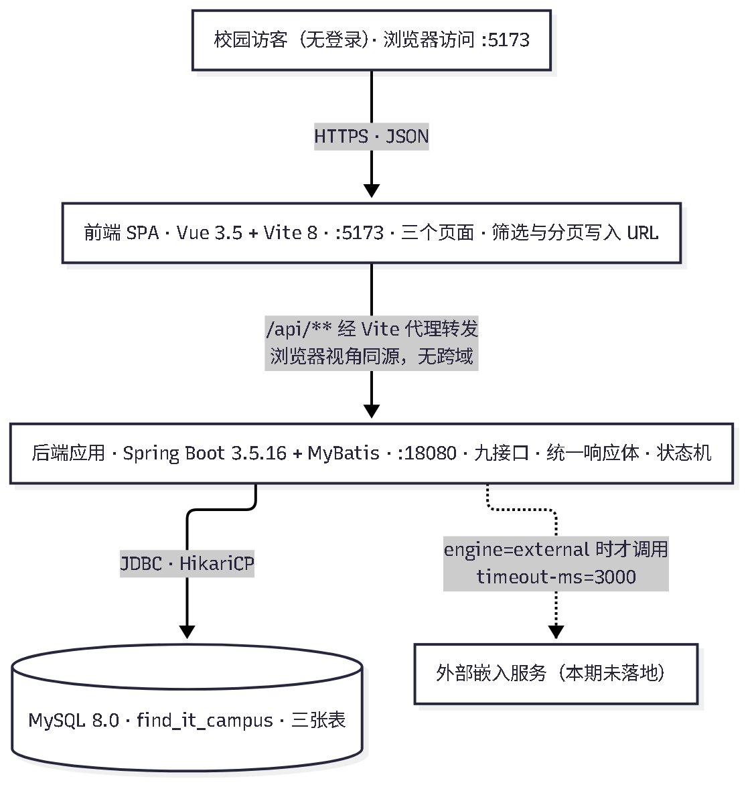
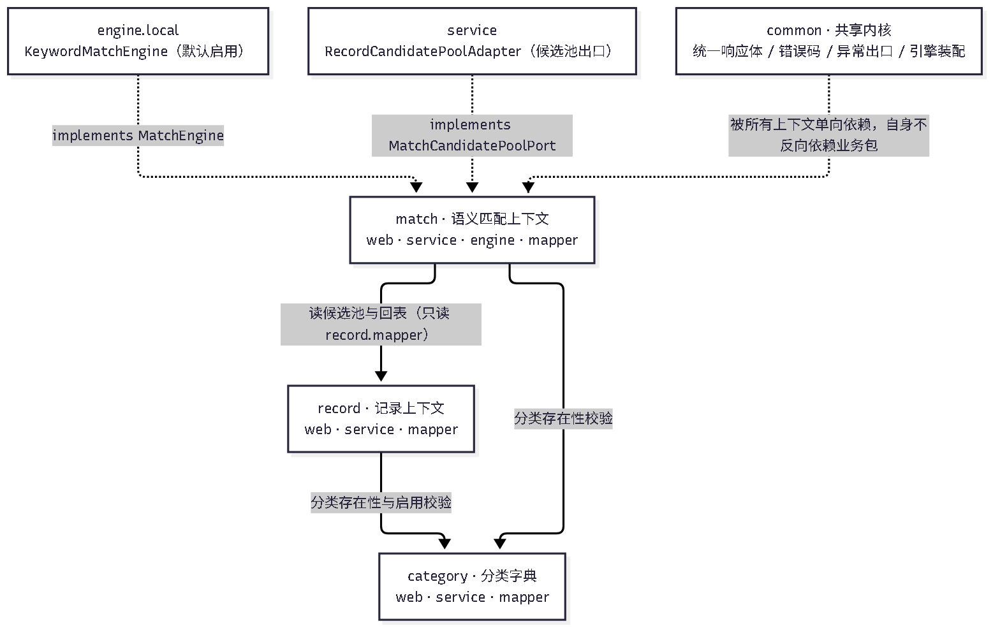
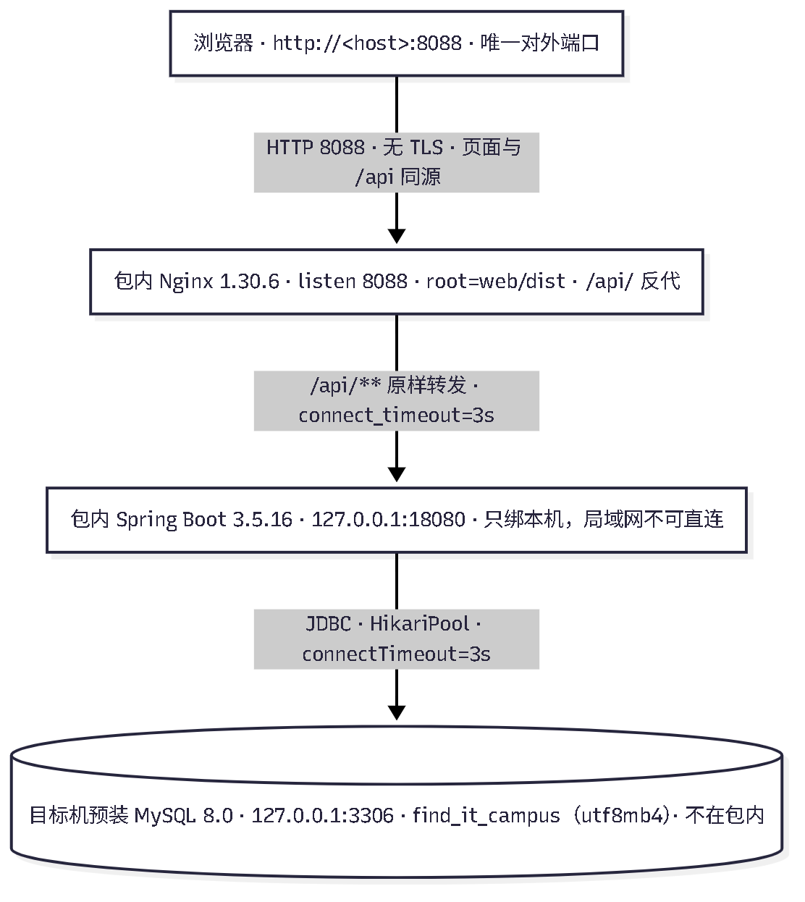
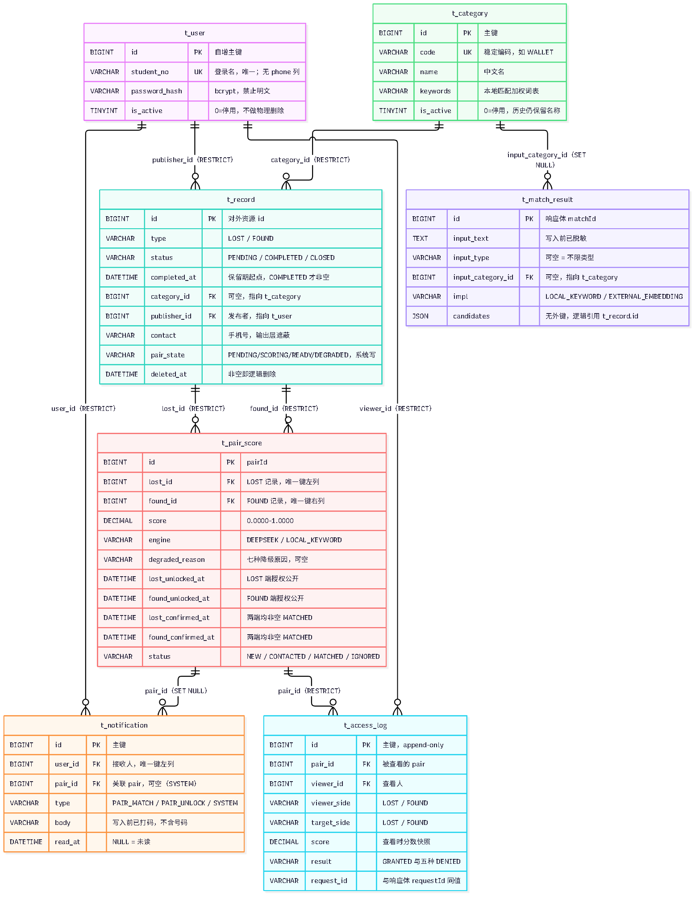
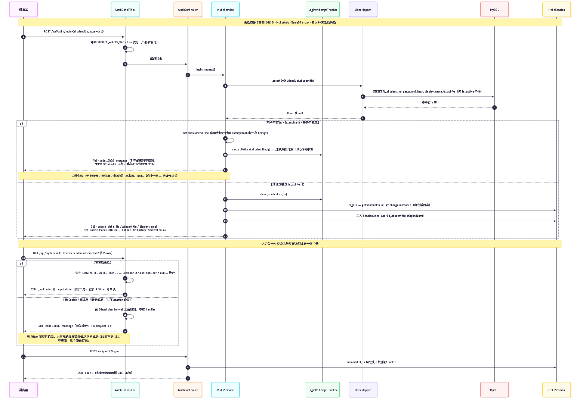
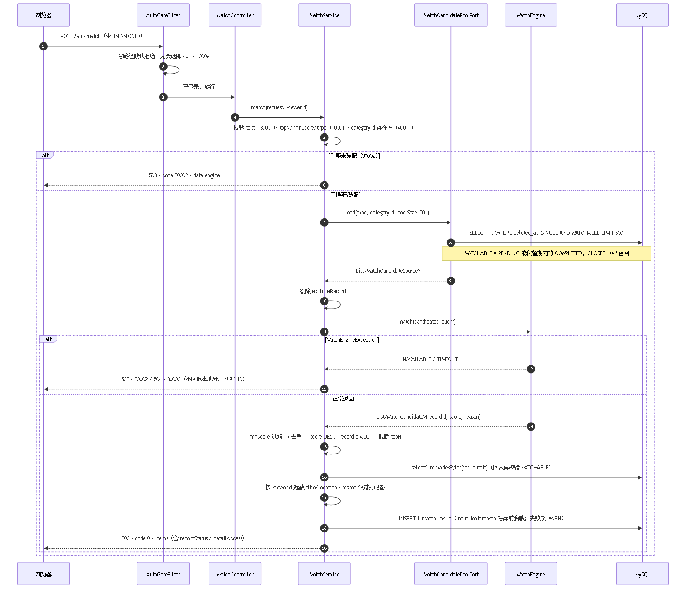
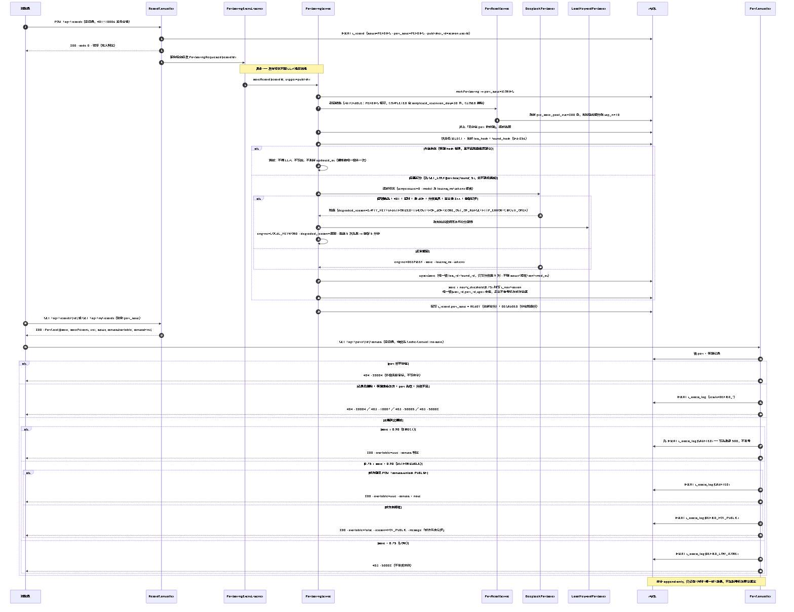

# 校园失物招领平台（find-it-campus）程序设计文档

| 项 | 内容 |
|---|---|
| 文档版本 | **v2.0**（取代 v1.0；v1 描述的「三张表 / 九个接口 / 无登录」形态已随 v2 阶段作废，见 §10.5 版本与废弃说明） |
| 对应代码基线 | `feat/v2-F2-integration @ 941fdee`（含 B1 数据层、B2/B3 认证、C1/C2 遮蔽、D1/D2 配对与通知、E1/E1b/E2 三档与档位 UI、F1 回归资产、F2 集成回归）。另有三个**尚未合入任何集成分支**的只读参考：F3 安全评审报告 `feat/v2-F3-security-review @ a64639e`、P1 遮蔽归一修复 `fix/v2-F3-p1-masking-normalize @ 08f4bb9`、P2 加固 `fix/v2-F3-p2-hardening @ fbd538f`。本文 §5.6（遮蔽归一）、§5.1（响应头）、§5.8（状态条件更新）、§6.9（过期扫描）按这两个修复分支的**最终行为**撰写，并就地标注「待合入」，合入前请勿据此认为 `941fdee` 已包含该行为。 |
| 适用仓库 | https://github.com/BLingKiy/find-it-campus |
| 编写日期 | 2026-10-28 |
| 编写 | 文通通（文档 Agent），内容取自各阶段交付物与仓库实际代码 |
| 交付形态 | `docs/design/program-design.md`（源）+ `docs/design/program-design.docx`（可提交附件）；导出方式见 §10.3 |
| 配图 | `docs/design/diagrams/*.mmd`（Mermaid 源）+ 同名 `.png` / `.svg`；v2 新增登录时序与配对时序两张 |

**这份文档只写仓库里能验证的东西。** 每个字段名、接口路径、状态码都可以按附录 B（`consistency-checklist.md`）的 v2 抽查记录回到源码行核对；本期没有做的能力（如外部嵌入模型、短信验证、自动下架）在文中明确标注为「未落地」或「不做」，不写成「已支持」。

**阅读路径**：答辩前看 §1 与 §8；评审查实现看 §3–§7；复现看 §9–§10 与附录 A/B。

---

## 1 项目背景与选题难度

### 1.1 要解决的问题

校园里每天都发生「丢了东西」和「捡到东西」这两件事，目前靠三类渠道传递：微信群、表白墙、宿舍楼下的纸质启事。三种渠道的共同缺陷是**信息不聚合**：

- 失主在群里刷屏式询问，招领信息却在另一个群；
- 纸片启事只在原地可见，跨校区无效；
- 即使两边都发了，也没有任何机制把「丢黑色钱包」和「捡到黑色钱包」这两条联系起来。

结果是最该发生的匹配依赖运气。本项目把这条链路做成一个可运行的系统：**发布启事 → 检索筛选 → 按描述语义找匹配 → 走完状态流转**。

### 1.2 系统做什么

一个前后端分离的 Web 应用：登录、发布与检索启事、自动配对打分、按匹配度分档放行联系方式、逐端授权与撤回、通知与审计。17 个业务接口 + 2 个运维接口，7 张表。

| 能力 | 你看到的样子 | 对应实现 |
|---|---|---|
| 登录 | 学号 + 口令登录，右上角出现你的名字；30 分钟不动自动失效 | `POST /api/auth/login`、`GET /api/auth/me`、`POST /api/auth/logout` |
| 发布启事 | 登录后「发布启事」页填八个字段，提交后落到该条详情 | `POST /api/records` |
| 浏览与筛选 | 列表页按类型/分类/关键词筛选，URL 记住条件，可翻页；未登录也能看，但看不到号码 | `GET /api/records` |
| 查看详情 | 非所有者看到的是遮蔽视图（地点截断、描述打码、`contact=null`）；本人看到明文与配对卡片 | `GET /api/records/{id}` |
| 自动配对 | 发布后异步召回候选、逐对打分，卡片上出现相似度百分比与档位文案 | `PairScoringService` + `t_pair_score` |
| 三档看号 | ≥0.90 直接可看；0.75–0.90 要对方授权后才能看；<0.75 点了也是 403 | `GET /api/pairs/{id}/contact` |
| 授权与撤回 | 「公开我的联系方式」/「撤回」，附言会先打码再落库 | `POST /api/pairs/{id}/contact-unlock` |
| 逐端确认 | 双方各自点「确认是同一物品」，两端都确认才算 `MATCHED` | `PATCH /api/pairs/{id}`（`action=CONTACT/CONFIRM/IGNORE`） |
| 标记完成 / 关闭 | 只有本人能改；有一对 `MATCHED` 才准标完成，否则 409 且零写入 | `PATCH /api/records/{id}/status` |
| 通知 | 铃铛上的未读数，点开是「有新匹配」「对方已公开联系方式」；正文不含号码 | `GET /api/notifications`、`PATCH /api/notifications/{id}/read` |
| 审计 | 谁在何时看过哪一对、结果如何，只插不改不删 | `t_access_log` |
| 语义匹配 | 详情页输入一段描述，返回相似记录与百分比 | `POST /api/match` |
| 分类字典 | 提交页与筛选器的下拉数据 | `GET /api/categories` |

### 1.3 选题难度自述（对标评分项「选题难度 20」）

难度不是靠堆技术栈，而是由四个**必须同时成立**的约束构成：

1. **七张表承载「一行一对」的配对模型**。`t_record` 一张表同时承载寻物与招领（`type` 区分）；`t_pair_score` 用唯一键 `(lost_id, found_id)` 把每一对钉成独立的 1:1 匹配单元——一条招领可以与多条寻物各成一个 pair，处理完一对不影响其他启事、也不影响其他 pair，**不引入占用/锁定语义**；`t_access_log` 只插不改，用「取号前先落审计」换取可证明的隐私边界。
2. **前后端分离 + 契约先行**。接口契约 `docs/api-contract-v2.md` 是唯一事实源，17 个接口 × 3 种身份的权限矩阵逐格带状态码。工程上带来一组真实约束：字段命名两侧不同（DB `snake_case` / JSON `camelCase`）、错误码要在传输层与业务层双轨表达、可见性判定只能有一份实现（`RecordVisibilityPolicy` / `PairAccessPolicy` 都是纯函数）。
3. **AI 语义匹配且必须可替换、可降级**。匹配能力收敛到 `MatchEngine` 接口，用配置值切换实现；配对打分走 DeepSeek，密钥只从环境变量 `DEEPSEEK_API_KEY` 读，七种降级原因分别落库并回退到本地关键词分。`/api/match` 与 pair 链路的失败语义**刻意不同**（前者不自动降级、直接 503/504；后者降级出分并留原因），这个差异是设计决定，见 §7.3。
4. **有登录，但只做能证明的那部分**。写接口与私有读全部要求登录，匿名只读且必须过遮蔽；手机号只做格式校验、不做短信验证、不落 `t_user`；状态只能本人改、系统不自动置位、不自动下架。边界写清楚比假装完备更难，也更有价值——见 §10 已知限制。

补充难度在于**协作形态**：四人课程项目，按「需求与架构 / 后端与匹配 / 前端与 UI / 测试与交付（含部署与工程化）」划分主责，实现由 Agent 按阶段产出，代码只能经仓库流转，`main` 由人类合并。这带来额外的工作量：每个阶段都要留下可核对证据，任何「我觉得做完了」都不算数。§8.1 给出分工表，§8 记录了这个过程真实发生的问题。

### 1.4 范围与明确不做

| 做 | 不做（口径已拍板，写明是为了不让人误以为漏了） |
|---|---|
| 三页主流程 + 登录/我的启事/通知、17 业务接口 + 2 运维接口、7 张表 | 微服务、独立 AI 服务进程、多实例部署 |
| 记录 CRUD、三态流转、逻辑删除、逐端授权与逐端确认 | **短信验证**（手机号只做 `^1[3-9]\d{9}$` 格式校验，真实性由当事人自行核实） |
| 匿名可读（走遮蔽）+ 写需登录 + 越权 403/不可见 404 | **自动下架**（`COMPLETED`/`CLOSED` 只能本人手动标记，到期也不改写 `status`） |
| 联系方式三档放行 + 查看审计（append-only） | 注册自助开通、找回密码、管理后台、RBAC 角色体系 |
| 本地关键词 + DeepSeek 双打分链路，降级留原因 | 消息推送（站内通知靠轮询，不接 WebSocket / 不接短信邮件） |
| 分类字典与筛选、遮蔽规则单点实现 | 图片/附件上传与对象存储 |
| 接口回归、E2E、一致性自查、落库取证 | 移动端原生壳、深色模式（本期） |
| Windows 单机部署包（8088 单端口） | Docker / Linux 部署、HTTPS 与域名、MSI 安装器、服务注册与开机自启 |
| 每日兜底扫描（03:30 cron + 运维手动触发） | 分布式锁、外部调度平台、持久化会话存储 |

### 1.5 与评分项的对应

| 评分项 | 分值 | 本文对应章节 | 证据 |
|---|---|---|---|
| 选题难度 | 20 | §1.3、§3.1、§4.1 | 七表 ER 图、登录与配对时序图、权限矩阵 |
| 程序实现的完整性 | 30 | §3–§8、§10 | 17 接口全通（111/111）、三页黄金路径 + 登录/三档/降级 E2E（25/25）、落库取证 19/19 |
| 技术先进性 | 20 | §7 | 接口抽象 + 装配切换 + 可替换性测试 + 七种降级原因与熔断 |
| 文档与视频 | 30 | 本文 + §8 过程记录 | 本文件、`docs/testing/v2/`、`docs/demo/record-script-v2.md`、`qa/reports/` |

> 说明：分值权重引自课程实施方案，本文只说明对应关系，不预测得分。

---

## 2 需求说明

### 2.1 功能清单与验收判据

需求清单取自 1.1（`ZHYYKFX-3`，37 条编号，按 A–G 七组组织；`R-28` 拆成 `R-28` / `R-28b` 两行，故表内共 38 行）。下表是完整清单的**压缩版**：验收判据保持「给定…当…则…」的可判定句式，删去的是重复的背景描述，判定条件本身没有放宽。

#### A 组 · 列表页

| 编号 | 功能 | 验收判据 | 落点 |
|---|---|---|---|
| R-01 | 列表渲染记录卡片 | 给定后端已启动且有种子数据，当打开列表页，则卡片数量与接口返回条数一致，每张卡片显示标题/类型/地点/发生时间/状态，点击跳转详情并携带记录标识 | 4.1 |
| R-02 | 按类型筛选 | 给定同时存在两类记录，当选择「失物」，则结果每条 `type=LOST`；选择「全部」，则两类都出现 | 3.1 + 4.1 |
| R-03 | 关键词搜索 | 给定输入只出现在某条标题中的词，当触发搜索，则命中该条且不含完全无关记录；输入不存在的词则显示空态而非报错 | 3.1 + 4.1 |
| R-04 | 分页控件 | 给定总记录数大于每页条数，当点击下一页，则列表整体更换且页码 +1；停在最后一页时再点下一页不发起请求 | 3.1 + 4.1 |
| R-05 | 默认倒序 | 给定两条发布时间不同的记录，当打开第一页，则较晚的一条在前；跨页时第二页首条不晚于第一页末条 | 3.1 + 4.1 |
| R-06 | 空结果与失败提示 | 给定查询无结果，则显示空状态文案；给定后端未启动，则显示失败提示且页面框架仍在，无未捕获异常 | 4.1 + 4.2 |

#### B 组 · 详情页

| 编号 | 功能 | 验收判据 | 落点 |
|---|---|---|---|
| R-07 | 详情展示全部字段 | 给定一条种子记录的标识，当以**所有者**身份打开详情页，则类型/标题/描述/地点/发生时间/联系方式/状态/发布时间均与库中一致；**（v2 改）**非所有者与匿名打开同一条，走遮蔽视图：`contact=null`、`description`/`title` 打码、`location` 截断、`publisherName` 只留首字 | 3.1 + 4.1 + v2-C1 |
| R-08 | 状态展示 | 给定分别处于三种状态的记录，当打开各自详情，则状态文案与实际一致，不出现第四种取值；**（v2 改）**三态取值改为 `PENDING`/`COMPLETED`/`CLOSED`，`CLAIMED` 作废（收到即 400/`10001`） | 4.1 + v2-B1 |
| R-09 | 记录不存在处理 | 给定不存在的标识，则显示「记录不存在或已删除」与返回列表入口，不渲染空白字段、不抛未捕获异常；**（v2 扩）**`CLOSED`、到期 `COMPLETED`、以及非合格对端看未到期 `COMPLETED` 一律同一响应（404/`20001`），不区分「不存在」与「不够格」 | 3.1 + 4.1 + v2-C1 |

#### C 组 · 提交页

| 编号 | 功能 | 验收判据 | 落点 |
|---|---|---|---|
| R-10 | 表单字段齐全 | 给定打开提交页，则类型（二选一）/标题/描述/地点/发生时间/联系方式控件齐全；选择「招领」提交后详情类型为招领；**（v2 改）**未登录访问 `/create` 由前端路由守卫跳登录页并带 `redirect` 回跳原地址，登录后可继续 | 4.1 + v2-B3 |
| R-11 | 必填校验 | 给定标题留空，当点击提交，则不发起请求且字段下方出现提示；绕过前端直接发缺标题请求，则返回校验失败且不写库；**（v2 扩）**`contact` 新写入只接受 `^1[3-9]\d{9}$`，不合法返回 `10001` 并指明字段；匿名直发写请求返回 401/`10006` | 3.1 + 4.1 + v2-C1 |
| R-12 | 成功反馈与落库 | 给定合法数据提交成功，则出现成功提示，且该条记录可在列表与详情查到（真实写库）；**（v2 扩）**新建行的 `publisher_id` 取自会话，不接受请求体传入；发布后 `pair_state=PENDING`，异步打分完成后转 `READY` 或 `DEGRADED` | 3.1 + 4.1 + v2-D1 |
| R-13 | 成功后跳转 | 给定提交成功，当跳转完成，则落在详情页；浏览器后退不会再次触发提交请求 | 4.1 |
| R-14 | 失败提示 | 给定后端未启动，则显示失败提示且已填内容不丢失；服务端校验失败信息落到对应字段而非通用「提交失败」 | 4.1 |

#### D 组 · 后端业务规则

| 编号 | 功能 | 验收判据 | 落点 |
|---|---|---|---|
| R-15 | 状态定义与初始值 | 给定一次合法新建，则状态为 `PENDING`；任意记录的状态只可能是 **`PENDING`/`COMPLETED`/`CLOSED`**（v2 三态，由 `ck_record_status` 在库层兜底），`CLAIMED` 已作废 | 3.1 + v2-B1 |
| R-16 | 状态流转 | 给定 `PENDING` 记录，当置为 `COMPLETED`，则详情返回 `COMPLETED` 并在同一条 UPDATE 里写 `completed_at`；给定 `CLOSED` 记录，当尝试迁出，则返回 409 + `20002`，不静默成功；**（v2 新增）**未达 `MATCHED` 前置就标完成 → 409 + `20005` 且 `status`/`completed_at`/`updated_at` **零写入**；状态只能本人改，系统任务不自动置位 | 3.1 + v2-C1 |
| R-17 | 删除与下架 | 给定一条记录被删除，则列表不再出现且不占用总条数，按标识查详情返回 `20001`，而数据库物理行仍存在；**（v2 口径）**`CLOSED` = 本人手动关闭（不召回、不显示、详情任何身份 404，其相关 pair 一并失效）；`COMPLETED` = 列表隐藏但保留期内仍进召回，**列表隐藏 ≠ 匹配隐藏** | 3.1 + v2-C1 |
| R-18 | 列表空结果 | 给定匹配不到任何记录的筛选参数，则 `list=[]`、`total=0`、HTTP 2xx，响应中不含错误描述 | 3.1 |
| R-19 | 详情不存在 | 给定不存在的标识，则返回约定错误码 `20001` 与可读信息，服务端日志无未捕获异常堆栈 | 3.1 |
| R-20 | 服务端字段校验 | 给定请求缺任一必填字段，则返回 `10001` 且 `fieldErrors` 指明具体字段名；超长同理 | 3.1 |
| R-21 | 演示种子数据 | 给定执行一次初始化脚本，则记录数不少于 20 条且两类三状态均覆盖；正例输入能命中目标记录；**（v2 扩）**seed v2 为 24 条记录（PENDING 21 / COMPLETED 2，其中 1 条已过保留期 / CLOSED 1）+ 14 对 pair（三档分数与四态齐全）+ 8 条通知 + 3 个演示账号 `demo01`~`demo03`；`t_access_log` 与 `t_match_result` 故意留空，由运行期真实请求产生 | 2.1 + 5.1 + v2-B1 |

#### E 组 · `/api/match` 语义匹配

| 编号 | 功能 | 验收判据 | 落点 |
|---|---|---|---|
| R-22 | 输入形态 | 给定只带描述文本的请求，则返回候选列表且不报参数缺失；文本为空则返回 `30001` 而非空结果或 500 | 3.1 |
| R-23 | 返回条数上限 | 给定不传条数参数，则返回条数不超过默认上限；传入超过上限的值则 `10001`，不返回超限条数 | 3.1 |
| R-24 | 相似度口径 | 给定任意结果，则分值落在 `[0,1]` 且带百分比字段；前端展示 83% 与响应 0.83 一致 | 3.1 + 4.1 |
| R-25 | 无匹配表现 | 给定与库中记录完全无关的描述，则返回成功 + 空数组；前端显示空状态文案而非错误提示 | 3.1 + 4.1 |
| R-26 | 不可用时降级 | **（v2 分两条，两条语义不同）**① `POST /api/match`：**不自动降级**——外部引擎挂了悄悄用关键词分顶替，会让用户以为拿到语义结果，属答辩诚信问题；引擎不可用返回 503/`30002`、超时返回 504/`30003`，前端提示「匹配服务暂不可用」而页面其余功能可用。② pair 打分链路：**降级出分**——密钥缺失/401/超时/非 JSON/分数越界/其它非 2xx/熔断七种原因分别记入 `t_pair_score.degraded_reason`，用本地关键词分顶替并置 `pair_state=DEGRADED`，密钥恢复后由每日扫描重算 | 3.1 + 4.1 + v2-D1 |
| R-27 | 接口与实现解耦 | 给定接口定义，当把实现从一种换成另一种，则调用方代码与请求/响应契约均无改动 | 3.2 |
| R-28 | 效果自测样例集 | 给定样例集中的每条正例，目标记录出现在结果中且排序在前列；负例不产生高分误报 | 3.2 + 5.1 |
| R-28b | 匹配的前端入口 | 给定在详情页输入描述并触发，则候选以列表展示且每条带相似度，一次触发只发一次请求；**（v2 改）**匹配入口与配对卡片是两件事：详情页的「开始匹配」走 `/api/match`（一次性快照），`pairs[]` 卡片由后台打分异步产出，二者互不阻塞 | 4.1 + v2-E2 |

#### F 组 · 交付材料

| 编号 | 功能 | 验收判据 | 落点 |
|---|---|---|---|
| R-29 | 程序设计文档 | 给定接口清单与 ER 图，当与代码/建表脚本逐条比对，则路径、方法、字段名、表名全部对得上 | 6.1（本文） |
| R-30 | 接口测试报告 | 给定报告中每个接口，当按样例重放，则响应与记录一致；任一失败项都有后续结论 | 5.1 |
| R-31 | 匹配效果评估 | 给定评估记录，则写明样本数、判定阈值、命中与未命中条数；未命中案例有原因归类 | 5.1 |
| R-32 | 答辩 PPT | 给定标为「已完成」的表述，当与测试报告或代码比对，则能找到证据；找不到证据的改写为「计划中」 | 6.2 |
| R-33 | 录屏脚本与成片 | 给定脚本，当按它操作一遍，则每一步都能执行，无找不到入口的步骤 | 6.2 |
| R-34 | 开发过程证据链 | 给定材料中任一阶段结论，当回溯，则能在 commit 历史或任务记录中找到对应时点的证据 | 本文 §7.2、§7.3 |

#### G 组 · 工程基线

| 编号 | 功能 | 验收判据 | 落点 |
|---|---|---|---|
| R-35 | 前端骨架可启动可构建 | 给定一次全新克隆，当执行 README 的安装与启动命令，则开发服务可访问；构建命令成功退出并产出 `dist/` | 2.1 |
| R-36 | 后端骨架可启动可构建 | 给定一次全新克隆与可用 MySQL，当按 README 启动，则应用启动成功并能响应健康检查；构建成功退出 | 2.1 |
| R-37 | 建表脚本与初始化 | 给定空数据库，当执行脚本，则七张表被创建且脚本可重复执行（先按外键逆序 `DROP … IF EXISTS` 再重建）；查询表清单恰好七张；给定 seed 脚本，当重复执行，则行数、id 集合、分数、状态分布完全一致 | 2.1 + v2-B1 |

### 2.2 角色与使用场景

v2 有四种身份，判定只看服务端会话，不看前端传的字段（完整矩阵见 §5.3）：

| 身份 | 判定 | 能做什么 | 看不到什么 |
|---|---|---|---|
| 匿名 | 无有效会话 | 读列表、读 `PENDING` 详情、读分类 | 任何写操作（401/`10006`）、`/my`、通知、pair 资源、任何号码；`COMPLETED`/`CLOSED` 详情 404 |
| 登录非所有者 | 有会话，但不是目标资源的发布者/参与方/接收人 | 读、发布自己的启事、管理自己的 pair | 别人的 `contact`（`null`）、别人的 `description`/`location`/`publisherName` 原文（走遮蔽）；对他人记录写操作 403/`10007` |
| 合格对端 | 「登录非所有者」的子集：本人某条未删除启事与目标记录存在 `pairUsable` 的 pair 且 `score ≥ 0.90` | 额外能看未到期 `COMPLETED` 详情的**遮蔽视图** | 仍看不到 `contact`；不满足条件时与「不存在」同码同文案（404/`20001`） |
| 所有者 | `publisher_id` = 当前用户（pair 为两端任一；通知为 `user_id`） | 明文看自己的 `contact`、改状态、编辑、删除、授权与确认 | 自己 `COMPLETED` 记录的详情（按 vF 口径 404，管理入口在 `/my`） |

三个典型场景（每一步都能在录屏脚本 v2 里走通）：

| 场景 | 起点 | 路径 | 结束状态 |
|---|---|---|---|
| 失主找东西 | 匿名打开列表 | 筛选「招领」→ 看遮蔽详情 → 登录 → 配对卡片显示 96% 直看档 → `GET /api/pairs/1/contact` 拿到号码（审计落一行 `GRANTED`）→ 联系对方 | `t_access_log` 多一行；pair 迁到 `CONTACTED` |
| 拾到者发布并被匹配 | 登录后提交页 | 填八字段 → 提交 → 后台异步召回打分 → `/my` 出现 `READY` → 收到「有一条新的匹配结果」通知 | 记录 `PENDING`，`t_pair_score` 新增行，`t_notification` 一行 |
| 走完认领 | 我的启事 | 逐端点「确认是同一物品」→ 两端 `confirmed_at` 均非空 → pair `MATCHED` → 本人点「标记完成」→ `status=COMPLETED` + `completed_at` | 公共列表 0 命中，保留期 30 天内仍可被匹配到 |

### 2.3 需求与实现的偏差（照实登记）

1.1 的默认假设与最终实现有五处不一致（表末另列一条经核对**没有**偏差的项，用作对照）。**每一处都不是实现写错，而是下游在契约或人类口径上做了更具体的决定**；列在这里，避免读者拿 1.1 的句子去核对代码时误判。

| # | 需求侧（1.1 默认假设） | 实现侧 | 原因与出处 |
|---|---|---|---|
| D-1 | 提交表单六个字段全必填 | `contact`、`publisherName` 可选；新增 `categoryId`、`publisherName` 两个字段 | 联系方式是否必填属 Q-01，未拍板前取最宽松；分类是匹配加权的重要输入。见 `docs/api-contract.md` §5.1 |
| D-2 | `topN` 默认 10、上限 20 | 默认 5、上限 20 | 契约 §8.1 取更保守的默认值，避免首屏返回过多弱相关结果 |
| D-3 | 提交成功后页面直接展示匹配结果 | 只在详情页提供「开始匹配」按钮 | R-28b 的入口位置由 Q-13 决定，实现取「详情页」单入口，避免提交后自动发起一次额外请求 |
| D-4 | 排序固定倒序，不提供切换 | 支持 `sortBy ∈ {createdAt, occurredAt}` 与 `sortOrder` | 契约 §1 用白名单实现，成本低；前端默认仍为 `createdAt DESC` |
| D-5 | 「删除」即「下架」语义 | 拆成两件事：`CLOSED` 状态 = 下架（仍可在 `status=ALL` 下查到），`deleted_at` = 删除（任何读接口不可见） | ADR-006：两者语义不同，混用会让「下架后还能改回来」与「删除不可恢复」无法区分 |
| D-6 | 状态流转「已领/关闭不可回退」 | 终态不可回退这条**一致**；但 v2 已把「已领」换成 `COMPLETED`：三态为 `PENDING → COMPLETED / CLOSED`，`CLAIMED` 从枚举与 DDL 删除，收到即 400/`10001`（不是 409，它不是「不允许的流转」而是非法参数） | 需求侧句子仍成立，取值域已按 v2 拍板改写。见 `RecordStatusPolicy`、`RecordStatus.java:15-16`、`StatusUpdateRequest.java:14` |

### 2.4 需求变更与拍板记录

| 日期 | 事项 | 决定 | 影响 |
|---|---|---|---|
| 2026-10-21 | `/api/match` 课程版实现选型（Q-01） | 本地关键词实现 + 文档化替换路径；外部嵌入模型另立任务 | 3.2 只交付本地实现，本文 §6.4 写切换成本 |
| 2026-10-22 | `10005` 的 HTTP 口径（三处文档/代码互相矛盾） | 方案 A：枚举固定映射 500，依赖不可用（DB DOWN）由 `HealthController` 显式覆写 503，body `code` 仍为 10005 | 改基线 §6.2 注脚；`docs/api-contract.md` 三处无需改 |
| 2026-10-22 | `t_match_result.input_type` 是否可空 | 放宽为可空（`NULL` = 不限类型） | 契约 §8.1 允许不带 `type`，§8.5 又要求每次成功都写快照，原 `NOT NULL` 下二者无解；属放宽方向，ALTER 见 `db/schema.sql` 附 2 |
| 2026-10-22 | 4.2 三项视觉选择 | 品牌色 `#2450d0`、按钮圆角 6px、本期不做深色模式 | 影响三页一致性断言（5.1 已按新值复验 9/9） |
| 2026-10-22 | 3.2 外部实现本期是否落地 | 不落地；只认本地实现 + 文档化替换路径 | `docs/testing/5.1-*.md` 不评估 external 效果，不因此判 3.2 不通过 |
| 2026-10-27 | v2 配对单元语义 | 1:1：每一对 `LOST↔FOUND` 是独立匹配单元，一条招领可与多条寻物各成一个 pair；处理完一对不影响其他启事与其他 pair；**不引入占用/锁定语义**，已认领的招领仍留在候选池 | `t_pair_score` 唯一键 `(lost_id, found_id)`；§4.3、§6.7 |
| 2026-10-27 | 记录状态集与自动置位 | `PENDING`/`COMPLETED`/`CLOSED` 三态，`CLAIMED` 作废；状态只能本人改，系统不自动置位，到期也不改写 `status`（读时窗口） | `ck_record_status`、`ck_record_completed_at`；§5.6 |
| 2026-10-27 | 「列表隐藏」与「匹配隐藏」是否等价 | **不等价**：`COMPLETED` 公共列表与搜索 0 命中，保留期（`completed_retention_days=30`，从 `completed_at` 起算）内仍进召回；仅合格对端（`score ≥ 0.90`）可看详情，其余一律 404；`CLOSED` 不召回、不显示、详情任何身份 404 | `RecordVisibilityPolicy.isMatchable` / `detailAccess`；§5.6、§5.7 |
| 2026-10-27 | 阈值是否散落硬编码 | 集中一处：`contact_direct_threshold=0.90`、`contact_unlock_threshold=0.75`、`completed_visible_threshold=0.90`、`completed_retention_days=30`、`notify_threshold=0.75`，同一配置类 `PairPolicyProperties` 读取并在启动期 fail-fast 校验关系约束 | `application.yml` 的 `findit.pair` 段；§5.7 |
| 2026-10-27 | 手机号是否做短信验证、是否入 `t_user` | 只做格式校验、不做短信验证、`t_user` 不存手机号列；不自动下架 | `db/schema.sql` 表 1、`RecordCreateRequest` 的 `@Pattern`；§9.1 已知限制 |
| 2026-10-27 | LLM 密钥放置 | 只走环境变量 `DEEPSEEK_API_KEY`；配置文件里**刻意没有 api-key 键**；代码/配置/日志/证据/文档零明文，证据只记 `model` / `latency_ms` / `tokens` | `LlmProperties`、`DeepSeekPairScorer`；§6.8（密钥纪律）、§9.2（限制） |
| 2026-10-28 | F3 安全评审后的 P1/P2 处置 | P0=0；P1（分隔符/国际前缀归一，堵手机号与证件号绕过）与 P2（状态竞态条件更新、`Cache-Control: no-store` + `Vary: Cookie`、会话只允许 Cookie 承载、日志格式化、过期 COMPLETED 不再进扫描目标）各立分支，**尚未合入任何集成分支** | `fix/v2-F3-p1-masking-normalize @ 08f4bb9`、`fix/v2-F3-p2-hardening @ fbd538f`；本文 §5.1、§5.6、§5.8、§6.9 |

### 2.5 v2 新增验收判据

v2 在 1.1 的 38 条之外新增七组判据，逐条都有落库或截图证据（证据路径见末列）：

| 组 | 判据 | 证据 |
|---|---|---|
| 登录与会话 | 给定未登录访问任一写接口或私有读，则 401/`10006`；给定凭证错误、账号不存在、账号停用三种情况，则状态码、body、message 完全一致（防账号枚举）；给定登录成功，则 `JSESSIONID` 带 `HttpOnly` + `SameSite=Lax`，刷新后会话保持，登出后受保护路由回落登录页 | `docs/testing/v2/B2-auth-evidence.md`、`B3-frontend-auth.md`（7 张截图） |
| 输出层遮蔽 | 给定非所有者或匿名读列表/详情/`/api/match`/`/my`/通知五个出口，则响应体内 grep 不到 11 位手机号；给定本人读自己的 `PENDING` 详情，则 `contact` 明文 | `docs/testing/v2/C1-masking-evidence.md`、`C2-frontend-masking.md`（DOM 扫描 `dom-scan.txt`） |
| 联系方式三档 | 给定 `score ≥ 0.90`，则双端免授权可看；给定 `0.75 ≤ score < 0.90` 且对方未 `PUBLISH`，则 200 + `available=false` + `reason=NOT_PUBLIC`；给定 `score < 0.75`，则 403/`50002` 且不出成功体；给定取号成功，则 `t_access_log` 先落一行（写失败即 500、不出号） | `docs/testing/v2/E1-contact-unlock.md`、`E2-tier-ui.md`（三档截图 + 320px） |
| 配对与幂等 | 给定同一条记录重复触发打分，则 `t_pair_score` 仍是一行（唯一键 `(lost_id, found_id)`），内容未变时不改 `status`/授权/`confirmed_at`；给定一条招领匹配多条寻物，则每个 pair 独立处理，互不影响 | `docs/testing/v2/D1-idempotency.md`、`gate2-review.md` G1/G4/G4b |
| 降级 | 给定 `DEEPSEEK_API_KEY` 缺失，则不发起任何网络请求、`engine=LOCAL_KEYWORD` + `degraded_reason=EMPTY_KEY` + `latency_ms=NULL`、`pair_state=DEGRADED`；给定 `/api/match` 引擎不可用，则 503/`30002`，不顶替 | `docs/testing/v2/D1-degradation.md`、`shots/f2-degradation.json` |
| 状态与可见性 | 给定未达 `MATCHED` 调「标记完成」，则 409/`20005` 且 `status`/`completed_at`/`updated_at` 零写入；给定 `COMPLETED` 且 `completed_at + 30 天` 已过，则不召回、详情任何身份 404，但 `status` 不被改写；给定 `CLOSED`，则详情 404 且其 pair 取号 403/`50005` | `docs/testing/v2/F2-integration-report.md` 终态组 19/19、`gate2-review.md` G5 |
| 密钥零泄漏 | 给定代码、配置、日志、证据文件、文档五处全量扫描，则不出现 `DEEPSEEK_API_KEY` 明文值；证据只记 `model` / `latency_ms` / `tokens` | `docs/testing/v2/F2-phone-scan.txt`、`gate2-review/raw/g7-secret-scan.txt` |

---

## 3 总体架构

### 3.1 架构决策：模块化单体

**结论：Spring Boot 单进程 + 按能力分包 + MyBatis 显式 SQL + 匹配能力以接口隔离。** 三条理由：

1. **规模输入不支持拆分**。项目没有并发量与数据量指标（架构基线 A7 按 ≤1 万条估算，属经验区间）。微服务、缓存、消息队列的成本由部署与联调支付，收益要规模才显现。
2. **评分点在「接口解耦」而不是「架构复杂度」**。技术先进性 20 分看的是 `/api/match` 与实现可替换，一个 Java 接口 + 一个 `@ConditionalOnProperty` 就能拿到，不需要独立进程。
3. **七张表恰好覆盖七个所有权**：身份（auth）、记录（record）、配对与审计（pair）、通知（notification）、匹配证据（match）、主数据（category）、以及不属于任何单一上下文的公共外壳。每张表只有一个写入方，没有两处写同一张表。

**放弃的东西**：将来若真要拆服务，`t_record` 与 `t_match_result` 的读写归属要重新划分。

### 3.2 系统上下文与容器



| 容器 | 职责 | 技术 | 端口 |
|---|---|---|---|
| 前端 SPA | 五个页面（列表 / 详情 / 发布与编辑 / 我的启事 / 通知）+ 登录页，筛选与分页写进 URL、路由守卫、请求封装与错误提示 | Vue 3.5.44 + Vite 8.3.5 + TypeScript 5.x + vue-router 5.4.0 | 5173 |
| 后端应用 | 17 个业务接口 + 2 个运维接口、统一响应体、错误码、会话门禁、三态与四态状态机、遮蔽、匹配与配对编排、异步打分与每日扫描 | Spring Boot 3.5.16 + MyBatis starter 3.0.5 + spring-security-crypto（只用 bcrypt），JDK 17 | 18080 |
| 数据库 | 七张表的持久化 | MySQL 8.0.x（实测 8.0.29） | 3306 |
| DeepSeek 对话服务 | **v2 已接**，只用于 pair 打分（`prompt_version=pair-score-v1`）；密钥只从 `DEEPSEEK_API_KEY` 读；不可用时降级出本地分 | OpenAI 兼容 `/chat/completions`，默认 `deepseek-chat` | 出网 443 |
| 外部嵌入服务 | **本期未落地**，仅保留配置位与装配位（`findit.match.engine=external`） | — | — |

> 端口取 18080 而不是 8080：开发机上 8080 已被另一个常驻服务占用，与其让每个执行环境各配一次，不如把仓库默认值直接对齐（`docs/architecture-baseline.md` §9.2）。

### 3.3 模块边界与依赖方向



v2 把包从四个扩到七个业务上下文 + `common`，依赖方向仍单向：

```
web → service → (mapper | engine 接口)
common ← 所有层（单向，common 不反向依赖业务包）
match   → record.mapper（只读候选池与回表）      record ✗→ match
pair    → record.mapper（读两端记录做可见性判定）  record ✗→ pair
record  → pair.mapper（读 pair 事实出卡片）        pair   ✗→ record 的写路径
notification → 只写自己的表，被 pair 上下文调用     category ✗→ 任何业务上下文
禁止：controller → mapper；service → controller；任何包 import engine 实现类；
      跨上下文直接改别人的表（每个上下文只写自己拥有的表，见下表「数据所有权」）
```

| 上下文 | 职责 | 数据所有权 | 核心不变量 |
|---|---|---|---|
| **auth** | 登录、登出、当前用户、会话门禁 | 只读 `t_user`（写入属于注册/停用路径，本期不开放注册） | 三种登录失败（账号不存在 / 停用 / 密码错）对外不可区分；`password_hash` 是 bcrypt（cost=10），禁止明文；门禁在路由之前执行，未实现的私有路径匿名也是 401 不是 404 |
| **record** | 记录生命周期：发布、查询、修改、三态流转、逻辑删除、`/my` 视图 | `t_record` | `type ∈ {LOST, FOUND}`、`status ∈ {PENDING, COMPLETED, CLOSED}`、`pair_state ∈ {PENDING, SCORING, READY, DEGRADED}`（系统写，不是业务状态）；状态只能按 §5.6 迁移且只能本人改；`COMPLETED` 与 `completed_at` 同一条 UPDATE 写入；系统任务不写 `status`/`completed_at`/`updated_at` |
| **pair** | 召回、打分、逐端授权、逐端确认、三档取号、查看审计 | `t_pair_score`、`t_access_log` | 唯一键 `(lost_id, found_id)` 一行一对；`MATCHED ⇔` 两端 `confirmed_at` 均非空（`ck_pair_matched` 库层兜底）；`IGNORED` 是终态，hash 变化触发的重算只更新分数类列；取号前必须先落审计（fail-closed）；审计不复制号码与附言原文 |
| **notification** | 配对与授权通知、未读数 | `t_notification` | 唯一键 `(user_id, pair_id, type)` 保证重复打分/重复扫描不刷屏；`title`/`body` 写入前已打码，不得含手机号 |
| **match** | 输入自由文本 → 返回候选与相似度，并落一份可评估快照 | `t_match_result` | 引擎输出 `score ∈ [0,1]`；结果按分数倒序、条数 ≤ `topN`；返回前必须经 record 回表校验合法性；快照 `impl` 与实际执行引擎一致；**引擎失败不自动降级** |
| **category** | 分类主数据（编码、名称、匹配词表、排序、启用位） | `t_category` | `code` 唯一；分类不可物理删除，只能停用（历史记录仍显示名称） |
| **common** | 统一响应体、错误码、异常出口、遮蔽、Web 配置与响应头、引擎与异步装配 | 无 | 任何 controller 不得自定义响应包裹；任何错误必须映射到 `ErrorCode`；遮蔽规则只在 `MaskingPolicy` 一处 |

**为什么按能力分包，而不是顶层 `controller/service/mapper` 三个桶**：挡住的变化是「新增一个能力」——只增一个包，不动已有包的 import 关系；顶层分层会把新能力摊到三个桶里，改动面 ×3。v2 是这条决定的实测回报：新增 auth / pair / notification 三个上下文时，`MatchService`、`RecordService` 与 `CategoryController` 的 import 关系未变。代价是初次阅读要适应一次。

### 3.4 技术选型与理由

| 决策点 | 选了什么 | 放弃的备选 | 理由 |
|---|---|---|---|
| 后端框架版本 | Spring Boot 3.5.16（JDK 17） | Boot 4.1.1 | 3.x 与课程资料、MyBatis starter 3.0.x 的兼容表最短；升 4.x 只改 `pom.xml`，属可逆 |
| 持久层 | 原生 MyBatis（接口 + XML） | MyBatis-Plus、JPA | SQL 全在仓库里，能讲执行计划；不引「版本对照表」风险 |
| 迁移工具 | 无（`db/schema.sql` 手工执行 + 提交说明附 ALTER） | Flyway / Liquibase | 表数虽增至七张，仍是「一人改、周期短」；脚本自身可重复执行（逆序 DROP 再重建），引入迁移目录与启动期行为是净负担。v2 筹备期无历史数据，不做 v1→v2 迁移 |
| 会话载体 | 服务端 `HttpSession` + `JSESSIONID` Cookie（`HttpOnly`、`SameSite=Lax`、30 分钟） | JWT / 自管 token | 登出与失效要**立即生效**：JWT 在过期前无法收回，除非再引一张黑名单表，那就退化成了服务端状态。代价写进 §10：内存会话，进程重启即全员掉线 |
| 口令散列 | `spring-security-crypto` 的 `BCryptPasswordEncoder`（cost=10） | 引 `spring-boot-starter-security` 全家桶 | 只需要 bcrypt 一个功能，引整个过滤器链会带来默认表单登录、CSRF 配置与一整套学不动的调试面 |
| 会话门禁落点 | Servlet `Filter`（`AuthGateFilter`），在 `DispatcherServlet` 之前判**路径** | `HandlerInterceptor` / AOP | 拦截器只对「已映射到 handler」的请求生效，一个「该拦但还没实现」的路径匿名访问会先得到 404，等于把路由存在性泄露出去；Filter 天然 fail-closed |
| 门禁规则形态 | 规则是「写默认拦、读默认放」+ 两张显式清单（`PUBLIC_WRITE_PATHS` / `LOGIN_REQUIRED_READS`） | 逐接口标注 `@RequiresLogin` | 新增写接口忘了登记也不会变成「匿名可写」——匿名可写是安全问题，匿名多读一点是产品问题，两种错误代价不对称 |
| 敏感值处置 | 只在输出层遮蔽，DB 里 `contact` 存明文 | DB 加密 + 解密 | 本人回显不需反解、不引入密钥管理。代价：能读库的人能看到号码，靠部署侧访问控制兜底（V2-ADR-003），写进 §10 |
| 配对打分模型 | DeepSeek（OpenAI 兼容 `/chat/completions`，`temperature=0`、`max-tokens=256`、`prompt_version=pair-score-v1`） | 自建向量库 / 继续只用关键词 | 需要「两条描述是不是同一件东西」的判断，关键词分给不出；`temperature=0` 让同一对输入可复现，`prompt_version` 让口径可回溯 |
| 降级形态 | pair 链路七种 `degraded_reason` + 熔断（连续 5 次失败开 5 分钟）+ 本地关键词顶替；`/api/match` **不顶替** | 统一「失败就悄悄用本地分」 | 两个出口的语义不同是设计决定（§6.10）：匹配快照会被当成语义结果引用，顶替等于污染评估数据 |
| 阈值配置 | 单一 `PairPolicyProperties`（`findit.pair.*`），启动期 `@PostConstruct` 校验跨字段关系并 fail-fast | 各处写常量 / 只校验单字段 | 关系约束（`unlock < direct`、`notify ≥ unlock`）注解表达不了；配错就在启动期炸，不带病跑到第一个用户请求 |
| 前端状态管理 | 不引 Pinia，筛选状态写 URL；登录态与分类字典各用一个模块级缓存 | Pinia | 只有两处需要跨页状态：`useAuth`（缓存 `/api/auth/me`，唯一事实源仍是服务端 Cookie，不写 localStorage、不存 token）与 `categoryCache`（并发去重 + 手动失效）；URL 承载筛选额外得到「刷新保留、可分享、前进后退可用」 |
| HTTP 封装 | 原生 `fetch` 封装（`src/api/http.ts`） | axios | 只有一个用途（base URL + 解包 + 超时），axios 的拦截器带不来收益 |
| 样式方案 | 手写 CSS 变量 + 十个原始类族（`components.css`） | Element Plus 等组件库 | 自定义视觉基线会与组件库主题冲突；三页规模不需要组件库 |
| 匹配实现 | 本地关键词（bigram + IDF + 类目词表），接口隔离 | 先做外部 embedding | 零外部依赖、可离线演示、结果确定可复现；接口先立，换实现只改装配 |
| 架构形态 | 模块化单体 | 微服务 | §3.1 |

### 3.5 前后端分离与接口分层

**物理分离**：`web/` 与 `server/` 两套独立构建，唯一通信方式是 `/api/**` 的 JSON 请求。开发期浏览器请求 `/api`，由 Vite 代理转发到 18080，浏览器视角同源；后端同时配置了白名单 CORS 作为兜底：`allowedOriginPatterns` 写死 `http://localhost:5173` 与 `http://127.0.0.1:5173`（**不用 `*`**，浏览器禁止 `*` 与凭据同时使用），`allowCredentials=true`（B2 起必须为 `true`，否则「直接连 18080」的场景登录成功后下一个请求仍 401），`allowedHeaders` 保持通配（不涉及凭据，收紧只会给前端多加一次预检失败），`exposedHeaders=X-Request-Id`。前端所有请求必须 `credentials:'include'`。

> **文档—实现偏差登记**：`docs/api-contract-v2.md` §1.1 把 `allowedHeaders` 写成 `Content-Type,X-Requested-With`，实现是 `allowedHeaders("*")`。按「以实现为准，改文档不改代码」处置，本段按实现描述；代码注释已说明理由，不视为缺陷。

**契约先行**：`docs/api-contract-v2.md`（A1 冻结稿）是唯一事实源，v1 的 `docs/api-contract.md` 保留仅作历史对照。任一方需要改字段，顺序固定为「先改契约 → 再改 DDL/DTO/TS 类型 → 三处同一 commit」。这条规则被真实使用过两次：`input_type` 可空同时改了 `schema.sql`、契约 §8.2/§8.5、基线 §7.3（见 §2.4）；v2 的 `t_record.status` 三态替换 `CLAIMED` 同时改了 `db/schema.sql` 的 `ck_record_status`、契约 §0.2 第 9 行、以及 `RecordStatus` 枚举。

**后端四层 + 一条实现层**：

| 层 | 允许 | 禁止 |
|---|---|---|
| Controller | 参数绑定、`@Valid`、调 service、映射 Response DTO | 写业务规则、注入 Mapper、返回实体、手拼 `ApiResponse` |
| Service | 业务规则与不变量、事务边界、编排引擎调用、排序字段白名单 | 依赖 HTTP 类型、把实体当出参、跨聚合开一个事务改多张表 |
| Mapper | 单表 CRUD、显式分页 SQL、LIKE 检索 | 业务分支、用 `${}` 拼接请求值 |
| Engine | 纯文本打分/排序，消费候选池 | 访问 `t_record` 之外的表、知道 HTTP 概念 |
| Domain | 与表字段一一对应 | 承载校验注解、出现在响应体 |

**统一响应体**：所有接口（含错误、404、405）返回同一外壳：

```json
{ "code": 0, "message": "ok", "data": {}, "requestId": "6f1c2b9e" }
```

**双轨错误表达**：HTTP 状态码由 `ErrorCode.httpStatus` 单一映射，业务分支只看 `code`。好处是前端能按状态码分流（4xx 归用户、5xx 归系统）又按 `code` 出精确文案；代价是两处表达同一事实，靠「`ApiResponse.success/fail` 唯一构造入口 + `GlobalExceptionHandler` 唯一失败出口」约束。

**前端分层**：`api/`（`http.ts` 解包与 `BizError`，`records.ts`/`categories.ts`/`match.ts` 各自封装）→ `composables/`（`useRequest` 收敛 loading/error 时序，`useRouteQueryState` 把筛选写回 URL）→ `views/` + `components/`。页面不直接 `fetch`，也不各自实现 loading。

### 3.6 部署与运行形态

**开发期**两个进程：后端 18080（`./mvnw spring-boot:run`）、前端 5173（`npm run dev`）。这一形态要求机器上装 Node 与 Maven，只用于开发与录屏，**不是交付形态**。

**交付形态**是 Windows 10/11 x64 单机部署包（`deploy/`：7.1 出包与脚本，7.2 补部署文档）：



图只画请求链路上的三个进程。包内另有三类东西不参与链路，但构成可运维性：`scripts/`（`install.ps1` / `start.ps1` / `stop.ps1` / `status.ps1`，公共函数在 `_common.ps1`）、`config/deploy.env.ps1`（安装时生成的连接串与密码，只留本机）、`logs/` 与 `runtime/`（四类日志、两个 PID 文件）。

| 组件 | 端口 | 绑定地址 | 来源 | 说明 |
|---|---|---|---|---|
| Nginx 1.30.6 | **8088** | 所有网卡 | 包内 | 唯一对外端口；托管 `web/dist`，`/api/**` 原样反代 |
| Spring Boot 3.5.16 | **18080** | `127.0.0.1` | 包内 jar | 只绑本机，局域网不可直连；地址与端口由 `start.ps1` 以启动参数传入 |
| MySQL 8.0 | 3306 | 由 MySQL 自身配置 | 目标机预装 | 不随包分发；`schema.sql` / `seed.sql` 由 `install.ps1` 导入 |

几条**写进脚本、也写进部署文档**的运维事实：

- **一条命令起停**：`start.ps1` 先拉起后端，等到 `/api/health` 同时满足 `code=0`、`status=UP`、`db=UP` 才启动 Nginx，再校验 8088；任一步失败就回滚本次拉起的进程。`stop.ps1` 先 `nginx -s quit`、再按 PID 停 JVM，两者都幂等，重复执行不报错。
- **健康判据唯一**：`/api/health` 的 `status` / `db` / `version` / `engine` 是唯一判据，`start.ps1` 与 `status.ps1` 用同一套条件，避免把「进程在但服务不可用」算成启动成功。
- **单端口对外 + 无 HTTPS**：后端不对外暴露，外部只能经 8088 进来；本期不做 TLS，只在可信内网使用。
- **不注册服务、不需要管理员**：普通进程，机器重启后需手工 `start.ps1`；不写系统目录、不改系统环境变量。
- **停止不是优雅停机**：Windows 无服务控制，JVM 为进程终止，在途请求不 drain。这是已声明的边界，不是待修缺陷。
- **密码只落本地文件**：真实密码只出现在 `config/deploy.env.ps1`（已被 `.gitignore` 忽略，zip 内只有 `deploy.env.example`），并以 `icacls` 尽力收窄到当前用户。

自检口径：7.1 的 23 项（解压结构、非管理员、无服务注册、install、start、三页 200、match 200、status 全绿、stop、停止后非 0、stop 幂等）全部通过；7.2 在全新目录按部署文档的命令重跑了同一条路径。逐条命令与实测输出见 `deploy/DEPLOY-WINDOWS.md`，未实测的条目在该文 §12.2 单独标注依据。**v2 尚未重跑这套部署包自检**——v2 改变了后端的状态假设（见下），部署包口径需要随 G1 打包再验一次。

**后端在 v2 不再无状态**：登录态是进程内存里的 `HttpSession`。这一条推翻了 v1 结尾「后端无状态、可多实例」的说法——v2 **只能单实例部署**，多实例会把会话分散到各自内存里，表现为「在 A 实例登录、请求打到 B 实例就 401」；进程重启则所有会话消失，用户表现为下一次请求 401、需重新登录。这是单实例演示形态的**已声明限制**（§10 第 3 条），不是待修 bug，客户端不做补偿。除会话外后端不落本地文件。

| 环境变量 | 用途 | 缺省行为 |
|---|---|---|
| `DEEPSEEK_API_KEY` | pair 打分的 LLM 密钥；**配置文件里刻意没有这个键** | 未设置或空白 → 不发起任何网络请求，直接落本地关键词分并记 `degraded_reason=EMPTY_KEY`，`pair_state=DEGRADED`；离线演示可跑 |
| `FINDIT_DB_URL` / `FINDIT_DB_USER` / `FINDIT_DB_PASSWORD` | 数据源连接 | 取 `application.yml` 里的本机默认值 |
| `OPS_SCAN_TOKEN` | `POST /api/ops/pair-scan` 的运维口令 | 未配置 → 该路径对任何请求都返回 404/`10003`（不区分「没传 / 传错 / 没配置」） |
| `FINDIT_MATCH_ENGINE` | `local` \| `external` | `local`；取值非法则**启动直接失败**，不带病运行 |
| `FINDIT_LLM_BASE_URL` / `FINDIT_LLM_MODEL` | LLM 端点与模型名 | `https://api.deepseek.com/v1` / `deepseek-chat` |
| `FINDIT_DB_POOL_SIZE` | Hikari 最大连接数 | 30（D1 实测：20 并发发布 + 后台打分时 10 条连接会让发布 P99 到 528ms，超 500ms 阈值；调到 30 后 265ms。数字是这台 4 核机上的实测值，换机器要重测） |
## 4 数据库设计

### 4.1 ER 图



图只画主键、外键与起约束作用的列（82 个列全塞进一张图会让字号小到不可读），完整字段清单见 §4.3。九条外键、四个唯一键、二十三个 CHECK 与 `db/schema.sql` 逐条对应，脚本执行一次 0 报错、`SHOW TABLES` 恰好 7 张。

九条外键，按「删除时怎么处理引用方」分三类：

| 外键 | 列 | 引用 | ON DELETE | 为什么是这个行为 |
|---|---|---|---|---|
| `fk_record_category` | `t_record.category_id` | `t_category.id` | RESTRICT | 分类被记录引用时不可删；分类的实际下线手段是 `is_active=0`，不删行 |
| `fk_match_result_category` | `t_match_result.input_category_id` | `t_category.id` | SET NULL | 历史快照要永远可读，分类消失不能把整行带走 |
| `fk_record_publisher` | `t_record.publisher_id` | `t_user.id` | RESTRICT | 有启事的账号不可物理删除，只能 `is_active=0` |
| `fk_pair_lost` | `t_pair_score.lost_id` | `t_record.id` | RESTRICT | pair 是评估证据，两端记录都不许被硬删（记录只做逻辑删除） |
| `fk_pair_found` | `t_pair_score.found_id` | `t_record.id` | RESTRICT | 同上 |
| `fk_notification_user` | `t_notification.user_id` | `t_user.id` | RESTRICT | 通知的收件人必须在 |
| `fk_notification_pair` | `t_notification.pair_id` | `t_pair_score.id` | SET NULL | pair 若失效，历史通知仍要出现在列表里，只是不再可跳到 pair |
| `fk_access_pair` | `t_access_log.pair_id` | `t_pair_score.id` | RESTRICT | 审计行不允许因业务对象消失而失联 |
| `fk_access_viewer` | `t_access_log.viewer_id` | `t_user.id` | RESTRICT | 审计必须能回答「谁看的」 |

另有一处**逻辑关系不建外键**：`t_match_result.candidates`（JSON）里的 `recordId`。JSON 列内无法建外键，已删除记录由「回表过滤」吸收，前端不会看到死链——这一条从 v1 保留。

### 4.2 七张表的职责与所有权

每个上下文只写自己的表，没有两处写同一张表。这是「不加分布式事务也不打架」的前提。

| 表 | 所有权 | 存在理由 | 关键不变量 |
|---|---|---|---|
| `t_user` | auth | 登录身份 | **没有手机号列**；`student_no` 唯一；密码只存 bcrypt 哈希；账号只做停用不做物理删除 |
| `t_record` | record | 业务主表，一张表同时承载寻物与招领 | `type` / `status` / `pair_state` 取值受限（CHECK）；`COMPLETED ⇔ completed_at IS NOT NULL`；`status` 与 `updated_at` 只有发布者写路径能改；`deleted_at IS NOT NULL` 对所有读接口不可见；标题/描述/地点有长度上下限 |
| `t_category` | category | 分类字典，同时充当本地匹配的加权词表 | `code` 唯一；不可物理删除，只能 `is_active=0`；停用分类不出现在下拉，但历史记录仍保留其名称 |
| `t_match_result` | match | 每次 `/api/match` 成功调用写一行（含空结果），是评估与录屏的证据链 | `impl` 与实际执行引擎一致；`candidates` 与响应 `items` 同构但**不含展示字段**；写失败不影响已返回的响应；不参与业务读写路径 |
| `t_pair_score` | pair | 每条 LOST↔FOUND 一行，承载分数、逐端授权、逐端确认 | `uk_pair_lost_found` 一行一对；`lost_id <> found_id`；`score ∈ [0,1]`；**两端 `confirmed_at` 均非空 ⇔ `status='MATCHED'`**（`ck_pair_matched`）；`IGNORED` 是终态；重算只更新分数类列 |
| `t_notification` | notification | 通知 | 唯一键 `(user_id, pair_id, type)` 使重复打分/重复扫描不刷屏；`title` / `body` 写入前已打码，**不得含手机号** |
| `t_access_log` | accesslog | 联系方式查看审计 | append-only，只插不改不删；没有 `contact` / `note` 列，不复制敏感值；fail-closed：返回号码前必须成功插入本表 |

两张表容易被读错，先把话说在前面：

- **`t_record.status` 与 `t_record.pair_state` 是两件事**。前者是业务状态（发布者管），后者是打分进度（系统管）。pair 进展永远不改 `status`，`status` 变化也不改写 `pair_state`。
- **`t_match_result.impl` 与 `t_pair_score.engine` 是两套词表**，不是同一字段的两种写法。前者描述 `/api/match` 用的是哪个 `MatchEngine`（`LOCAL_KEYWORD` / `EXTERNAL_EMBEDDING`），后者描述这条 pair 的分数是哪个打分器产的（`DEEPSEEK` / `LOCAL_KEYWORD`）。CHECK 约束把它们各自锁死，混用会直接报约束错误。

### 4.3 字段说明

八十二列，逐列与 `db/schema.sql` 对齐。约束列只写约束的名字，语义在 §4.4 集中解释。

#### `t_user`（登录身份，7 列）

| 列 | 类型 | 约束 | 用途 |
|---|---|---|---|
| `id` | BIGINT UNSIGNED | PK, AUTO_INCREMENT | 主键，也是 `t_record.publisher_id` 的落点 |
| `student_no` | VARCHAR(32) | NOT NULL, UNIQUE `uk_user_student_no` | 学号，同时是登录名；**表里没有手机号列** |
| `password_hash` | VARCHAR(100) | NOT NULL | bcrypt 哈希（cost=10），禁止明文 |
| `display_name` | VARCHAR(32) | NOT NULL | 展示名 |
| `is_active` | TINYINT(1) | NOT NULL DEFAULT 1 | 1 可登录 / 0 停用；停用不做物理删除 |
| `created_at` | DATETIME | NOT NULL DEFAULT CURRENT_TIMESTAMP | 注册时间 |
| `updated_at` | DATETIME | NOT NULL DEFAULT CURRENT_TIMESTAMP ON UPDATE | 最后修改时间 |

演示账号是 `demo01` / `demo02` / `demo03`（口令见 `db/seed.sql` 头部说明，不进本文档）。这三个是纯夹具，不含真实学号。

#### `t_record`（启事主表，17 列）

| 列 | 类型 | 约束 | 用途 |
|---|---|---|---|
| `id` | BIGINT UNSIGNED | PK, AUTO_INCREMENT | 对外 URL 中的资源 id |
| `type` | VARCHAR(8) | NOT NULL, `ck_record_type` IN ('LOST','FOUND') | 寻物 / 招领；列表筛选与候选池过滤的依据 |
| `status` | VARCHAR(16) | NOT NULL DEFAULT 'PENDING', `ck_record_status` IN ('PENDING','COMPLETED','CLOSED') | 业务三态；只有发布者 PATCH 能改，系统不自动置位 |
| `completed_at` | DATETIME | NULL, `ck_record_completed_at` | 本人标记完成的时间；**保留期起点**；`COMPLETED` 时非空、其余状态必须为 NULL |
| `title` | VARCHAR(64) | NOT NULL, `ck_record_title_len` 长度 2–64 | 列表卡片与详情标题；匹配的次要文本 |
| `description` | TEXT | NOT NULL, `ck_record_desc_len` 长度 2–2000 | 详情正文；**匹配与打分的主文本** |
| `category_id` | BIGINT UNSIGNED | NULL, `fk_record_category` → `t_category.id` | 分类筛选、提交页下拉、匹配加权；停用分类不可新选 |
| `location` | VARCHAR(128) | NOT NULL, `ck_record_location_len` 长度 1–128 | 详情展示；本地实现的地点加分项 |
| `occurred_at` | DATETIME | NOT NULL | 业务时间（丢失/发现），非提交时间 |
| `contact` | VARCHAR(64) | NULL | 手机号；新写入按 `^1[3-9]\d{9}$`（应用层）校验，历史非手机号值保留 |
| `publisher_name` | VARCHAR(32) | NULL | 联系人称呼（展示用，非登录身份） |
| `publisher_id` | BIGINT UNSIGNED | NULL, `fk_record_publisher` → `t_user.id` | 发布者；应用层新建必填，NULL 仅迁移期存量 |
| `pair_state` | VARCHAR(16) | NOT NULL DEFAULT 'PENDING', `ck_record_pair_state` IN ('PENDING','SCORING','READY','DEGRADED') | 打分进度，**系统写、不是业务状态** |
| `pair_scored_at` | DATETIME | NULL | 最后一次打分完成时间；每日扫描的判据之一 |
| `deleted_at` | DATETIME | NULL | 逻辑删除时间，非空即删除 |
| `created_at` | DATETIME | NOT NULL DEFAULT CURRENT_TIMESTAMP | 发布时间，列表默认排序键 |
| `updated_at` | DATETIME | NOT NULL DEFAULT CURRENT_TIMESTAMP，**刻意不带 ON UPDATE** | 只由本人写路径（POST/PUT/PATCH/DELETE）显式 `NOW()` |

`updated_at` 不带 `ON UPDATE` 是这条链路上最容易被"顺手改回来"的一处。理由：自动任务（打分、通知、扫描、到期清扫）如果用 `UPDATE` 碰了行，MySQL 会自动刷新 `updated_at`，那么「自动任务跑完 `status` 与 `updated_at` 都不变」这条判据就永远验不出来——它会把「系统动了这条数据」和「本人改了这条数据」混成同一个字节。改回去是一行 DDL 的事，代价是 A2 的那组取证失效，因此登记为不可逆倾向的约定。

#### `t_category`（分类字典，8 列，沿用 v1）

| 列 | 类型 | 约束 | 用途 |
|---|---|---|---|
| `id` | BIGINT UNSIGNED | PK | 提交与筛选用它 |
| `code` | VARCHAR(32) | NOT NULL, UNIQUE `uk_category_code` | 稳定标识（如 `WALLET`），程序内引用用它而不是 `id`，改名不影响映射 |
| `name` | VARCHAR(32) | NOT NULL | 中文名，前端下拉与标签展示 |
| `keywords` | VARCHAR(255) | NULL | 本地匹配扩展词表，空格分隔；`NULL` 表示只靠 `name` |
| `sort_order` | SMALLINT | NOT NULL DEFAULT 0 | 展示顺序，小的在前 |
| `is_active` | TINYINT(1) | NOT NULL DEFAULT 1 | 1 可选 / 0 停用（历史记录仍保留名称） |
| `created_at` / `updated_at` | DATETIME | NOT NULL DEFAULT CURRENT_TIMESTAMP | 时间戳 |

> `keywords` **不出现在 `/api/categories` 的响应里**：它是后端匹配实现的内部资料，暴露给前端会形成「前端顺手用上」的隐性耦合。

#### `t_match_result`（`/api/match` 快照，10 列）

| 列 | 类型 | 约束 | 用途 |
|---|---|---|---|
| `id` | BIGINT UNSIGNED | PK | 响应体 `data.matchId` |
| `input_text` | TEXT | NOT NULL | 原始输入，用于复现评估；**写入前已脱敏** |
| `input_type` | VARCHAR(8) | NULL, `ck_match_result_type` 为 NULL 或 LOST/FOUND | 本次「要找的记录类型」；不传时如实记 NULL，不伪造 |
| `input_category_id` | BIGINT UNSIGNED | NULL, `fk_match_result_category` → `t_category.id` | 本次传入的分类过滤/加权参数 |
| `impl` | VARCHAR(32) | NOT NULL, `ck_match_result_impl` IN ('LOCAL_KEYWORD','EXTERNAL_EMBEDDING') | 产出该结果的引擎标识；跨实现对比与分组统计的维度 |
| `top_n` | SMALLINT | NOT NULL | 请求参数留痕：返回条数上限 |
| `min_score` | DECIMAL(6,4) | NOT NULL, `ck_match_result_score` 0–1 | 请求参数留痕：相似度阈值 |
| `candidates` | JSON | NOT NULL | `[{recordId,score,reason}]`，与响应 `items` 同构但**不含展示字段**；写入前已脱敏 |
| `cost_ms` | INT | NULL | 引擎耗时（毫秒）；未采集时为 NULL |
| `created_at` | DATETIME | NOT NULL DEFAULT CURRENT_TIMESTAMP | 调用时间 |

#### `t_pair_score`（配对事实，21 列）

一行一对，`uk_pair_lost_found (lost_id, found_id)`。列分四组读：分数组、授权组、确认组、状态组。

| 列 | 类型 | 约束 | 用途 |
|---|---|---|---|
| `id` | BIGINT UNSIGNED | PK, AUTO_INCREMENT | `pairId`，对外唯一句柄 |
| `lost_id` | BIGINT UNSIGNED | NOT NULL, `fk_pair_lost` | LOST 记录 id |
| `found_id` | BIGINT UNSIGNED | NOT NULL, `fk_pair_found`, `ck_pair_distinct`（`<> lost_id`） | FOUND 记录 id |
| `score` | DECIMAL(5,4) | NOT NULL, `ck_pair_score` 0–1 | 分数，四档小数位（`.9600` 而非 `0.96`） |
| `engine` | VARCHAR(32) | NOT NULL, `ck_pair_engine` IN ('DEEPSEEK','LOCAL_KEYWORD') | 这条分数由哪个打分器产出 |
| `degraded_reason` | VARCHAR(32) | NULL, `ck_pair_degraded`（7 个取值） | 降级原因：`EMPTY_KEY` / `UNAUTHORIZED` / `TIMEOUT` / `NON_JSON` / `SCORE_OUT_OF_RANGE` / `HTTP_ERROR` / `CIRCUIT_OPEN` |
| `prompt_version` | VARCHAR(32) | NOT NULL DEFAULT 'pair-score-v1' | 提示词版本，改提示词必须同时改它 |
| `latency_ms` | INT | NULL, `ck_pair_latency >= 0` | LLM 调用耗时；本地引擎为 NULL |
| `prompt_tokens` | INT | NULL, `ck_pair_tokens` 之一 | LLM 输入 token |
| `completion_tokens` | INT | NULL, `ck_pair_tokens` 之一 | LLM 输出 token |
| `lost_hash` | CHAR(64) | NOT NULL | LOST 内容 SHA-256（小写 hex），文本变化才重算 |
| `found_hash` | CHAR(64) | NOT NULL | FOUND 内容 SHA-256 |
| `lost_unlocked_at` | DATETIME | NULL | LOST 端授权公开时间 |
| `found_unlocked_at` | DATETIME | NULL | FOUND 端授权公开时间 |
| `lost_unlock_note` | VARCHAR(200) | NULL, `ck_pair_lost_note`（≤200 且**有附言必须有授权时间**） | LOST 端附言；写入前已打码 |
| `found_unlock_note` | VARCHAR(200) | NULL, `ck_pair_found_note` 同上 | FOUND 端附言；写入前已打码 |
| `lost_confirmed_at` | DATETIME | NULL | LOST 端确认「这一对就是同一物品」的时间 |
| `found_confirmed_at` | DATETIME | NULL | FOUND 端确认时间 |
| `status` | VARCHAR(16) | NOT NULL DEFAULT 'NEW', `ck_pair_status` IN ('NEW','CONTACTED','MATCHED','IGNORED'), `ck_pair_matched` | 四态，**没有「已解决」**；`MATCHED` ⇔ 两端确认时间均非空 |
| `created_at` | DATETIME | NOT NULL DEFAULT CURRENT_TIMESTAMP | 首次打分时间 |
| `updated_at` | DATETIME | NOT NULL DEFAULT CURRENT_TIMESTAMP ON UPDATE | 最后更新时间；`idx_pair_scan` / `idx_pair_status_updated` 用它 |

`status` 的默认值 `NEW` 只对**首次插入**生效：`upsertScore` 的 INSERT 列清单里刻意不写 `status`，ON DUPLICATE 分支也不写。这样重算不可能把 `IGNORED` 翻回 `NEW`——这是任务书冻结的新规则在 SQL 层的落点，由 `PairScoreUpsertSqlTest` 解析 mapper XML 断言列清单，不靠人眼。同理，`t_pair_score` 没有任何 `DELETE` 语句：pair 失效是读时谓词（`CLOSED`、到期），不是删行。

#### `t_notification`（通知，8 列）

| 列 | 类型 | 约束 | 用途 |
|---|---|---|---|
| `id` | BIGINT UNSIGNED | PK, AUTO_INCREMENT | 主键 |
| `user_id` | BIGINT UNSIGNED | NOT NULL, `fk_notification_user` → `t_user.id` | 接收人 |
| `pair_id` | BIGINT UNSIGNED | NULL, `fk_notification_pair` → `t_pair_score.id` SET NULL | 关联 pair；`SYSTEM` 通知可为 NULL |
| `type` | VARCHAR(32) | NOT NULL, `ck_notification_type` IN ('PAIR_MATCH','PAIR_UNLOCK','SYSTEM') | 通知类型 |
| `title` | VARCHAR(128) | NOT NULL | 标题，**写入前已打码** |
| `body` | VARCHAR(500) | NOT NULL | 正文，**写入前已打码，不得含手机号** |
| `read_at` | DATETIME | NULL | NULL=未读；已读只写一次（`WHERE read_at IS NULL`） |
| `created_at` | DATETIME | NOT NULL DEFAULT CURRENT_TIMESTAMP | 发送时间 |

幂等靠 `uk_notification_user_pair_type` + `INSERT ... ON DUPLICATE KEY UPDATE id = id`（no-op）。**一个如实登记的边界**：唯一键含 `pair_id`，而 MySQL 的唯一索引不把 NULL 视为相等，所以 `pair_id IS NULL` 的 `SYSTEM` 通知不受这条唯一键约束，重复发送不会被库层拦住。当前 `SYSTEM` 只在启动通知里出现、无重试路径，因此实际不会重复；一旦将来加了「系统通知重发」，需要在应用层去重或给 `SYSTEM` 也配一个非空键。

#### `t_access_log`（联系方式查看审计，11 列）

| 列 | 类型 | 约束 | 用途 |
|---|---|---|---|
| `id` | BIGINT UNSIGNED | PK, AUTO_INCREMENT | 主键 |
| `pair_id` | BIGINT UNSIGNED | NOT NULL, `fk_access_pair` | 被查看的 pair |
| `viewer_id` | BIGINT UNSIGNED | NOT NULL, `fk_access_viewer` → `t_user.id` | 查看人 |
| `viewer_side` | VARCHAR(8) | NOT NULL, `ck_access_side` IN ('LOST','FOUND') | 查看人所处的记录端 |
| `target_side` | VARCHAR(8) | NOT NULL, `ck_access_side` 同一条约束 | 被查看的那一端 |
| `score` | DECIMAL(5,4) | NOT NULL | 查看时的分数快照（分档结论可由分数复算，不需要额外存档位） |
| `result` | VARCHAR(24) | NOT NULL, `ck_access_result`（6 个取值） | `GRANTED` / `DENIED_NOT_PUBLIC` / `DENIED_NOT_PROVIDED` / `DENIED_LOW_SCORE` / `DENIED_NOT_OWNER` / `DENIED_PAIR_INVALID` |
| `request_id` | VARCHAR(64) | NULL | 与响应体 `requestId` 同值，用于日志—响应互相定位 |
| `ip` | VARCHAR(45) | NULL | 客户端 IP；反代场景取可信 `X-Forwarded-For` |
| `user_agent` | VARCHAR(255) | NULL | 请求 UA |
| `created_at` | DATETIME | NOT NULL DEFAULT CURRENT_TIMESTAMP | 查看时间 |

这张表**没有** `contact` / `note` / `prompt` 列。审计要回答的是「谁在何时看了哪条 pair、结果如何」，把号码抄进审计表等于把敏感值复制一份到约束更少的地方，是负优化。

### 4.4 库层约束：哪些不变量落在 DDL

二十三个 CHECK 分成四类，判断标准只有一条：**违反了以后能不能靠应用层补救**。不能补救的（会留下读不懂的数据）才进 DDL。

| 类别 | 约束 | 挡住的具体事故 |
|---|---|---|
| 枚举 | `ck_record_type` / `ck_record_status` / `ck_record_pair_state` / `ck_pair_engine` / `ck_pair_status` / `ck_pair_degraded` / `ck_match_result_type` / `ck_match_result_impl` / `ck_notification_type` / `ck_access_side` / `ck_access_result` | 一个拼错的枚举值会让读接口把未知状态原样吐给前端，前端没有映射表就渲染空白；CHECK 让写入直接失败，错误暴露在最早一环 |
| 派生一致性 | `ck_record_completed_at`（`COMPLETED ⇔ completed_at` 非空）、`ck_pair_matched`（两端确认 ⇔ `MATCHED`） | 这两条是**跨列不变量**。只在应用层保证，则任何一条手写 SQL、任何一次部分失败的迁移都能造出「有 `completed_at` 但状态是 PENDING」的行，而这类行会让保留期窗口算出错误结果 |
| 范围 | `ck_pair_score` / `ck_match_result_score` / `ck_pair_latency` / `ck_pair_tokens` | 分数越界（LLM 可能回 `1.4`）一旦落库，分档判断会永久错；耗时/ token 为负说明采集逻辑坏了 |
| 长度与引用 | `ck_record_title_len` / `ck_record_desc_len` / `ck_record_location_len` / `ck_pair_lost_note` / `ck_pair_found_note` / `ck_pair_distinct` | 长度是前后端契约的兜底；`note ⇔ unlocked_at` 防止「附言还在、授权已撤回」这种泄露残留；`lost_id <> found_id` 防止自己和自己配对 |

**没有的东西同样要说清楚**：`db/schema.sql` 里没有触发器、没有生成列、没有定时事件。三条理由——① pair 的 `status` 只由用户显式动作（CONTACT / CONFIRM / IGNORE）写入，触发器会造出一条没人审查的写路径；② `t_record.status` 只由发布者改，`COMPLETED` 到期是**读时窗口**（`completed_at + completed_retention_days`），到期不改写 `status`，所以不需要事件；③ 触发器和生成列在 MySQL 8 / MariaDB 之间行为差异最大，把它们排除在外，A2 声明的引擎兼容性才站得住。

### 4.5 索引与查询路径

| 索引 | 表 · 列 | 服务的查询 |
|---|---|---|
| PRIMARY | 各表 `id` | 详情、状态流转、回表 |
| `idx_record_list` | `t_record` (`type`, `status`, `deleted_at`, `created_at`) | 列表主查询：三个等值条件 + 按 `created_at` 免排序；同时覆盖匹配候选池取数 |
| `idx_record_status_created` | `t_record` (`status`, `deleted_at`, `created_at`) | 不带 `type` 的公共列表 |
| `idx_record_category` | `t_record` (`category_id`, `deleted_at`, `created_at`) | 分类筛选 |
| `idx_record_publisher` | `t_record` (`publisher_id`, `deleted_at`, `created_at`) | `/api/my` 三态列表 |
| `idx_record_pair_scan` | `t_record` (`pair_state`, `pair_scored_at`) | 每日扫描：`pair_state IN (...) AND pair_scored_at < ?` |
| `idx_record_completed` | `t_record` (`status`, `completed_at`) | `COMPLETED` 保留期召回与到期统计（不改 `status`） |
| `ft_record_search` | `t_record` FULLTEXT(`title`, `description`) WITH PARSER ngram | 关键词检索取数加速（**可选**，内核无 ngram 时可删掉该行，接口契约不变） |
| `uk_category_code` / `idx_category_active_sort` | `t_category` | 分类编码唯一；下拉取启用分类并按序返回 |
| `idx_match_result_impl_created` / `idx_match_result_created` | `t_match_result` | 按实现分组统计；时序查询 |
| `uk_pair_lost_found` | `t_pair_score` (`lost_id`, `found_id`) | 一行一对的幂等写入（`upsertScore` 的冲突键） |
| `idx_pair_found_status` | `t_pair_score` (`found_id`, `status`) | 「这条招领涉及哪些 pair、进展如何」 |
| `idx_pair_lost_score` / `idx_pair_found_score` | `t_pair_score` (`lost_id`/`found_id`, `score`) | 三档切分与 topN 排序 |
| `idx_pair_scan` | `t_pair_score` (`engine`, `updated_at`) | 降级补算：捞 `engine='LOCAL_KEYWORD'` 且够旧的回旋重打 |
| `idx_pair_status_updated` | `t_pair_score` (`status`, `updated_at`) | 「等对方确认」列表 |
| `uk_notification_user_pair_type` | `t_notification` (`user_id`, `pair_id`, `type`) | 通知幂等（`SYSTEM` 的 NULL 边界见 §4.3 末） |
| `idx_notification_user_read` | `t_notification` (`user_id`, `read_at`, `created_at`) | 未读优先列表 |
| `idx_access_pair_created` / `idx_access_viewer_created` / `idx_access_result_created` | `t_access_log` | 按 pair、按查看人、按结果（`DENIED_*` 占比）取证 |

**v1 那条「已知薄弱点」已经消掉了**：v1 只有三张表，`/api/match` 不带 `type` 时首列条件缺位、`idx_record_list` 用不上。v2 补了 `idx_record_status_created (status, deleted_at, created_at)`，不带 `type` 的公共列表查询走它。这是加索引，可逆。

**排序稳定性**：`DATETIME` 取秒精度，同一秒内创建的记录排序不稳定，因此所有分页排序一律追加 `id DESC` 兜底；通知列表是 `created_at DESC, id DESC`，pair 扫描是 `updated_at ASC, id ASC`（升序 = 最旧的优先，避免饿死）。

### 4.6 设计取舍

| 取舍 | 选择 | 代价 | 为什么可接受 |
|---|---|---|---|
| 两类启事同表 | `type` 枚举区分 | `type` 参与所有查询与索引；将来字段分叉要拆表 | 字段几乎同构，代码量约省一半；拆表属不可逆变更，届时先报 |
| 分类做成字典表 | 独立表 + `code` | 多一次 JOIN、占一张表名额 | 用 ENUM 则每次调整分类都要 DDL + 数据迁移 |
| pair 一行一对，不引入占用/锁定 | `uk_pair_lost_found`，四态无「已解决」 | 一条招领与多条寻物各成 pair，用户要逐对确认 | 人类 2026-10-27 拍板冻结：1:1 配对单元，谁都可以谈、谈成靠双方确认，不用先到先得 |
| 分数进库、快照也进库 | `t_pair_score` + `t_match_result` 两张 | 两份证据可能不同步（`/api/match` 不进 pair） | 二者回答不同问题：前者是业务事实（分档、授权依据），后者是评估证据（参数留痕）。强行合并会让业务表带上只有评估才需要的列 |
| 授权与确认逐端两列，不用一张关系表 | `lost_*` / `found_*` 各一列 | 加第三端要改 DDL | 当前模型恰好两端，两列 + 一条 CHECK 比一张表少一次 JOIN，且「两端均非空 ⇔ MATCHED」能在 DDL 层兜住 |
| `updated_at` 不自动刷新（`t_record`） | 只由本人写路径显式 `NOW()` | 忘了写就留不下修改痕迹 | 换来「自动任务不改业务数据」可取证；见 §4.3 |
| 候选存 JSON | 一张表搞定 | 无外键、不能索引、SQL 级聚合难 | 评估样本几十条量级，读 JSON 够用 |
| 逻辑删除 | `deleted_at` | 每条查询都要带 `deleted_at IS NULL`，忘带即 bug | 快照与 pair 的历史引用不会因删除而失真；`RESTRICT` 外键本来就禁止硬删 |
| 无迁移工具 | 手工执行 schema + seed，`schema.sql` 自身可重复执行 | 靠人守约定 | 七张表、单人改；v2 筹备期无历史数据，不做 v1→v2 迁移（已在 §2.4 拍板记录里） |
| 不做 v1→v2 数据迁移 | 空库全量重建 | v1 的演示数据丢失 | `schema.sql` 头部就写明「会清空已有数据，正式数据请勿执行」；v1 数据全是夹具 |

---

## 5 接口设计

### 5.1 通用约定

| 项 | 约定 |
|---|---|
| Base path | `/api`（不带版本段，单一前端消费者；v2 与 v1 同前缀，靠字段与行为区分） |
| 编码 | UTF-8，`Content-Type: application/json` |
| 字段命名 | JSON `camelCase`；DB `snake_case`，由 `mapUnderscoreToCamelCase` 桥接 |
| 时间格式 | `yyyy-MM-dd HH:mm:ss`，本地时间无时区无毫秒（与 `DATETIME` 精度对齐，避开 JS 时区偏移） |
| 外层响应体 | `{code, message, data, requestId}`，**所有接口统一**，含 401/403/404/500 |
| 成功判定 | HTTP 2xx **且** `code === 0`（前端拦截器的唯一判据） |
| 分页请求 | `page`（默认 1，≥1）、`pageSize`（默认 10，1–50） |
| 分页响应 | `page`、`pageSize`、`total`、`totalPages`、`list`、`hasNext`；`total=0` 时 `totalPages=0`、`list=[]`、`hasNext=false` |
| 排序 | `sortBy ∈ {createdAt, occurredAt}`（默认 `createdAt`）、`sortOrder ∈ {asc, desc}`（默认 `desc`）；service 层白名单；同值追加 `id DESC` |
| 枚举 | 后端只回原值：`type ∈ {LOST,FOUND}`、`status ∈ {PENDING,COMPLETED,CLOSED}`、`pairStatus ∈ {NEW,CONTACTED,MATCHED,IGNORED}`、`pairState ∈ {PENDING,SCORING,READY,DEGRADED}`、`pairAction ∈ {CONTACT,CONFIRM,IGNORE}`；中文文案前端一处映射 |
| 空结果 | `200` + 空数组，不是 404、不是错误码 |
| 鉴权 | **服务端 session（`JSESSIONID` Cookie）**。规则是「写默认拦、读白名单」：非 GET/HEAD 的 `/api/**` 一律要求登录，例外只有 `login` / `logout` / `ops/pair-scan` 三条；GET 默认匿名可读，`/api/auth/me`、`/api/my`、`/api/notifications`、`/api/pairs` 四条登记为需登录。判定见 `AuthPaths.requiresLogin`，执行点在 `AuthGateFilter`（**早于 DispatcherServlet**，所以「需要登录但路由还不存在」的路径匿名访问也是 401 而不是 404） |
| 会话属性 | `HttpOnly` + `SameSite=Lax` + `Path=/` + 30 分钟无活动失效 + `tracking-modes: cookie`（禁 `;jsessionid=` URL 重写）；`secure=false`（本地 http，生产在 HTTPS 前置代理后改 true） |
| 遮蔽 | 服务端单点 `MaskingPolicy`，列表/详情/`/api/match`/`/my`/通知五个出口共用；前端不得自行「还原」或拼接号码。规则见 §5.6 |
| 联系方式出口 | **对方号码只从 `GET /api/pairs/{id}/contact` 返回**。列表、详情、`/api/match`、通知、pair 卡片都不带对方号码；本人的 `contact` 仍在本人可见的详情与 `/my` 中原样返回 |
| 缓存头（按 `941fdee` 实现） | 只有 `GET /api/pairs/{id}/contact` 显式设 `Cache-Control: no-store`（每次查看都写审计，不能被缓存）。其余 `/api/**` 当前**未设置**缓存头；P2-2（`fbd538f`，待合入）为全部 `/api/**` 统一加 `Cache-Control: no-store` + `Vary: Cookie` 与四条最小安全头（`X-Content-Type-Options: nosniff`、`X-Frame-Options: DENY`、`Referrer-Policy: no-referrer`、`Content-Security-Policy: default-src 'none'; frame-ancestors 'none'`）。详见 §5.1.1 |

#### 5.1.1 一处已登记的文档—实现偏差（缓存头）

`docs/api-contract-v2.md` §4.7 写着分类字典可缓存（`Cache-Control: private, max-age=300`），但 `941fdee` 的实现里没有任何地方设置这个头（全仓库只有 `PairController` 设了 `no-store`）。这条**不是实现漏写**：P2-2 的结论恰好相反——所有 `/api/**` 一律 `no-store`，理由是响应体随 Cookie 变化，`GET /api/records` 与详情的明文/遮蔽视图、`/my`、通知都是个性化内容，一旦前置加了 CDN 或反代缓存，200 会按 URL 回给另一个用户，直接绕过鉴权与 404 门槛。

按「以实现为准、改文档不改代码」处理：**契约 §4.7 那句作废**，v2 交付口径为「`/api/**` 全部 `no-store`，公共列表也不缓存」。现阶段没有 CDN，收益为零，这是有意的保守取舍；将来真要缓存公共列表，应当新增一份明确的「匿名公共响应」白名单，而不是从「漏设头」里省出来。

#### 错误码表

与 `common/api/ErrorCode.java` 逐条对照（该枚举是 `code ↔ 文案 ↔ httpStatus` 的**唯一**映射点，`ApiResponse.fail` 从这里取 code 与文案，`GlobalExceptionHandler` 从这里取 httpStatus）。

| code | HTTP | 含义 | 触发场景 | `data` |
|---|---|---|---|---|
| 0 | 200 | 成功 | — | 业务数据 |
| 10001 | 400 | 参数校验失败 | `@Valid` 未过、必填缺失、超长、枚举非法、分页/排序非法、`status` 传 `CLAIMED` | `fieldErrors[{field,reason}]` |
| 10002 | 413 | 请求体过大 | 超过 `spring.codec.max-in-memory-size` | null |
| 10003 | 404 | 资源不存在 | 路径不存在（通用兜底） | null |
| 10004 | 405 | 方法不支持 | 路由存在但动词错 | null |
| 10005 | 500（默认）；DB 不可用时由 `HealthController` 覆写 503 | 未预期异常 / 依赖不可用 | 兜底出口；响应体不含堆栈，只含 `requestId` | null（`/api/health` 例外） |
| 10006 | 401 | 未登录 / 会话失效 / 凭证错误 | 门禁拦截、`/api/auth/me` 无会话、登录失败 | null；登录失败时 `message="学号或密码不正确"`（默认文案是「请先登录」） |
| 10007 | 403 | 越权 | 非所有者改记录、非参与方动 pair、改他人通知 | null |
| 20001 | 404 | 记录不存在或已删除 | 详情/修改/状态/删除；**也用于 CLOSED、到期 `COMPLETED`、非合格对端看 `COMPLETED`** | null |
| 20002 | 409 | 状态流转非法 | 同值再提交、终态再流转 | `{current, allowed}` |
| 20003 | 409 | 当前状态不可执行该操作 | `COMPLETED` / `CLOSED` 记录被 PUT | null |
| 20004 | 404 | 配对不存在或任一端记录已删除 | pair 三个接口 | null |
| 20005 | 409 | 需双方确认匹配后才能标记完成 | `PENDING → COMPLETED` 但无有效 MATCHED pair；**零写入** | `{currentStatus, required, matchedPairCount}` |
| 30001 | 400 | 匹配输入无效 | `text` 空白或长度不在 2–2000 | `fieldErrors` |
| 30002 | 503 | 匹配引擎不可用 | 引擎未装配 / 外部服务失败（**不自动降级**） | `{engine}` |
| 30003 | 504 | 匹配引擎超时 | 超过读超时 | `{engine}` |
| 40001 | 404 | 分类不存在 | 提交/筛选/匹配带了不存在的 `categoryId` | null |
| 40002 | 409 | 分类停用不可选 | 提交时指向 `is_active=0` 的分类 | null |
| 50002 | 403 | 档位不足，无法查看联系方式 | `score < contact_unlock_threshold`（`0.75`） | null |
| 50003 | 409 | 配对状态已变更，无法执行该操作 | `MATCHED` / `IGNORED` 终态再改 | null |
| 50004 | 404 | 通知不存在 | 标记已读了不存在的通知 | null |
| 50005 | 403 | 该配对已失效 | 任一端 `CLOSED`，或 `COMPLETED` 已过保留期 | null |
| 50006 | 409 | 兜底扫描正在运行，请稍后重试 | `POST /api/ops/pair-scan` 单飞冲突 | null |

`30004`（429 匹配过频）在架构基线 §6.2 登记为「当前不实现」，枚举里没有这个值——限流应做在反向代理/IP 层，不在这里开第二个 401 出口。

两个刻意分流的码对，合并就等于丢信息：

- **`10007`(403) 与 `20001`(404)**：403 说「这条记录对你可见，但你不是所有者」；404 说「按可见性规则你连它存在都不该知道」。前端要据此决定是提示换人操作、还是直接从列表里移除该行。
- **`20004`(404) 与 `50005`(403)**：20004 是「这一行/这一端已经没了」；50005 是「行还在，但所属记录 `CLOSED` 或到期，pair 失效」。`CLOSED` 一律走 50005，不用 20004。

### 5.2 接口清单

十九个接口 = 17 个业务接口 + 2 个运维接口。逐条与 `server/src/main/java/com/findit/campus/*/web/*Controller.java` 的类级 `@RequestMapping` 与方法级注解对照过（核对记录见附录「一致性自查」）。参数级明细见 `docs/api-contract-v2.md` §4，本文不重复。

| # | 方法与路径 | 用途 | 认证 | 实现位置 | v1/v2 |
|---|---|---|---|---|---|
| 1 | `GET /api/records` | 列表（筛选 + 分页 + 排序） | 匿名可读，输出遮蔽 | `record/web/RecordController` | 保留，输出改遮蔽 |
| 2 | `GET /api/records/{id}` | 详情（所有者含 pair 卡片） | 匿名可读，按状态与身份分档 | 同上 | 扩展 |
| 3 | `POST /api/records` | 发布 | 需登录 | 同上 | 行为变更 |
| 4 | `PUT /api/records/{id}` | 全量修改 | 所有者 | 同上 | 行为变更 |
| 5 | `PATCH /api/records/{id}/status` | 三态流转（完成 / 关闭） | 所有者 | 同上 | 行为变更 |
| 6 | `DELETE /api/records/{id}` | 逻辑删除 | 所有者 | 同上 | 行为变更 |
| 7 | `GET /api/categories` | 分类字典 | 公开 | `category/web/CategoryController` | 不变 |
| 8 | `POST /api/match` | 同步匹配 | 需登录 | `match/web/MatchController` | 行为变更 |
| 9 | `POST /api/auth/login` | 登录 | 公开（不开放注册） | `auth/web/AuthController` | 新增 |
| 10 | `POST /api/auth/logout` | 登出 | 公开（幂等） | 同上 | 新增 |
| 11 | `GET /api/auth/me` | 当前用户 | 需登录 | 同上 | 新增 |
| 12 | `GET /api/my/records` | 我的启事（含 pair 卡片） | 需登录 | `record/web/MyRecordsController` | 新增 |
| 13 | `PATCH /api/pairs/{id}` | pair 动作：联系 / 确认 / 忽略 | 两端任一 | `pair/web/PairController` | 新增 |
| 14 | `GET /api/pairs/{id}/contact` | 查看对方联系方式（三档 + 审计） | 两端任一 | 同上 | 新增 |
| 15 | `POST /api/pairs/{id}/contact-unlock` | 授权公开 / 撤回本端联系方式 | 两端任一 | 同上 | 新增 |
| 16 | `GET /api/notifications` | 通知列表 + 未读数 | 需登录 | `notification/web/NotificationController` | 新增 |
| 17 | `PATCH /api/notifications/{id}/read` | 标记已读 | 接收人 | 同上 | 新增 |
| O1 | `GET /api/health` | 健康检查 | 公开 | `common/web/HealthController` | 保留，不计入 17 |
| O2 | `POST /api/ops/pair-scan` | 手动兜底扫描 | `X-Ops-Token` | `pair/web/OpsPairScanController` | 新增，不计入 17 |

O2 的两条实现细节要在这里说明，否则运维文档看不懂它的返回码：`OPS_SCAN_TOKEN` 未配置时该接口整体返回 **404**（入口隐藏），配置了但请求头不匹配也返回 **404**（不区分「没开」与「token 错」，避免给探测者反馈），比较用常量时间；已有扫描在跑则 409/`50006`。它不参与三态矩阵。

### 5.3 权限矩阵（17 × 3，逐格有状态码）

> 读法：`✅ 200` 允许；`❌ 401` 未登录；`❌ 403` 越权；`❌ 404` 不可见；`⚠️` 行内注明分支规则。**没有空格，没有「视情况」。**
> 「所有者」对集合接口 = 该集合中属于他的那些资源；他拿不到别人的记录或通知。
> 「合格对端」是**登录非所有者的子集**：本人某条未删除启事与目标记录存在 `pairUsable` 的 pair，且该 pair `score ≥ completed_visible_threshold`（`0.90`）。只在 `COMPLETED` 详情用；不满足按 404，不区分「不存在」与「不够格」。

| # | 接口 | 匿名 | 登录非所有者 | 所有者 |
|---|---|---|---|---|
| 1 | `GET /api/records` | ✅ 200（只返回 `PENDING`，逐条遮蔽，无 contact/publisherName/description） | ✅ 200（同一 `PENDING` 集合，`isMine=false`；传 `status=COMPLETED/CLOSED` 也是 200 + 空列表） | ✅ 200（本人 `PENDING` 明文、`isMine=true`；本人 `COMPLETED`/`CLOSED` **同样不在公共列表**，0 命中；管理视图走 #12） |
| 2 | `GET /api/records/{id}` | ✅ 200（`PENDING`，遮蔽）；`COMPLETED`/`CLOSED`/到期 → ❌ 404（20001） | ⚠️ `PENDING` → ✅ 200（遮蔽）；`COMPLETED` 且为合格对端 → ✅ 200（遮蔽，无 contact、无 pairs）；其余 `COMPLETED`/`CLOSED`/到期 → ❌ 404（20001） | ⚠️ `PENDING` → ✅ 200（明文 + `pairs` + `allowedStatuses`）；`COMPLETED` → ❌ 404（20001）；`CLOSED` → ❌ 404（20001） |
| 3 | `POST /api/records` | ❌ 401（10006） | ✅ 200（`publisherId` 取 session） | ✅ 200（同左） |
| 4 | `PUT /api/records/{id}` | ❌ 401 | ❌ 403（10007，`PENDING` 或合格对端可见的 `COMPLETED`）；其余 `COMPLETED`/`CLOSED` → ❌ 404（20001） | ⚠️ `PENDING` → ✅ 200；`COMPLETED`/`CLOSED` → ❌ 409（20003） |
| 5 | `PATCH /api/records/{id}/status` | ❌ 401 | ❌ 403（10007）；不可见状态 → ❌ 404（20001） | ⚠️ `PENDING→COMPLETED` 有有效 MATCHED → ✅ 200；无 MATCHED → ❌ 409（**20005，零写入**）；`PENDING→CLOSED` → ✅ 200；同值/终态再流转 → ❌ 409（20002）；目标值非法 → ❌ 400（10001） |
| 6 | `DELETE /api/records/{id}` | ❌ 401 | ❌ 403（10007）；不可见状态 → ❌ 404（20001） | ✅ 200（三态都可逻辑删除，不写 `status`）；已删除 → ❌ 404（20001） |
| 7 | `GET /api/categories` | ✅ 200 | ✅ 200 | ✅ 200 |
| 8 | `POST /api/match` | ❌ 401 | ✅ 200（候选 = `PENDING` 遮蔽 + 保留期内 `COMPLETED` 遮蔽并标 `detailAccess=RESTRICTED`；`CLOSED` 恒 0 命中；引擎失败 → ❌ 503/504） | ✅ 200（同左；候选仍遮蔽，因为候选是别人的记录） |
| 9 | `POST /api/auth/login` | ✅ 200（成功）/ ❌ 401（凭证错，三种失败同响应） | ✅ 200 / ❌ 401 | ✅ 200 / ❌ 401 |
| 10 | `POST /api/auth/logout` | ✅ 200（幂等） | ✅ 200 | ✅ 200 |
| 11 | `GET /api/auth/me` | ❌ 401 | ✅ 200（返回本人） | ✅ 200（返回本人） |
| 12 | `GET /api/my/records` | ❌ 401 | ✅ 200（只返回自己的集合；三态都返回，带 `detailVisible`） | ✅ 200（同左） |
| 13 | `PATCH /api/pairs/{id}` | ❌ 401 | ❌ 403（10007，非参与方，不区分 pair 状态） | ⚠️ `action ∈ {CONTACT,CONFIRM,IGNORE}` 且 pair 可用 → ✅ 200（同 action 幂等）；`score < 0.75` → ❌ 403（50002）；任一端 `CLOSED`/到期 → ❌ 403（50005）；记录已删 → ❌ 404（20004）；终态再改 → ❌ 409（50003）；非法 action 或直传 `status` → ❌ 400（10001） |
| 14 | `GET /api/pairs/{id}/contact` | ❌ 401 | ❌ 403（10007，非参与方） | ⚠️ `score ≥ 0.90` → ✅ 200 直看；`0.75 ≤ score < 0.90` 且对方已授权 → ✅ 200 出号；同档对方未授权 → ✅ 200（`available=false`）；`score < 0.75` → ❌ 403（50002）；任一端 `CLOSED`/到期 → ❌ 403（50005）；记录已删 → ❌ 404（20004） |
| 15 | `POST /api/pairs/{id}/contact-unlock` | ❌ 401 | ❌ 403（10007） | ⚠️ `PUBLISH` 且 `score ≥ 0.75` → ✅ 200；`PUBLISH` 且 `score < 0.75` → ❌ 403（50002）；`REVOKE` 任意分档 → ✅ 200；任一端 `CLOSED`/到期 → ❌ 403（50005）；记录已删 → ❌ 404（20004） |
| 16 | `GET /api/notifications` | ❌ 401 | ✅ 200（只返回自己的集合） | ✅ 200（同左） |
| 17 | `PATCH /api/notifications/{id}/read` | ❌ 401 | ❌ 403（10007，他人通知） | ✅ 200；不存在 → ❌ 404（50004） |

**矩阵自检**：17 行 × 3 格 = 51 格，每格都有状态码。`⚠️` 只出现在「同一请求内按记录状态 / 分数 / action 分支」的行（#2、#4、#5、#13、#14、#15），分支条件与状态码都写死在格内。O1/O2 不在此表。

**三处容易读错的点**：

1. #2 的「合格对端」不是第四种身份，是登录非所有者的子集；不满足时统一 404，避免泄露 `COMPLETED` 是否存在。
2. #1 的所有者格是 200，但 `PENDING` 以外的记录 **0 命中**——公共列表从不返回 `COMPLETED`/`CLOSED`，所有者要看自己的完成/关闭记录请走 #12。
3. #14 的「对方未授权」是 **200 + `available=false`**，不是 403。它不是错误，是一个正常的业务状态（可以同意、也可以拒绝），前端要渲染成提示而不是 toast 报错；真正的拒绝只有 50002（档位不足）与 50005（pair 失效）。

### 5.4 典型请求与响应

以下示例的**结构与状态码**取自 v2 实测证据（`docs/testing/v2/`，标注在每例末尾），**id 与分数**取自 `db/seed.sql` 夹具。seed 的重置口径：`t_record` 24 行（`PENDING` 21 / `COMPLETED` 2 / `CLOSED` 1，id 段 1–26 但 11、12 空缺）、`t_pair_score` 14 行、`t_notification` 8 行、`t_access_log` 与 `t_match_result` 为空表（运行期才产生）。演示中新发布的记录 id 会从 27 起，因此**不要在文档里把 27+ 当种子数据引用**。

#### 5.4.1 登录（`docs/testing/v2/B2-auth-evidence.md`）



```http
POST /api/auth/login
Content-Type: application/json

{"studentNo":"demo01","password":"<见 db/seed.sql 头部说明>"}
```

```text
HTTP/1.1 200
Set-Cookie: JSESSIONID=…; Path=/; HttpOnly; SameSite=Lax
```

```json
{"code":0,"message":"登录成功","data":{"id":1,"studentNo":"demo01","displayName":"演示甲"},"requestId":"…"}
```

三种失败（账号不存在 / 密码错 / 账号停用）的 HTTP、`code`、`message` **完全一致**：

```json
{"code":10006,"message":"学号或密码不正确","data":null,"requestId":"…"}
```

这不是省事，是防账号枚举：能区分「账号不存在」和「密码错」就等于告诉探测者哪些学号真实存在。

#### 5.4.2 发布（需登录）

```http
POST /api/records
Cookie: JSESSIONID=…

{"type":"LOST","title":"图书馆丢了黑色钱包","description":"昨天下午在图书馆三楼自习区…","categoryId":1,
 "location":"图书馆三楼自习区","occurredAt":"2026-10-19 17:30:00","contact":"13800000001","publisherName":"李同学"}
```

成功返回与详情同构（所有者视角），`status="PENDING"`、`completedAt=null`、`hasMatchedPair=false`、`matchedPairCount=0`、`allowedStatuses=["CLOSED"]`、`pairs=[]`、`pairState="PENDING"`、`lowConfidenceCount=0`、`message="已提交"`。请求体里**不接受** `publisherId`、`status`、`completedAt`、`pairState`——`publisherId` 一律取会话，客户端传了也被忽略。

`contact` 只做格式校验（`^1[3-9]\d{9}$`），**不做短信验证**；不合法 → `400/10001` + `fieldErrors`。

#### 5.4.3 详情：同一条记录的三种身份（`C1-masking-evidence.md`）

`GET /api/records/13`（`FOUND`，`PENDING`，所有者是 demo02）：

| 身份 | HTTP | `title` | `location` | `contact` | `publisherName` | `pairs` | `allowedStatuses` |
|---|---|---|---|---|---|---|---|
| 匿名 | 200 | 打码 | `图书馆三楼自习区`（未截到定位片段） | `null` | `周**` | **字段省略** | `[]` |
| demo01（登录非所有者） | 200 | 打码 | 同上 | `null` | `周**` | 省略 | `[]` |
| demo02（所有者） | 200 | 原文 | 原文 | `13800000101` | `周同学` | 1 张（pair 1，`0.9600` DIRECT，`CONTACTED`） | `["CLOSED"]` |

所有者那一格为什么不是 `["COMPLETED","CLOSED"]`：记录 13 确实有一对 `MATCHED`（pair 14，lost 端是 25），但 25 已 `COMPLETED` 31 天、过了 30 天保留期，`countValidMatched` 的「有效」谓词要求两端都未过期，所以不算。**卡片同理不返回 pair 14**，`lowConfidenceCount` 为 0。

`COMPLETED` 详情（记录 23，所有者 demo03）三种身份：

| 身份 | 判定 | HTTP | 依据 |
|---|---|---|---|
| demo01 | 合格对端（本人记录 10 与 23 的 pair 12，`0.9500 ≥ 0.90`，`MATCHED`） | 200 遮蔽视图（无 `contact`、无 `pairs`） | `countQualifyingPairs` |
| demo02 | 有 pair 11（`0.9300`）但 `IGNORED` → 不算合格对端 | 404/`20001` | 同上，SQL 里显式 `status <> 'IGNORED'` |
| demo03（所有者本人） | 按 A9 字面，`COMPLETED` 所有者也 404 | 404/`20001` | `RecordVisibilityPolicy.detailAccess` |

第三种最反直觉，但它是**口径而不是 bug**：`COMPLETED` 之后本人要看自己的记录走 `GET /api/my/records`，那里三态都返回、带 `detailVisible=false` 让前端不渲染详情入口。详情页这条路只服务「对端来核对」这一个场景。

#### 5.4.4 三档取号（`E1-contact-unlock.md`，全部实测）

| 档 | pair（seed） | 分数 | 结果 |
|---|---|---|---|
| `DIRECT` | 1（记录 1 ↔ 13） | `0.9600` | 200，双端都免授权出号 |
| `AUTHORIZABLE` 已授权 | 4（记录 4 ↔ 16，FOUND 端已 `PUBLISH`） | `0.8600` | 200 + `available=true` + `note` |
| `AUTHORIZABLE` 未授权 | 同类 pair，对方端 `unlocked_at IS NULL` | `0.8000` | **200** + `available=false` + `reason=NOT_PUBLIC` + `message="对方尚未公开"`，审计记 `DENIED_NOT_PUBLIC` |
| `LOW` | 10（记录 10 ↔ 22） | `0.4200` | 403/`50002`，审计记 `DENIED_LOW_SCORE` |
| `CLOSED` 端 | 13（记录 24 CLOSED ↔ 22） | `0.8800` | 403/`50005`，审计记 `DENIED_PAIR_INVALID` |
| 到期 `COMPLETED` 端 | 14（记录 25 到期 ↔ 13） | `0.9000` | 403/`50005`，同上 |

`DIRECT` 那一格的实际响应体：

```json
{"code":0,"message":"ok","data":{"pairId":1,"score":0.9600,"scorePercent":96,"tier":"DIRECT",
 "viewerSide":"LOST","targetSide":"FOUND","available":true,"contact":"13800000101","reason":null,
 "message":"匹配度较高，可直接查看","unlockedAt":null,"note":null},"requestId":"5f6b18a9a55249e4"}
```

后两行是本节最重要的口径：**CLOSED 与到期优先于分数**。`0.8800` 与 `0.9000` 都在可看范围内，但对端记录已经 `CLOSED`／过期，就一定是 50005 而不是 50002 或 200——否则「分数够就能看已关闭记录的号码」会把关闭动作变成摆设。

#### 5.4.5 授权与撤回

```http
POST /api/pairs/{id}/contact-unlock
{"action":"PUBLISH","note":"周六下午图书馆见 13800000027"}
```

```json
{"code":0,"message":"ok","data":{"pairId":15,"side":"LOST","public":true,
 "unlockedAt":"2026-10-27 23:33:49","note":"周六下午图书馆见 [手机号已隐藏]"},"requestId":"…"}
```

三条要点：`note` 落库前过同一打码器（附言里的号码不会流到对端）；`REVOKE` 把 `unlocked_at` 与 `unlock_note` **在同一条 UPDATE 里一起置空**，附言随撤回消失（`ck_pair_lost_note`「有附言必须有授权时间」正是为了拦住「只清一半」的写法）；`REVOKE` 不检查分数档，任意分数都能撤回——分数掉下阈值时也必须能收回同意。`PAIR_UNLOCK` 历史通知不删除（它是已发生的投递事实）。

#### 5.4.6 未达 MATCHED 就标记完成（`F2-integration-report.md` 终态组）

```json
{"code":20005,"message":"需双方确认匹配后才能标记完成",
 "data":{"currentStatus":"PENDING","required":"MATCHED_PAIR","matchedPairCount":0},
 "requestId":"r-2005"}
```

零写入的取证方式：调用前后各查一次 `SELECT status, completed_at, updated_at FROM t_record WHERE id=?`，三列必须完全一致。前置检查在 `UPDATE` 之前，409 分支的事务里没有任何 DML。

#### 5.4.7 通知列表与未读数

```json
{"code":0,"message":"ok","requestId":"…",
 "data":{"unreadCount":5,"page":1,"pageSize":10,"total":5,"totalPages":1,"hasNext":false,
   "list":[{"id":8,"type":"SYSTEM","pairId":null,"title":"平台维护通知",
             "body":"平台将于近期进行例行维护……","read":false,"createdAt":"2026-10-26 09:00:00"}]}}
```

`unreadCount` 是**全部**未读数而不是本页；`seed` 里 demo01 有 5 条（id 1、3、5、7、8，`read_at` 全为 NULL）、demo02 有 2 条其中 1 条已读、demo03 有 1 条。标记已读返回 `{id,read:true,readAt,unreadCount}`，红点不必再发一次请求。已读的幂等靠 SQL 里的 `AND read_at IS NULL`：第二次影响 0 行、时间保持第一次的。

#### 5.4.8 `POST /api/match`（需登录，输出仍遮蔽）

```http
POST /api/match
{"text":"昨天 14:30 联系 13900001111，QQ 123456789","minScore":0,"topN":5}
```

```text
HTTP/1.1 200  ·  响应体内 11 位手机号命中数 0
```

同一次调用写入 `t_match_result` 的那一行（实测）：

```text
input_text = [时间已隐藏] 联系 [手机号已隐藏]，QQ[QQ号已隐藏]
candidates = [{"score":0.78,"reason":"关键词命中:[手机号已隐藏]qq[QQ号已隐藏]、1430、昨天、联系","recordId":27}, …]
```

`input_text` 与 `candidates[].reason` 都在 `INSERT` **之前**过 `maskDescription`，所以库里没有明文号码可比、也不需要任何「事后清洗」。候选命中 `COMPLETED` 时带两个新字段：

```text
{"recordId":23,"recordStatus":"COMPLETED","detailAccess":"RESTRICTED",
 "title":"已归还:第二教学楼捡到的蓝色挂件钥匙","location":"第二教学楼楼梯口", …}
```

`detailAccess=RESTRICTED` 说的是「命中 ≠ 详情授权」：点进去仍由 §5.4.3 的详情门槛判定，前端不能把匹配结果当授权用。

### 5.5 错误到界面的映射

前端拦截器只做一件事：`code !== 0` 抛 `BizError{code,message,fieldErrors,requestId}`，页面按下表处理。这张表是「用户看到什么」的唯一依据。

| code | 界面行为 |
|---|---|
| 10001 / 30001 | 把 `fieldErrors` 落到对应输入框下方；非表单场景 toast `message` |
| 10006 | 401 全局跳登录页并保留 `redirect`；**登录页内的 10006** 只显示统一文案，不区分失败原因 |
| 10007 | toast「无权操作该资源」；列表行内动作按钮对非所有者本就不渲染，出现 10007 说明状态已变，刷新一次 |
| 20001 | 详情页显示「记录不存在或已删除」空态 + 返回列表，**不重试**（`CLOSED`／到期／不够格都是这一个码） |
| 20002 | toast + 重新 GET 详情刷新 `allowedStatuses`（状态可能已被本人另一处改过） |
| 20003 / 40002 | toast `message` |
| 20005 | 「标记完成」置灰并提示「需双方确认匹配后才能标记完成」，读 `data.matchedPairCount` 说明现状；**不改本地状态**（零写入） |
| 20004 | 配对卡片置为「记录已删除」并从列表移除，不重试 |
| 50002 | 号码区显示「匹配度不足，无法查看联系方式」，比 403 通用文案更具体——用户需要知道是分数问题而不是权限坏了 |
| 50003 | toast「配对状态已变更」+ 重新拉 `/my`（终态不可撤销，重试没有意义） |
| 50004 | 通知已读：本地标记成功即可（通知列表是幂等读） |
| 50005 | 配对卡片标为「该配对已失效」，禁用取号/授权按钮，**不删卡片**（历史可见） |
| 50006 | 运维脚本按码决定「稍后重试」，不要按 `message` 匹配 |
| 30002 / 30003 | 匹配区显示「匹配服务暂不可用，请稍后再试」，**列表区不受影响**（局部降级，不整页报错） |
| 10005 / 网络失败 | toast「请求失败，请稍后再试（requestId）」，把 `requestId` 带出来便于查日志 |

一个界面上的分工要写清楚：**「对方尚未公开」不是错误**，它走 `code=0` + `available=false` + `message`，渲染成提示文案；只有 50002/50005 才是真拒绝。把 200 的成功体渲染成报错，用户会以为操作失败而反复重试。

### 5.6 遮蔽规则（输出层单点）

规则实现只有 `common/masking/MaskingPolicy` 一个地方，五个出口（列表、详情、`/api/match`、`/my`、通知）共用。为什么必须单点：遮蔽不是某个接口的展示细节，而是隐私边界。列表与详情各写一份，就会出现「列表打码了、详情忘了」的漏口，而这种漏口在功能测试里完全看不出来——只有拿手机号去 grep 响应体才能发现。**出口只决定「传不传原文」，不决定怎么掩。**

三条纪律：

1. **只在输出层做**：数据库里 `contact` 仍是明文（人类 2026-10-27 拍板）。这样本人回显不需要反解，也不引入密钥管理；代价是能读库的人看得到号码，靠部署侧访问控制兜底。
2. **不扩大规则**：裸 5–9 位数字（学号、卡号、房间号）不打码，`3 号楼 201` 必须原样保留。为了「更安全」把规则放宽，会把正常描述打成筛子，用户看不懂自己在读什么。
3. **返回新字符串，不改入参**：DTO 装配失败时不能把半个打码结果残留到实体上。

#### 四条硬判据（`maskDescription`，按此顺序执行）

| # | 规则 | 匹配 | 替换为 | 为什么这个顺序 |
|---|---|---|---|---|
| 0 | 归一化 | 全角数字 → ASCII、全角冒号 → `:` | 原位 | **不做整体 NFKC**：那会把 `，` 改成 `,`，用户看到的描述会变形 |
| 1 | 证件号 | `(?<!\d)\d{17}[\dXx](?!\d)` | `[证件号已隐藏]` | 必须**先于**手机号：18 位串里含有合法的 11 位子串，手机号规则先跑会把它切成两段 |
| 2 | 手机号 | `(?<!\d)1[3-9]\d{9}(?!\d)` | `[手机号已隐藏]` | 前后断言保证不从更长数字串里截取 |
| 3 | QQ 号 | `(QQ\|扣扣\|企鹅)\s*[:：号]?\s*(?<!\d)\d{5,9}(?!\d)` | `$1[QQ号已隐藏]` | 带关键词才算；裸 5–9 位数字不命中（纪律 2） |
| 4 | 相对时间 | `(昨天\|前天\|今天\|…\|周[一二三四五六日天])\s*(上午\|下午\|…)?\s*\d{1,2}[:：]\d{2}` | `[时间已隐藏]` | 绝对时间（`2026-10-21 13:30`）**刻意不命中**——那是事实描述，不是行踪线索 |

标题额外套用同一函数，属**防御性追加**：标题也是自由文本，用户完全可能把手机号写进标题；它不属于四条硬判据，但不做就是漏口。

实测（同一份证据文件）：

```text
联系电话13812345678         → 联系电话[手机号已隐藏]
我的QQ：123456789           → 我的QQ[QQ号已隐藏]
昨天 14:30 丢的             → [时间已隐藏] 丢的
身份证号11010119900101123X  → 身份证号[证件号已隐藏]
学号20230001                → 学号20230001           （不命中，纪律 2）
3 号楼 201                  → 3 号楼 201             （不命中）
```

#### 一处必须说明的边界（P1，`08f4bb9` **待合入**）

上面两条断言式匹配都要求**数字连续**。用户写号码的真实形态是 `138 1234 5678`、`138-1234-5678`、`+8613812345678`——在 `941fdee` 上这三种写法**都不会被打码**（实测：`电话 138 1234 5678` 原样返回）。加一个空格就能绕过隐私分档，F3 评为 P1。

修复分支 `fix/v2-F3-p1-masking-normalize @ 08f4bb9` 在 `maskDescription` 前加了一步「分隔符归一检测」：把空格（含全角空格、零宽字符）、制表、换行、`- . / \` 与括号视为数字间分隔符，扫描「数字 + 分隔符」的最长片段，归一后**整段**恰好是 11 位手机号（含 `+86` / `86` / `0086` 前缀）或 18 位证件号（含尾位 `X`）时，替换原文中对应的整段；整段不是单个号码时，再按原文左右非数字边界补找独立成号的手机号。刻意不放宽裸 5–9 位数字与日期时间的口径，N1/N2/N3 反例保持原样。**这是规则 1/2 的输入规范化，不是第五条规则**——归一只用于确定「替换区间」，不改写整条文案的标点。

本节把它写进设计文档，是因为读者拿文档去核对 `941fdee` 的代码时会以为文档写错了。以分支合并后的行为为准，合入点由人类在门禁 3 判定。

#### 地点与称呼

- `maskLocation`：先按**码点**截 8 个（不是 UTF-16 char，emoji 不会被劈成两半），再去掉末尾的精确定位片段（`201` / `A12 座` / `三楼` / `号楼|栋|层|室|…`），末尾残留分隔符清掉，截过就补 `…`；为空或只剩定位信息时兜底 `校园内`。**顺序不可换**：先删定位片段会把「图书馆三楼自习区A12座」的 `座` 留在末尾，截断后变成「图书馆三楼自习区A1…」这种既泄露又难读的结果。实测：`第三教学楼201` → `第三教学楼…`、`第二食堂二楼` → `第二食堂…`、`实验楼402` → `实验楼…`、`图书馆三楼自习区` → 原样（正好 8 码点且 `区` 不是定位片段）。
- `maskPublisherName`：空 → `匿名同学`；1 个码点 → `*`；否则首码点 + `**`（`周同学` → `周**`）。只保留首字是为了让读者还能分辨「是不是同一个人发的」，同时不暴露完整姓名。
- 字段级规则（详情/列表）：非所有者 `contact=null`（**不是掩码，是整个字段没有值**）、`publisherName` 打码、`description` 打码、`location` 截断、`completedAt=null`、`pairs` 省略、`lowConfidenceCount=0`；本人读自己的 `PENDING` 全部原值。**号码没有任何「部分可见」形态**——`138****5678` 这种留着两位比全给还糟，因为它是可搜索的。

### 5.7 联系方式分档规则

分档只有一个判定函数 `PairAccessPolicy.tier(score, direct, unlock)`，三档边界由配置 `findit.pair.*` 给出（唯一持有者 `PairPolicyProperties`，启动期 fail-fast 校验 `unlock < direct` 这类**关系**约束，注解表达不了）：

| 档 | 条件（当前配置） | 行为 | 对应错误码 |
|---|---|---|---|
| `DIRECT` | `score ≥ 0.90` | 双端都无需授权，直接出号 | — |
| `AUTHORIZABLE` | `0.75 ≤ score < 0.90` | 必须**对方端**已 `PUBLISH` 才出号；未授权返回 200 + `available=false` | 非授权问题不报错 |
| `LOW` | `score < 0.75` | 一律拒绝，**不出成功体**（`PairCard` 里连卡片都不生成） | `403/50002` |

四条实现细节，都是踩过的位置：

- **比较用 `BigDecimal.compareTo`，不用 `equals`**：`0.90` 与 `0.9000` 在 scale 上不相等、数值上相等。用 `equals` 的话，「恰好等于阈值」的 pair 会随数据库返回的标度时进时出。
- **`LOW` 不出卡片**：`selectCardsByRecordIds` 的 SQL 里就有 `score >= #{threshold}`，Java 侧拿不到低分对的文本，只拿到 `lowConfidenceCount`（一个数字）。低分结果不展示内容、只给条数，是为了不给用户「看起来很像其实不是」的误导。
- **`contactAvailable` 只是按钮状态，不是号码**：公式 `(tier==DIRECT || otherUnlocked) && contactPresent`，且额外排除 `LOW`（卡片查询已过滤，这是不可达分支的防御）。`PairCard` **永远不含 `contact` 字段**，SQL 里只取 `other.contact IS NOT NULL AND <> ''` 这个布尔，Java 侧根本拿不到原文。
- **`contactHint` 四选一的判定顺序**：先看「能不能看」，再看「有没有号」。直看档但对方没填号时给「对方未填写联系方式」而不是「匹配度较高，可直接查看」——否则按钮显示可点、点开什么都拿不到。

失效判定在档位**之前**：`pairUsable`（两端未删除、都未 `CLOSED`、`COMPLETED` 端未过保留期）为 false 时，无论分数多少都是 `403/50005`。所以 `0.8800` 的 CLOSED pair 拿 50005、`0.9000` 的到期 pair 也拿 50005，而 `0.4200` 才拿 50002。

审计与分档绑在一起（fail-closed）：`GET /api/pairs/{id}/contact` **每次调用都先写 `t_access_log`，写失败就 500、不出号**。审计记的是事实（谁、哪一端、看哪一端、当时分数、结果），不记号码本身。六种结果值与 HTTP 的对应：`GRANTED`→200 出号、`DENIED_NOT_PUBLIC`→**200** 不出号、`DENIED_NOT_PROVIDED`→**200** 不出号、`DENIED_LOW_SCORE`→403/50002、`DENIED_NOT_OWNER`→403/10007、`DENIED_PAIR_INVALID`→403/50005；pair 行不存在时不写审计（外键会拒），但记录已删而 pair 行还在时会写 `DENIED_PAIR_INVALID`。

### 5.8 状态流转与可见性

#### 记录三态

```
PENDING ──(已有有效 MATCHED pair，本人标记)──► COMPLETED ──(读时窗口关闭)──► 不再召回、详情 404
   │                                                                    （status 不被改写）
   └────────(本人关闭，无前置条件)──────────► CLOSED ─────────────────► 不召回、不显示、详情 404
```

| 当前 | 目标 | 前置 | 结果 |
|---|---|---|---|
| `PENDING` | `COMPLETED` | 本记录已有一对**有效 MATCHED** | 200：同一条 UPDATE 写 `status`、`completed_at=NOW()`、`updated_at=NOW()` |
| `PENDING` | `COMPLETED` | 无 | **409/`20005`，零写入** |
| `PENDING` | `CLOSED` | 无 | 200：`completed_at` 保持 `NULL`（`ck_record_completed_at` 拦住「只写一半」） |
| `PENDING` | `PENDING` | — | 409/`20002` |
| `COMPLETED` | 任意 | — | 409/`20002`（终态） |
| `CLOSED` | 任意 | — | 409/`20002`（终态） |

`CLAIMED` 已作废：传进来是 `400/10001`，不是「兼容旧值」。规则只写在一处（`RecordStatusPolicy` + `RecordVisibilityPolicy`），三处消费同一份数据：详情出参的 `allowedStatuses`、PATCH 的合法性判定、`20002` 错误体里的 `allowed`。写成两份的话，改一处忘一处就变成「详情页按钮点了才报 409」。

系统任务（配对、通知、扫描、到期清扫）**没有**写 `status` / `completed_at` 的代码路径；到期也不改写 `status`，它是**读时窗口**（`completed_at + completed_retention_days > now`，用「大于」而不是「大于等于」，到期那一刻即不可见，避免「最后一秒」的时钟偏差让同一请求在两个实例上出现两种结果）。

**终态与编辑的竞态（P2-1，`fbd538f` 待合入）**：`PUT /api/records/{id}` 的 UPDATE 带 `AND status = 'PENDING'`，与 `PATCH …/status` 并发时只可能有一方改到终态；影响 0 行时用 `SELECT … FOR UPDATE` 回读一次，据回读结果区分 `20001`（不存在/已删）与 `20003`（并发下已是终态）。**这里是全项目唯一使用 `SELECT … FOR UPDATE` 的地方**——它挡的是「已完成的记录被后到的 PUT 覆盖正文」，属于终态不可回退的硬不变量；pair 进展不在这个级别，所以那边只用条件 UPDATE（见下）。`941fdee` 上的行为是「先读后写、无行锁」，两个请求都返回 200 而后者覆盖前者。


#### pair 四态

```
NEW ──CONTACT──► CONTACTED ──CONFIRM(两端)──► MATCHED（终态）
  │                   └──IGNORE──► IGNORED（终态）
  ├──CONFIRM(单端)──► CONTACTED
  └──IGNORE──► IGNORED
```

`MATCHED` **不是客户端可写值**，由两端 `confirmed_at` 均非空派生（`ck_pair_matched` 在库层兜住），PATCH 请求体里带 `status` 直接 `400/10001`。同 `action` 重复提交幂等（不写库、`updatedAt` 不变）；终态再改一律 `409/50003`，接口不提供撤销——「改主意」不是幂等操作。

| 动作 | 写什么 | 不写什么 |
|---|---|---|
| `CONTACT` | `status: NEW → CONTACTED`（条件 `WHERE status='NEW'`） | 确认时间、记录状态 |
| `CONFIRM` | 调用者拥有的**所有端**的 `confirmed_at`（`COALESCE` 保留第一次的时间），再按两端是否齐了把 `status` 推到 `CONTACTED`/`MATCHED` | 对方端的确认时间 |
| `IGNORE` | `status → IGNORED` | 任何时间列 |

三条 SQL 都带 `status` 条件：并发下影响 0 行表示状态已被别人改过，由 service 回读再判定，**不用 `SELECT … FOR UPDATE`**——pair 进展不是资金，行锁只会把接口串行化。`CONFIRM` 的 `SET` 子句里 `status` 刻意排在两个 `confirmed_at` **之后**：MySQL 的 `SET` 从左到右求值，`status` 的 `CASE` 能看到刚写入的确认时间，这样「两端并发各确认一端」在行锁下也能得到 `MATCHED`，而不是被 CHECK 约束打回 500。

**pair 与记录状态互不联动**：确认、忽略、MATCHED 都不写 `t_record.status`；标记完成也不批量改 pair。列表隐藏 ≠ 匹配隐藏：

| 记录状态 | 公共列表 | 关键词搜索 | `/api/match` 候选 | 召回打分 | 详情 | 取号 |
|---|---|---|---|---|---|---|
| `PENDING` | 出现（遮蔽） | 命中 | 出现 | 进 | 非所有者 200 遮蔽 / 所有者 200 明文 | 按档 |
| `COMPLETED` 未到期 | **0 命中** | **0 命中** | 出现（`detailAccess=RESTRICTED`） | **进** | 仅合格对端 200 遮蔽；本人也 404 | 按档（`pairUsable` 仍 true） |
| `COMPLETED` 到期 | 0 命中 | 0 命中 | 0 命中 | **不进** | 任何身份 404 | `403/50005` |
| `CLOSED` | 0 命中 | 0 命中 | 0 命中 | 不进 | 任何身份 404（含本人） | `403/50005` |
| 逻辑删除 | 不可见 | 不可见 | 不可见 | 不进 | 404 | `404/20004` |

「完成」的记录仍进候选池，是这套语义的核心：**失主在别处重新发帖时，那条已经完成的招领还得能被匹配到**；如果他直接把它关了（`CLOSED`），就等于声明「不要再联系我了」，于是连召回一起消失。这也是为什么 `COMPLETED` 的保留期是**读时窗口**而不是定时改写——没有任何任务会在半夜把你的记录状态改掉，你什么时候点「标记完成」都是你自己那一次 UPDATE。

---

## 6 匹配与配对设计

v2 把「这条启事和那条是不是同一件东西」这一件事拆成**两条链路**，它们共用算法与可见性口径，但**降级策略相反**（§6.10）。先把分工钉住，后面所有小节都在这张表里定位：

| | 同步匹配链路 | 异步配对链路 |
|---|---|---|
| 入口 | `POST /api/match`（需登录） | 发布 / 编辑记录后自动触发，另有每日扫描与手动重试 |
| 谁在等 | 用户，一次 HTTP 请求 | 没有人等；前端按 `pair_state` 轮询 |
| 产出 | 一次性排序结果 + `t_match_result` 快照 | `t_pair_score` 一行一对（**持久评估证据**）+ `t_notification` |
| 打分方 | `MatchEngine`（当前只有本地关键词实现） | `DeepSeekPairScorer`，失败时 `LocalKeywordPairScorer` 顶替 |
| 外部依赖挂了 | **503 / 30002，不顶替** | 本地关键词分顶替，`engine=LOCAL_KEYWORD` + `degraded_reason` |
| 章节 | §6.1–§6.5 | §6.6–§6.9 |

两条链路的候选口径**必须是同一份**：`MATCHABLE` = 未删除 且（`PENDING` 或 `completed_at` 在保留期内的 `COMPLETED`），`CLOSED` 一律不召回。这条谓词在 SQL 里只有一处（`RecordMapper.xml#matchablePredicate`），Java 侧的复核走 `RecordVisibilityPolicy.isMatchable`。

### 6.1 边界：谁负责什么

```
MatchController → MatchService → MatchEngine（接口）→ KeywordMatchEngine（本地，默认）
                       │                  ▲          └► ExternalEmbeddingMatchEngine（未落地）
                       ├─► MatchCandidatePoolPort → RecordMapper（候选池，只读）
                       ├─► RecordMapper（回表补展示字段 + 过滤非法候选）
                       ├─► MaskingPolicy（按 viewerId 遮蔽 title/location，reason 恒打码）
                       └─► MatchResultMapper（写 t_match_result 快照，写入前脱敏）
```

三条边界规则，违反任何一条就等于「接口独立」没做到：

1. **引擎不碰数据库**：不注入 Mapper、不写库，只消费 `MatchCandidatePoolPort` 递到手里的一池候选文本。挡住的变化：换实现时不需要理解表结构，外部实现可以被单测覆盖（无需起库）。
2. **引擎只返回 `recordId + score + reason`**：返回展示字段是非法的。候选合法性（未删除、状态可展示）由 `MatchService` 统一保证，不由每个算法各实现一遍。
3. **引擎不知道 HTTP**：没有 `HttpStatus`、没有 `ApiResponse`、不接收 DTO；异常只有 `MatchEngineException`。

v2 在这条链路上加了**三处**（都不改接口签名）：

- **需要登录**：`/api/match` 是 POST，落在「写默认拒绝」规则里，匿名在 `AuthGateFilter` 就被 401/10006 挡下；`MatchController` 再取一次会话只为把 `viewerId` 传给遮蔽层（候选恰好是本人记录时才返回原文），不是重复鉴权。
- **候选池从 `PENDING` 放宽到 `MATCHABLE`**：保留期内的 `COMPLETED` 仍参与召回（列表隐藏 ≠ 匹配隐藏）。
- **结果项新增 `recordStatus` / `detailAccess`**：`COMPLETED` 候选恒为 `RESTRICTED` —— **命中不等于有详情权限**，点进去仍由 §5.8 的详情门槛判定，前端不得把匹配结果当授权。

一次调用的完整时序（含失败出口，对应 `MatchService.match` 的实际顺序）：




### 6.2 接口抽象

以下是**仓库中的实际签名**（`docs/ai-match-module.md` §2 的初版提案在实现时做了调整，差异见附录 B 的 C-04）：

```java
public interface MatchEngine {
    /** 引擎标识，落 t_match_result.impl：LOCAL_KEYWORD / EXTERNAL_EMBEDDING。 */
    String impl();

    /** 对候选池打分，返回分数降序、条数 ≤ topN 的候选。 */
    List<MatchCandidate> match(List<MatchCandidateSource> candidates, MatchQuery query);
}

public record MatchQuery(String inputText, RecordType inputType,
                         Long categoryId, int topN, BigDecimal minScore) {}

public record MatchCandidate(Long recordId, BigDecimal score, String reason) {}

public record MatchCandidateSource(Long recordId, String title, String description,
                                   Long categoryId, String location) {}

public interface MatchCandidatePoolPort {
    List<MatchCandidateSource> load(RecordType targetType, Long categoryId, int limit);
}
```

设计要点：

- **候选池由调用方递进来**（`match(candidates, query)`），而不是引擎自己去取。这样「哪些记录可见」这条业务规则只存在于 `MatchService` 与 SQL 一处，引擎换实现时不会复制一遍。
- **`MatchQuery` 与 HTTP DTO 解耦**：`MatchRequest` 只存在于 web 层，`MatchService` 把它转成 `MatchQuery` 再交给引擎。
- **不加 `MatchEngineRegistry`、`AbstractMatchEngine`、`MatchEngineChain`**：只有一个注入点、两个实现，注册表挡不住任何真实变化，只增加阅读成本。
- **端口的实现落在 record 侧语义里**（`RecordCandidatePoolAdapter`）：它做的是「取数 + 判断可见」，不是算法；上限 `findit.match.pool-size`（默认 500）在这里兜底，不信调用方传的值——一次误传 10 万就能把请求拖垮。


### 6.3 本地实现：`KeywordMatchEngine`

不是「语义理解」，是**关键词 + 统计权重**。这一点在文档与答辩口径上都写清楚，避免把关键词分数说成语义置信度。

| 环节 | 做法 |
|---|---|
| 分词 | 中文按 unigram + bigram 切分；英文/数字按整词（正则 `[a-z0-9]+` 与 `[\u4e00-\u9fff]+` 分段） |
| 权重 | 基础权重 × 本次候选池的 IDF：bigram 1.0、unigram 0.45、英文数字整词 1.4；稀有词权重更高 |
| 分数构成 | 文本覆盖 0.78 + 标题覆盖 0.22 + 地点 bigram 覆盖 0.07 + 类目词表命中 0.25，`clamp` 到 `[0,1]` 后 `setScale(2, HALF_UP)` |
| 类目词表 | 首次匹配时读一次 `t_category.keywords`，进程内缓存；词表不可用时降级为纯文本匹配，不让接口 500 |
| 契约自保 | 非 null、`size ≤ topN`、`score ≥ minScore`、去重、降序（同分按 `recordId` 升序） |
| 依赖 | 只注入 `CategoryMapper`（`@Lazy`）；不注入 `RecordMapper`、不读 `t_record`、不写库 |

**为什么这样选**：零外部依赖、可离线演示、结果确定可复现（5.1 的正/负例断言不会飘）。代价在 §6.5 的失效抽样里有实测证据。

**v2 复用**：同一个类还被配对链路用了两次（§6.6、§6.8）——召回阶段的**整池预排**与 LLM 失败时的**降级兜底分**，都由 `LocalKeywordPairScorer` 直接 `new KeywordMatchEngine(categoryMapper)` 完成，不另写一套关键词算法。它拿的是 `CategoryMapper` 的 `ObjectProvider`：容器里没有类目表时退回空词表实现，降级路径不能被「类目表读不到」阻断。

### 6.4 可替换性

**切换方式**：一个配置值，`findit.match.engine=local|external`。装配在 `MatchEngineConfig`：

```java
@Bean
@ConditionalOnProperty(prefix = "findit.match", name = "engine",
                       havingValue = "local", matchIfMissing = true)
public MatchEngine keywordMatchEngine(@Lazy CategoryMapper categoryMapper) {
    return new KeywordMatchEngine(categoryMapper);
}
```

容器里**恒只有一个 `MatchEngine` bean**，所以注入用 `ObjectProvider<MatchEngine>` 取，不需要 `@Qualifier`，也不存在「两个实现谁生效」的歧义。不配置时是本地实现（演示环境零配置可跑）。配置值非法时**构造器直接抛 `IllegalStateException` 让启动失败**——带病启动的表现为「所有匹配请求 500」，而启动期失败是一条能看懂的日志。

**不做自动回退**（ADR-009）：外部挂了就是 503，不悄悄用关键词分数顶上。理由是评分诚信——静默降级会让用户以为拿到的是语义结果，`impl` 列也会被污染。配对链路相反，见 §6.10。


**换实现的改动面**：

| 变更 | 需要改 | 不需要改 |
|---|---|---|
| 本地 → 外部 | `application.yml` 的 `engine: external` + 环境变量；新增 `engine/remote/ExternalEmbeddingMatchEngine` 与包内 `EmbeddingClient`；`MatchEngineConfig` 加一个 `havingValue="external"` 的 `@Bean`；如需新枚举值则加 `impl` 取值与 `schema.sql` 的 CHECK | `MatchEngine` / `MatchQuery` / `MatchCandidate` / `MatchService` / `MatchController` / 请求响应 DTO / 前端全部代码 |
| 外部换供应商 | `EmbeddingClient` 实现类 + 3 个配置项 | 同上 |
| 本地算法改进 | `KeywordMatchEngine` 内部 | 接口、调用方、契约 |

**怎么证明「可替换」不是话术**：`KeywordEngineSwappabilityTest` 在同一调用点 `serviceWith(engine).match(request)` 分别注入 `FakeEngine` 与真实引擎，断言两者响应都满足契约（≤`topN`、≥`minScore`、去重、降序、`score ∈ [0,1]`）；另有一条用乱序/重复/低分的 Fake 输出验证 service 的兜底。3.1 的 `MatchServiceTest` 同样用 Fake 引擎覆盖编排，`MatchService` 与 `MatchController` 在 3.2 交付时**零 diff**。

### 6.5 效果评估结论（取自 5.1）

样例集来自 `db/seed.sql` 文末的 S1–S6（应命中）与 N1–N4（应不命中或低分），共 10 条 × 两种协议。

| 指标 | P1 产品路径（带 `type`） | P2 不限类型（对照） |
|---|---|---|
| top1 命中率 | 10/10（100%） | 6/10（60%） |
| top3 命中率 | 10/10（100%） | 10/10（100%） |
| 明显误报（score ≥ 0.6 且不相关） | 0 | 0 |
| 同一输入两次调用结果一致 | 10/10 | 10/10 |
| 后端 `tookMs`（只计引擎）avg / p95 / max | 0 / 0 / 0 ms | 0.2 / 1 / 1 ms |

**怎么读 P2 的 4 条「不通过」**：2/14、3/15、4/16、6/18 是同一件事的两侧（一个丢了、一个捡到），不带 `type` 时「同事件的另一侧」天然更容易命中。这不是误报，是**缺方向约束时的排序歧义**；证据是 top3 两种协议都 10/10。产品路径永远带 `type`，所以歧义不出现在真实界面上。

**失效边界（实测，不进入正式判定）**：

| 输入 | 结果 | 说明 |
|---|---|---|
| `丢了一个水杯` | 空结果 | 库里有「不锈钢保温杯」。「水杯」与「保温杯」没有共同 bigram，单字权重不足以过 0.3 阈值 |
| `丢了airpods右耳` | 命中 5 号 0.53 | 靠「充电/耳」等弱重合召回，不是真正识别了同义词 |
| `图书馆丢了黑色钱保` | 正确 top1 | 错别字没毁掉结果，因为地点与颜色词仍在；这是「错得不够狠」，不代表容错 |
| `tushuguan diu le qianbao` | 空结果 | 拼音/英文输入不支持 |

结论：当前实现对**具体名词 + 地点/颜色描述**有效，对**同义词、拼音、脱离词表的近义表达**无效。这不是缺陷（3.2 交付时就写明这是「零外部依赖、可复现」的代价），但答辩时不能把它讲成语义理解；需要泛化时按 §6.4 换实现，前端不动。

### 6.6 配对打分链路：从发布到落库

一次触发做四件事：**召回 → 逐对打分 → upsert → 跨阈值通知**，最后把 `t_record.pair_state` 落到 `READY` 或 `DEGRADED`。下图从发布一直画到取号（把 §5.7 的三档判定放在同一条时间线上看）：



分步与实际参数（`application.yml` 的 `findit.pair.*`，代码里不出现魔数）：

| 步 | 位置 | 做什么 | 关键取值 |
|---|---|---|---|
| 1 | `RecordService` | 发布 / 编辑事务内发 `PairScoringRequested(recordId, trigger, requestId)`；`trigger` 实测量为 `publish` / `update`（扫描侧另有 `scheduled` / `http` / `startup`） | — |
| 2 | `PairScoringEventListener` | `@TransactionalEventListener(AFTER_COMMIT, fallbackExecution=false)` + `@Async("pairScoringExecutor")` + `try/catch` 兜住全部异常；把 `requestId` 塞进 MDC 再还回去 | — |
| 3 | `PairAsyncConfig` | 有界线程池：`core=max=worker-threads`、`queue=worker-queue-capacity`，拒绝策略=**丢弃并计数**（不抛、不 `CallerRuns`），优雅关闭等 25 秒 | 2 线程 / 队列 200 |
| 4 | `PairScoringService.scoreRecord` | 回读记录；不可匹配就跳过（`CLOSED`；P2-4 后过期 `COMPLETED` 记 `EXPIRED`），**跳过不算失败** | — |
| 5 | 同上 | `markPairScoring` → `pair_state=SCORING` | — |
| 6 | `PairRecallService.recall` | 三步：取 `MATCHABLE` 反向类型池 → 本地关键词**整池预排**取前 `top-n` → 回表并复核 `MATCHABLE` | 池 200 / topN 10 |
| 7 | `withExistingCounterparts` | 召回结果 **∪ 已存在 pair 的对端**（`selectByRecord` 按 `updated_at ASC` 取，上限同 `pre-score-pool-size`） | ≤200 |
| 8 | `scorePair` | 逐对：算 hash → 不加锁快路径 → 命名锁 → 锁内再读 → DeepSeek →（失败则合并本地分）→ `upsertScore` + 通知（同一事务） | 锁等待 5 秒 |
| 9 | `markPairScored` | `countDegradedByRecord > 0 ? DEGRADED : READY`，写 `pair_scored_at` | — |
| 10 | `publishNotifications` | 分数 ≥ `notify_threshold` 时给两端发布人各写一条 `PAIR_MATCH`，`insertIfAbsent` 幂等 | 0.75 |

**第 2 步的三重保护缺一不可**：裸 `@Async` 会在事务提交前起线程，子线程读不到未提交的新行（更糟的是读到旧行算出旧分数）；没有 `@Async` 就是把一次最长 20 秒的 LLM 调用挂进发布请求；不 `try/catch` 则异步异常只会留在执行器日志里，业务侧完全看不见。

**第 3 步为什么丢弃而不是回压**：`CallerRunsPolicy` 会让发布线程亲自跑一次打分（含 20 秒超时），把发布接口 P99 直接打到 20 秒——那比丢任务严重得多。丢掉的任务由 §6.9 的扫描补，`enqueueRejected` 计数器负责让它不静默。

**第 6 步为什么必须有预排**：没有它，「最近 200 条」就是召回结果，一条三天前的招领永远匹配不到今天发的寻物——而这正是失物招领最常见的场景。预排只用内存 CPU，不产生一次 LLM 调用。预排返回空（查询词全是虚词）时退化为池顺序：有候选总比「一条都不打分」好。

**第 7 步是最容易被漏掉的一步**：召回只取 topN，随着记录增多，某条老 pair 的对端会掉出 topN。若只重算召回结果，那条老 pair 的 hash 永远停在旧内容上，用户改了标题、界面上却还挂着按旧标题算出来的 0.9——这是「改了内容却不重算」的另一种形态，单靠 hash 对比发现不了，因为根本走不到对比那一步。

**这条链路的禁止清单**（由 SQL 与单测共同守住，不靠人眼）：不写 `t_record.status/completed_at/deleted_at/updated_at`；不写 `t_pair_score.status/lost_confirmed_at/found_confirmed_at/*_unlocked_at/*_unlock_note`；不关闭任何记录。前两组分别属于「本人动作」与「pair 动作」，`PairScoringService` 连写它们的 SQL 都不引用。

### 6.7 幂等：唯一键 + 内容哈希 + 命名锁

三个入口（发布 / 编辑 / 扫描 / 手动重试）共用同一个 `PairScoringService`，「不重复调 LLM、不重复发通知」靠三件事叠加保证：

| 机制 | 实现 | 挡住什么 |
|---|---|---|
| 唯一键 | `t_pair_score` 的 `uk_pair_lost_found (lost_id, found_id)` + `ON DUPLICATE KEY UPDATE` | 同一对出现两行；并发双插 |
| 内容哈希 | `lost_hash` / `found_hash` = `sha256(lower(hex))`，未变则**跳过**（不调 LLM、不写库、不刷新 `updated_at`） | 内容没变却反复计费 |
| 命名锁 | `GET_LOCK('pair:{lostId}\|{foundId}', 5)`，跨入口互斥；拿不到就跳过（不等待） | 两个入口同时算同一对 |

**哈希覆盖哪些字段是口径，不是实现细节**：`trim(title) + "\n" + trim(description) + "\n" + trim(location) + "\n" + categoryId + "\n" + type`。这五项是 LLM 打分的全部依据，它们没变则重算必然得到同一分（`temperature=0` 且同一模型）。`contact` 与 `publisher_name` 不进 prompt 也就不进 hash——改一个联系人称呼不该触发一次计费。`occurred_at` **有意不进**：它是业务时间，改了不影响「是不是同一件物品」的判断，代价是 prompt 里的时间可能与库里的旧值不同步。为什么不用 `String.hashCode()`：32 位、碰撞概率随 pair 数平方增长，十万级下碰撞表现为「改了内容却不重算」，是最难排查的静默错误。

**快路径**：真正要写之前先做一次不加锁的读，哈希未变就直接返回。这让「每日扫描把整池过一遍」从每对 3 次往返（`GET_LOCK` + `SELECT` + `RELEASE_LOCK`）降到每对 1 次 `SELECT`。正确性不受影响：要写时仍然加锁并在**锁内再读一次**，两次读之间被别人改过只会导致「这次不写」。

**命名锁必须自己拿连接**：MySQL 命名锁是**会话级**的——连接 A 上 `GET_LOCK` 成功，只有 A 上的 `RELEASE_LOCK` 才有效。若用两次 Mapper 调用（Spring 每次可能给不同连接），就会出现「锁永远不释放」：连接归还池子后锁还挂在会话上。所以 `PairLockService` 直接 `DataSource.getConnection()`，锁的整个生命周期绑死同一条连接。**代价**：持锁期覆盖一次 LLM 调用（最长 20 秒），期间占用一条连接，因此 `worker-threads` 必须明显小于 Hikari 的 `maximum-pool-size`（本项目 2 对 30）。

**`upsertScore` 的列清单是白名单**：只允许 `score / engine / degraded_reason / prompt_version / latency_ms / prompt_tokens / completion_tokens / lost_hash / found_hash` 九列。出现 `status` 或任何 `*_unlocked_*` / `*_confirmed_*` 就是 bug（重算不得把 `IGNORED` 翻回 `NEW`、不得撤销已公开的联系方式）。这条纪律由 `PairScoreUpsertSqlTest` 解析 mapper XML 断言。`INSERT` 分支不写 `status`，让 DDL 默认值 `NEW` 只对「首次插入」生效；也没有 `DELETE`——pair 是评估证据，失效是读时谓词，不是删行。

**唯一的例外是降级重算**：已落库且 `engine='LOCAL_KEYWORD'` 的行，若 `updated_at` 早于 `now - degraded_retry_minutes`（60 分钟），允许在哈希未变的情况下重算一次。冷却的理由：key 刚恢复时一次扫描可能面对上千条降级行，无冷却会把它们在同一分钟里全部重算，等于自制一次流量尖峰。

### 6.8 降级与熔断

`DegradedReason` 七个值，与 `t_pair_score.degraded_reason` 的 DDL CHECK 值域一一对应（用枚举而非字符串：拼错在这里是编译错误，写成字符串会被 CHECK 拒掉并让整条链路 500；**枚举名即库值，不得改**）：

| 值 | 触发点 | 是否发起网络 | 是否计入熔断失败 | `latency_ms` |
|---|---|---|---|---|
| `EMPTY_KEY` | `DEEPSEEK_API_KEY` 为空/空白 | 否 | **否**（否则一启动就把熔断打开） | `NULL` |
| `UNAUTHORIZED` | 401 / 403 | 是 | 是 | 实测值 |
| `TIMEOUT` | connect / read 超时，或**事后判定**总耗时 > `total-timeout-ms`（拿到 200 也丢） | 是 | 是 | 实测值 |
| `NON_JSON` | 响应体不是 JSON、缺 `choices[0].message.content`、或 content 内层不是合法 JSON | 是 | 是 | 实测值 |
| `SCORE_OUT_OF_RANGE` | `score` 不是数字 / NaN / 不在 `[0,1]` | 是 | 是 | 实测值 |
| `HTTP_ERROR` | 其他非 2xx（429 / 5xx）、`IOException`（连接拒绝 / DNS / 流中断） | 是 | 是 | 实测值 |
| `CIRCUIT_OPEN` | 熔断打开期间 | 否 | 否 | 实测值（失败那次） |

`EMPTY_KEY` 与其余六个的区别要记住：前者是「没配」，后者是「配了但不通」，运维处置完全不同（补密钥 vs 查网络/额度），所以不能合并成一个 `ERROR`。

**熔断**：连续 5 次失败 → 打开 5 分钟（`findit.llm.circuit-failure-threshold` / `circuit-open-duration`）。为什么需要它：DeepSeek 故障时每条记录仍会逐对等 20 秒，一次扫描 500 条 × 10 对 = 5000 次超时，等于把后台线程和数据库连接挂死几小时。为什么是「连续失败」而不是「窗口内比例」：本链路调用量低（每天几百到几千次），比例窗口在低样本下会抖；代价是一次偶发 5xx 也会打开 5 分钟——对后台打分链路，这个代价远小于继续打网络。单测靠一个包级构造注入可控 `Clock` 验证「冷却期过后恢复」，不靠 sleep 5 分钟。

**降级合并规则**：分数用本地算法，**原因与耗时用失败那次的**。即 `engine='LOCAL_KEYWORD'` + `degraded_reason=<真实原因>` + `latency_ms=<失败调用实测>`（`EMPTY_KEY` 没发起调用，写 `NULL`），`prompt_tokens` / `completion_tokens` 一律 `NULL`。这样排障看的是「卡了多久才降级」，而不是本地那 1 毫秒。

**本地兜底分怎么算**：复用 §6.3 的关键词引擎，但取**双向平均**——`A→B` 与 `B→A` 各算一次取均值（`HALF_UP` 保留 2 位）。关键词覆盖本身是非对称的（长描述覆盖短描述容易，反之难），单方向会给「谁是查询」引入偏差；两次内存打分开销可忽略，换来的是同一对记录无论从哪端触发都得到同一个分（幂等验收要求「连跑两次结果一致」）。它**永不抛异常**：真出现运行时异常时返回 `0.00` 而不是让链路 500——降级的定义是「有结果地失败」，不是「换个地方崩」。

**可观测性下限**：`PairScoringMetrics` 是七个进程内原子计数器（`llmCalls` / `llmSuccess` / `degraded` / `skippedUnchanged` / `pairsWritten` / `enqueueRejected` / `lockMisses`）外加按 `DegradedReason` 分组的降级计数，由 `POST /api/ops/pair-scan` 的响应与日志输出。不引 Micrometer/actuator：pom 里没有，架构基线的指标名是「上线后接仪表盘」的契约；但 D1 的验收点「重跑不增加 LLM 调用数」必须在**没有外部仪表盘**时也能被证明，所以自己数。**这些数不持久化，进程重启归零**，不能当业务数据用（真正的业务事实在 `t_pair_score`）。

**密钥纪律**：只从 `@Value("${DEEPSEEK_API_KEY:}")` 读；唯一出现位置是 `Authorization` 请求头，不复制进任何字符串/日志/MDC；异常消息只打状态码；**不记录 prompt 与 response 原文**（即便 prompt 已打码，留存原文等于自建语料库）。

### 6.9 每日兜底扫描与到期统计

**不新增第二个调度器**：`PairScanService` 一个 `@Scheduled(cron = "${findit.pair.score.scan-cron:0 30 3 * * *}", zone = "Asia/Shanghai")` 任务，同时负责补算与到期统计。它补三类漏算：

| 类别 | 判据 | 怎么产生的 |
|---|---|---|
| 从未算过 | `pair_state='PENDING'` 且 `pair_scored_at IS NULL` | 队列满被丢弃、进程在打分前重启 |
| 算到一半挂了 | `pair_state='SCORING'` 且 `pair_scored_at < now - stale-minutes` | 持锁线程被杀 |
| 降级了 | `pair_state='DEGRADED'` | key 恢复后由 §6.7 的重算例外翻成 `DEEPSEEK` |

- **单次限量**：`scan-limit`（500 条记录）与 `max-llm-calls`（500 次调用）双闸，达到上限就停并把 `limited=true` 返回，下一轮继续——宁可分多次跑完，也不要在一次扫描里把线程和配额耗尽。
- **饿死保护**：目标 SQL `ORDER BY (pair_scored_at IS NULL) DESC, pair_scored_at ASC, id ASC`，从没算过的排最前，新记录不会被老积压挤掉。
- **单飞**：进程内 `AtomicBoolean`，重复触发抛 409 / `50006`。多实例部署时这个单飞不成立（需要数据库锁），本项目是单实例演示形态，**写进已知限制而不做假的多实例保证**（§10 第 5 条）。
- **三个触发口**：定时（`scheduled`）、`POST /api/ops/pair-scan`（`http`，需 `OPS_SCAN_TOKEN`）、启动参数 `java -jar app.jar --pair-scan-once`（`startup`，跑一次然后正常启动）。第三个存在的理由是：演示/排障时不想为了跑一次扫描去配 token、找 cookie、发 POST，而输出落在启动日志里方便取证。
- **到期只计数，不改写**：`countExpiredCompleted` 统计 `completed_at <= cutoff` 的 `COMPLETED`，`status` 一列不动。可见性由读时谓词保证（§5.8），所以**漏跑一轮不会导致数据泄露**，只会让 `expired` 数字晚一步出现。
- 扫描同样守 §6.6 的禁止清单：不写 `t_record.status/completed_at/deleted_at/updated_at`，不写 `t_pair_score.status/confirmed_at`，不关闭任何记录。
- **P2-4（待合入）**：`selectPairScanTargets` 的目标条件从「非 `CLOSED`」收紧为「`PENDING` 或保留期内的 `COMPLETED`」，过期记录即便停在 `DEGRADED` 也不再花 LLM 额度——它已不可见、不再召回，重算只会产生指向 404 的 pair 和通知；`scoreRecord` 侧用 `RecordVisibilityPolicy.isMatchable` 再兜一层，跳过原因记 `EXPIRED` 且不算失败。

### 6.10 为什么配对链路降级、`/api/match` 不降级

这是 v2 里**唯一一处两条链路故意不一致**的地方，答辩必问，理由写在这里：

| | `/api/match` 外部不可用 | 配对链路 LLM 不可用 |
|---|---|---|
| 行为 | 503 + `30002`，`data.engine` 说明是谁挂了 | 本地关键词分顶替，行上留 `engine` + `degraded_reason` |
| 为什么不假装成功 | 结果**没有落库以外的语义**：用户看到的就是「匹配结果」，用关键词分数冒充语义分数，等于让 `t_match_result` 快照成为被污染的评估证据 | 结果**有明确的降级标记**：`pair_state=DEGRADED`、卡片上的「已降级」提示与「分数仅供参考」文案、`engine` 列可查，用户知道这不是语义分 |
| 不降级的代价 | 演示环境不配 key 时该接口不可用 → 演示走本地实现（默认就是 `local`），不依赖外部 | 降级分可能偏低（中相似档实测 0.85 → 0.16），用户看不到本该看到的配对 |

共同点有两条，且都不因降级而放宽：**降级不改阈值**（`0.75` / `0.90` 一视同仁，低分照样是 LOW 档不给号），**降级不绕过可见性与审计**（取号仍走 §5.7 的三档判定与 fail-closed 审计）。

### 6.11 实测证据（真实调用与降级各一组）

**真实 DeepSeek 调用**（`docs/testing/v2/D1-deepseek-live.md`，2026-10-28 07:35，密钥只以「路径 + 字节数 35」出现在证据里）。三档样本两两成对共 9 行真实调用，全部 `engine='DEEPSEEK'`、`degraded_reason IS NULL`、`prompt_version='pair-score-v1'`：

| 档位 | model | `latency_ms` | `prompt_tokens` / `completion_tokens` | `score` | 同内容 `LOCAL_KEYWORD` 对照 |
|---|---|---|---|---|---|
| 高相似（充电宝：同标题同描述） | `deepseek-chat` | 1459 | 245 / 29 | 1.0000 | 1.0000（差 0） |
| 中相似（雨伞：同物不同措辞） | `deepseek-chat` | 600 | 206 / 28 | 0.8500 | **0.1600（+0.69）** |
| 低相似（保温杯 ↔ 蓝牙耳机） | `deepseek-chat` | 775 | 215 / 28 | 0.0000 | 0.0100（−0.01） |

中相似那一格是「真实调用有质量增量」的直接证据：关键词只共享「伞 / 体育馆」这类字面，模型识别出了「同一把折叠伞」。高相似档两者都满分，说明同标题同描述时关键词路径本来就能命中——不把这一格算成模型的功劳。

**降级路径实测**（`docs/testing/v2/F2-integration-report.md` §7，不设 `DEEPSEEK_API_KEY`）：

```text
POST /api/records → HTTP 200，recordId=27，pairState=DEGRADED
t_pair_score: pairId=15 engine=LOCAL_KEYWORD degraded_reason=EMPTY_KEY score=0.5600
UI:「已降级 智能匹配暂不可用，已用关键词匹配。分数仅供参考。」
```

三次发布耗时 0.167s / 0.054s / 0.061s——发布接口**没有**因为 LLM 不可用而变慢或失败，这就是 §6.6 第 2、3 步的效果。

### 6.12 本期未做的部分

| 项 | 状态 | 说明 |
|---|---|---|
| `ExternalEmbeddingMatchEngine` | **未落地** | 人类口径：本期只认「本地实现 + 文档化替换路径」，另立任务 `ZHYYKFX-19` |
| 外部实现的可用性验证（V2：切 `external` 后 503/30002） | 未执行 | 无实现即无 503 路径可测；契约与装配位已就绪 |
| 向量持久化、向量数据库、多路召回融合 | 明确不做 | 与七张表 + 单机基线冲突，且无规模依据 |
| 匹配缓存 | 明确不做 | 缓存会绕过快照，评估样本被吞掉 |
| 扫描的多实例互斥 | 明确不做 | 单实例演示形态；进程内 `AtomicBoolean` 单飞已够用，跨实例需数据库锁（§10 第 5 条） |
| Micrometer / actuator 指标端点 | 明确不做 | 无外部仪表盘需求；`PairScoringMetrics` 的原子计数器 + 扫描响应是下限 |
| pair 打分的实时推送 | 明确不做 | 前端 5 秒轮询 `/api/my/records`（仅「进行中」页签且有 `PENDING`/`SCORING` 时）已满足演示需求 |
| 降级行的自动重算调优 | 未做 | 只有一个 60 分钟冷却窗口，没有按 `degraded_reason` 区别对待（如 `UNAUTHORIZED` 与 `EMPTY_KEY` 同权） |


---

## 7 关键实现说明与开发过程

这一节回答的是「这东西是怎么被做出来的」，素材全部来自各子任务的交付/验收评论与 commit 历史，不做文学加工。每条问题都给了可回溯的位置。

### 7.1 团队分工与交付流水线

四人课程项目，每人一个主责域；具体实现由 Agent 按阶段产出，人负责两类事：**拍板**与**合并 `main`**。

| 成员 | 主责 | 承担的交付 | 可核对落点 |
|---|---|---|---|
| 成员 A | 需求与架构 | 37 条需求与验收判据、架构基线、API 契约、AI 模块边界与 ADR、部署架构（拓扑与端口） | §2、`docs/architecture-baseline.md`、`docs/api-contract.md`、§3.6 |
| 成员 B | 后端与匹配 | 六类记录接口 + 分类字典 + `/api/match` 编排 + 统一错误出口；`KeywordMatchEngine` 与可替换装配 | `server/`、§5、§6 |
| 成员 C | 前端与 UI | 三页主流程、URL 承载筛选、视觉基线、五状态与无障碍 | `web/`、`docs/frontend-baseline.md`、`docs/ui-baseline.md` |
| 成员 D | 测试、部署与交付材料 | 接口 64 例 / 走查 19 例 / 一致性 9 例 / 落库取证 10 项 / 匹配评估 10 样例；**Windows 部署包与部署文档**；设计文档、PPT、录屏脚本 | `qa/`、`docs/testing/`、`deploy/`、`docs/delivery/` |

**「部署与工程化」的归属与内容**：主责在**成员 D**，架构口径由成员 A 给（§3.6 的拓扑与端口）。具体交付是：打包脚本（`deploy/build-package.ps1`，出 `app/` + `web/dist` + Nginx + `db/` + 四个 PowerShell 脚本 + `BUILD-INFO.txt` + `SHA256SUMS.txt`）、单端口拓扑（Nginx 8088 → 127.0.0.1:18080 → MySQL）、健康检查与幂等启停、部署文档与排障手册（`deploy/DEPLOY-WINDOWS.md`）、自检脚本与证据。**不含** Docker / 容器编排 / CI 流水线 / Linux 部署——本期范围外。

阶段与分工的对应关系：A 的产出是 B、C、D 的输入（契约先行：先改契约，再改 DDL/DTO/TS 类型），4.1 与 4.2 串行，3.1 与 3.2 串行，其余并行；部署与交付材料（阶段 6、7）最后收口，因为要以稳定下来的构建产物为准。

**分支模型**：功能分支 `feat/<阶段>-<主题>` → 各 Agent 的 `hifox-agent/<名>/<任务号>` → 集成分支 `feat/5.1-integration` → `main`（仅人类合并）。规则是：Agent 只推自己的分支，不改表结构，不碰 `main`。

**验收方式**：看证据不看自述。每条交付评论必须带分支名 + commit SHA + 实测输出 + 附件；验收方会 `git ls-remote` 核对 SHA、下载附件抽查、必要时本机重跑。

### 7.2 阶段推进与时间线

时间为 commit 时间（CST，2026 年）。v1 部分止于 10-26 的 `main` 合并与阶段 7 交付；10-27 起为 v2（登录、遮蔽、配对、三档、通知、审计）。

| 时间 | 阶段 | 分支 / commit | 结论 |
|---|---|---|---|
| 10-21 19:50 | 初始化 | `dc66a07` | 空仓库 + 课程资料 |
| 10-21 23:18 | 2.1-A 前端骨架 | `eafdcd7` | Vue3 + TS + Vite 可启动 |
| 10-21 23:37 | 2.1-B 后端骨架 | `2e22132` | Boot 3.5.16 + MyBatis + 建表脚本 |
| 10-22 09:03 | 阶段 2 整合 | `80258ab` | 合并两骨架，解决 README/.gitignore 冲突 |
| 10-22 09:04 | 阶段 2 收口 | `5a166ac` | 默认端口对齐 18080；10005 HTTP 口径统一 |
| 10-22 09:41 | P1 修复 B | `74f07cf` | 前端 mock 改为显式开关，默认关 |
| 10-22 09:50 | P1 修复 A | `1537d54` | 10005 口径闭合 + 方法级校验出口补齐 |
| 10-22 10:18 | 阶段 2 合并 main | `6c68c01` | 人类批准，`--no-ff` 合并，树与 `1537d54` 一致 |
| 10-22 11:19 | 4.1 三页面 | `4f637ea` | 主流程通；落库项以 mock 兜底，记期中状态 |
| 10-22 11:40 | 4.2 UI 基线 | `89559e6` | 十类组件族、五状态、CLS 归零 |
| 10-22 11:42 | 3.1 后端接口 | `229aaa4` | 144 条接口断言全通；32 个单测 |
| 10-22 12:01 | 3.2 匹配引擎 | `daedc22` | S1–N4 全中；51 个测试；契约零改动 |
| 10-22 14:23 | 阶段 3/4 集成 | `dd30992`、`919b3e9` | 两次 `--no-ff`，无冲突 |
| 10-22 15:13 | 5.1 测试与评估 | `34c5dd1` | 64 例接口 / 19 例走查 / 9 例一致性 / 10 项落库取证 |
| 10-22 17:52 | 6.1 / 6.2 文档合入 | `f454dc9` | `--no-ff`，改动只落在 `docs/` |
| 10-22 17:33 | DEF-02 / DEF-01 修复合入 | `5d05961`、`d21fe78` | 两次 `--no-ff`；修复本体是 `web/src/composables/useRouteQueryState.ts` 与后端新增的 `@StrictDateTime` 校验器 |
| 10-22 17:47 | REG-01 回归（去豁免） | `d2d7d36` | 移除 `API-C-08` / `E2E-L-04` 两处 `knownDefect` 后全量复跑：接口 64/64、走查 19/19 |
| 10-22 19:03 | 阶段 6 收口合并 | `346bad1`、`21b033d` | 两次 `--no-ff`，先合 REG-01 报告（`d2d7d36`）再合演示资产（`9c4c7d5`）；改动只落在 `docs/` 与 `qa/`，集成分支头 = `21b033d` |
| 10-26 09:14 | 阶段 6 收口合并 main | `d38f868` | 人类批准 **fast-forward**，`main` `6c68c01` → `d38f868`（= `feat/5.1-integration` @`d38f868`，含 `ZHYYKFX-27` 文档口径同步 `e41dacf`；区间 21 提交 / 192 文件） |
| 10-26 11:17 | Z-35 P2 修复合入 main | `821423e` | `--no-ff` 合并 `0278575`（重置筛选时 `page` 显式回第 1 页） |
| 10-26 11:17 | Z-36 P2 修复合入 main | `a7abde6` | `--no-ff` 合并 `1dfccbb`（请求体不可解析时 `10001` 回可读 `fieldErrors`） |
| 10-26 11:17 | Z-37 文档口径同步合入 main | `baf9e44` | `--no-ff` 合并 `89cd738`；`main` 已包含 `baf9e44`，本文件随本次最终同步提交合入 |
| 10-26 14:20 | 7.1 Windows 部署包 | `feat/7.1-windows-deploy` @`db59673` | 出 `find-it-campus-windows-x64-db59673.zip`（26.84 MB）与四个 PowerShell 脚本；自检 23/23；**未合 `main`**，等 7.3 干净目录验收 |
| 10-26 | 7.2 部署文档与设计/PPT 同步 | `feat/7.2-windows-docs` | 本文 §1.4 / §3.6 / §7.1、`deploy/DEPLOY-WINDOWS.md`、PPT 两页新增；**未合 `main`** |
| 10-27 19:25 | v2 · B1 数据层 | `feat/v2-B1-schema` @`a1d1d79` | 七表 DDL（82 列 / 9 外键 / 23 CHECK）+ 幂等 seed（三档分数、四态 pair、#2 规则夹具） |
| 10-27 19:53 → 20:12 | v2 · B2/B3 登录 | `2553695`、`90d0628` | 服务端 `HttpSession` + bcrypt(cost=10) + 401 统一出口；前端 `/login`、路由守卫、顶栏学号与退出 |
| 10-27 20:20 → 20:44 | v2 · C1/C2 遮蔽与所有权 | `0fff831`、`acf98dd` | 遮蔽单点五出口共用、非本人写 403、三态状态写入收敛；前端占位与 `/my` 骨架 |
| 10-27 22:56 | v2 · D1 配对打分链路 | `77596f7` | 召回 + DeepSeek 打分 + 幂等三件套 + 七种降级 + 兜底扫描（§6.6–§6.9） |
| 10-27 23:35 → 23:55 | v2 · E1/E2 | `17dcc9a`、`2a1374c` | 三档取号 + 访问审计 + pair 动作与通知已读；详情页三档卡片与授权/撤回 |
| 10-28 00:23 → 00:54 | v2 · E1b/D2 | `3138f8b`、`440d668` | 详情/`/my` 返回 `pairs[]`（批量一条 SQL，禁 N+1）；我的启事三态与逐条 pair、未读红点 |
| 10-28 00:59 | v2 · 集成 | `feat/v2-integration` 五次 merge | D1/D2/E1/E1b/E2 五个分支合入，与 C1/C2/B2/B3 同链 |
| 10-28 08:22 | 门禁 2 第 7 组补测 | `ec670be` | 真实 DeepSeek 9 行调用（`latency_ms` 457–1459、tokens 非空），第 7 组由「不可判定」改判 PASS |
| 10-28 09:39 | v2 · F1 回归资产改造 | `db8b3dc` | 登录三态夹具 + v2 断言 + 47 条新增用例 |
| 10-28 10:29 | v2 · F2 集成回归 | `feat/v2-F2-integration` @`941fdee` | 接口 111/111、E2E 25/25、一致性 9/9、落库 19/19，0 fail；**本文的代码基线** |
| 10-28 10:55 / 11:19 | v2 · F3 P1/P2 修复分支 | `08f4bb9`、`fbd538f` | 遮蔽归一 / 状态竞态 + 缓存头 + 日志注入 + 过期扫描；**均未合入任何集成分支**（§2.4 末行） |
| 10-28 12:15 | v2 · F3 复验与门禁 3 材料 | `feat/v2-F3-security-review` @`a64639e` | P0=0；P1/P2 各自复验通过；门禁 3 交人类判定 |

关键路径是 `1.2 契约 → 2.1 骨架 → 3.1 接口 → 3.2 引擎 → 4.1 页面 → 5.1 测试 → 6.1 文档`。3.1 与 3.2 串行（3.2 要按 3.1 的接口签名实现），4.1 与 4.2 串行（4.2 要按 4.1 的 DOM 结构加样式），其余可并行。阶段 7（Windows 可部署）在 6 之后单开：部署文档要以稳定下来的构建产物为准，先出包（7.1）再写文档并同步设计稿（7.2），最后在干净目录验收（7.3）。

v2 的关键路径同样**先收数据与身份，再动算法与界面**：`B1 七表 DDL/seed → B2 会话 → B3 前端登录态 → C1 遮蔽与写权限 → C2 前端占位 → D1 打分链路 → E1 三档与审计 → E1b pairs[] → E2/E2b 卡片 UI → D2 我的启事与通知 → F1 回归资产 → F2 集成回归 → F3 安全评审`。B1 必须先落，因为 seed 里的三档分数与四态 pair 是后面所有验收断言的夹具；D1 必须先于 E1，因为三档判定读的就是 D1 写下的 `score` 与 `engine`。F1 排在 F2 之前是刻意的：先把断言改成 v2 口径（含「未登录必须 401」这类反向断言），再跑全量，否则「全绿」只说明测试没跟上需求。

### 7.3 遇到的问题与解决

#### P-01 执行环境没有 JDK / Maven / MySQL

- **现象**：架构基线在写环境章节时实测发现 Agent 运行机 `PATH` 上只有 Node 与 Git，`Program Files` 下也没有 JDK/MySQL/Maven，而 2.1 的验收要求「干净环境按 README 命令可启动前后端、脚本可在 MySQL 建表」。
- **处置**：基线 §9.1 提前写下这条警告，要求把验收放到装有 JDK + MySQL 的机器；复审环节由执行人下载免安装 Temurin 17 放在工作目录临时使用，**未装进系统、未改 PATH**。
- **结果**：后端构建与测试在临时 JDK 下跑通（`BUILD SUCCESS`），Java 版本为 17.0.20.1。
- **教训（写进文档而非口头）**：凡声称「可复现」的证据，必须同时写明环境；本文 §8.2 因此逐项列出了实测版本。

#### P-02 `10005` 的口径三处互相矛盾

- **现象**：契约 §2 写「DB 不可用 → 503 + 10005」，而 `ErrorCode.INTERNAL_ERROR` 枚举映射 500；基线 §6.2 的表格又标着「待人类确认」。同一条错误有三种说法。
- **定位**：不是实现写错，是**规范自身没闭合**。三处都「各自合理」，组合起来无解。
- **处置**：人类拍板方案 A——枚举固定 500（未预期异常走默认值），DB 探测失败由 `HealthController` 在返回时**显式覆写** HTTP 503，body 的 `code` 仍为 10005（「两轨不同源」是刻意的）。覆写点只允许 `HealthController` 一处。
- **证据**：`docs/architecture-baseline.md` §6.2 注脚；`ErrorCode.java:24`；`HealthController.java:64-71`（DB DOWN → 503）；复审记录里的三处自洽核对。

#### P-03 方法级参数校验漏了一个异常出口

- **现象**：`@RequestParam` / `@PathVariable` 上挂 `@Min` / `@Pattern` 时，违规不经过 `@Valid` 请求体那条路径，而是方法校验阶段抛异常。项目只注册了一个出口，换一种装配方式就静默退化成 500。
- **关键认知**：同一个错误在两种装配下抛**两个不同的异常**——`HandlerMethodValidationException`（Spring 6.1+ 内建方法校验）与 `ConstraintViolationException`（类上标了 `@Validated`，走 AOP 代理）。漏一个就等于给前端漏一个 500。
- **处置**：两个出口都注册，行为一致（`400` + `10001` + 全量 `fieldErrors`）。测试里两个 handler 都真实触发过（4 次 / 1 次）。
- **证据**：`GlobalExceptionHandler.java:75` 与 `:117`；`MethodValidationExitTest`（6 个测试）。

#### P-04 前端 mock 默认开着，「联调通过」是假象

- **现象**：2.1 阶段 `listRecords` 在未设置环境变量时走 mock，页面看起来一切正常，但请求根本没到后端。
- **处置**：改成显式开关 `USE_MOCK = import.meta.env.VITE_USE_MOCK === 'true'`，**未设置即默认关**；三处 TODO 阶段标注统一指向 4.1。
- **验证方式（值得记下来）**：不只看代码，还对比构建产物——默认构建的 `RecordList` chunk 5.54 kB 且**不含** mock 数据，`VITE_USE_MOCK=true` 构建 6.59 kB 且含 mock。体积差异就是「mock 有没有被打进去」的物证。

#### P-05 4.1 交付时后端还没就绪，验收项无法成立

- **现象**：4.1 开发时 3.1 尚未交付，任务正文允许用 mock 兜底，于是「提交后真实落库」这条验收不成立。
- **处置**：验收方明确记为**期中状态**，不判通过也不判失败；4.1 的分支保留，等 3.1 就绪后置 `VITE_USE_MOCK=false` 复验。5.1 阶段用真实接口重跑：UI 提交 → 用**全新浏览器上下文**（无 sessionStorage）打开该 URL 仍能渲染 → MySQL 直查该行 13 个字段与 UI 一致，10/10 通过。
- **为什么值得写进文档**：这是「看起来做完了」与「真的做完了」的差别。如果当时按页面截图判通过，后端没接上这件事要到答辩当天才暴露。

#### P-06 契约文档里的接口签名与实现漂移

- **现象**：`docs/ai-match-module.md` §2 的提案签名是 `MatchEngineKind kind()` + `List<MatchCandidate> match(MatchQuery query)`，并注明「勿改签名」；实际实现是 `String impl()` + `match(List<MatchCandidateSource> candidates, MatchQuery query)`。
- **定位**：3.1 在落地时把「候选池」从引擎内部取数改成由 `MatchService` 递入（这是更好的边界——可见性规则不必在引擎里复制一遍），签名随之变化，但 1.2 的文档没有同步。
- **处置**：本文以**代码为准**书写（§6.2），并在一致性自查里登记为已知偏差（`§10.2` 的 C-07）。未改代码、未改他人文档；建议后续把 `ai-match-module.md` §2 的签名段与 §8 落地记录对齐一次。
- **这条为什么必须写**：文档与代码不一致时，读者按文档写实现会拿到编译不过的代码。这正是本任务要防的事。

#### P-07 移动端 320px 下 CLS 超标

- **现象**：4.2 首次测量时 320px 宽度下 CLS 为 0.069（阈值 0.1），看似合格但其实已经在边缘。
- **定位**：用 `layout-shift` 的 `sources` 定位到**页脚**——内容回填后页脚被推出视口，触发一次大位移。
- **处置**：给 `main` 加 `min-height: calc(100dvh - header)`，18 个状态全部 ≤ 0.004。
- **证据**：`docs/ui-baseline.md` §5.4 记录了这个案例（含 320px 的对比数值）。

#### P-08 日志 `requestId` 双前缀（未修复）

- **现象**：logback 的 MDC 前缀与代码里手写的前缀叠加，日志出现 `[abc][abc]` 形式的重复。
- **处置**：复审时判定「新出口沿用既有写法，取舍正确，但重复未解决」，建议单独立一条任务统一交给 logback pattern。**本文不声称已修复**。

#### v2 的问题（P-09 起）

#### P-09 发布接口差点被 LLM 拖慢

- **现象**：D1 首版把打分挂在发布事务提交之后**同步**调用。一次真实 DeepSeek 调用 600–1500 ms、故障时最长 20 s，发布接口的 P99 直接跟着走。
- **定位**：三个坑叠在一起。① 裸 `@Async` 会在事务提交前起线程，子线程读不到未提交的新行（更糟的是读到旧行算出旧分数）；② 线程池用 `CallerRunsPolicy` 时，队列满会把打分回抛给发布线程，P99 变成 20 秒；③ 拒绝处理器若抛异常，异常会沿 `AFTER_COMMIT` 冒泡到 `RecordService` 的调用方，变成「数据已提交、用户收到 500」。
- **处置**：`@TransactionalEventListener(phase = AFTER_COMMIT, fallbackExecution = false)` + `@Async("pairScoringExecutor")` + 监听器内 `try/catch` 三重保护；拒绝策略改成**丢弃并计数**（`enqueueRejected`），丢掉的任务由每日扫描补（§6.9）。
- **证据**：`PairScoringServiceTest#repeatedTriggersDoNotCallLlmAgain`；F2 降级实测三次发布 0.167 s / 0.054 s / 0.061 s（`docs/testing/v2/F2-integration-report.md` §7）。

#### P-10 命名锁「拿了不释放」

- **现象**：某些 pair 再也不重算，日志里没有任何报错——最难查的一类。
- **定位**：MySQL 命名锁是**会话级**的。首版用两次 Mapper 调用分别 `GET_LOCK` / `RELEASE_LOCK`，Spring 每次可能给不同连接，于是锁挂在已经归还池子的那个会话上，直到连接被回收。
- **处置**：`PairLockService` 直接 `DataSource.getConnection()`，锁的整个生命周期绑死同一条连接，`LockHandle.close()` 先 `RELEASE_LOCK` 再归还；拿不到锁**跳过而不是等待**（等待会把一个后台任务的尾延迟传给另一个后台任务）。代价写进类注释：持锁期覆盖一次 LLM 调用（≤20 s）并占用一条连接，因此 `worker-threads`(2) 必须明显小于 Hikari 的 `maximum-pool-size`(30)。
- **证据**：`PairScoringServiceTest#lockMissSkips`；`PairLockService` 类注释。

#### P-11 改了标题，老 pair 还挂着按旧标题算出的 0.9

- **现象**：召回只取 `top-n=10`。一条被反复编辑的记录，它早年建立的 pair 会掉出 topN，于是那一行的 hash 对比**根本没机会执行**——分数永远停在旧内容上。
- **定位**：这是「改了内容却不重算」的第二种形态，与 hash 无关，靠 hash 检查发现不了。
- **处置**：`withExistingCounterparts` 把「召回结果 ∪ 已存在 pair 的对端」并起来再逐对处理，上限同 `pre-score-pool-size`，并按 `updated_at ASC` 让最老的优先，避免被反复编辑的记录饿死老 pair。
- **证据**：`PairScoringService#withExistingCounterparts` 的注释与实现；`PairScoringServiceTest#hashChangeRescores`。

#### P-12 熔断器单测全绿、应用启动失败

- **现象**：`LlmCircuitBreaker` 有两个构造器（生产用的 + 给单测注入可控 `Clock` 的），启动报 `No default constructor found`，**而所有单测通过**——因为单测走的是另一个构造器。
- **处置**：生产构造显式 `@Autowired` 钉死，并在注释里写明「这个错误只在启动时才暴露，而单测全绿」。
- **证据**：`LlmCircuitBreaker.java:38-49`；`LlmCircuitBreakerTest` 用可控时钟验证「冷却 5 分钟后恢复」，不 `sleep`。

#### P-13 库层 CHECK 与「两端并发各确认一端」打架

- **现象**：`ck_pair_matched` 要求 `status='MATCHED'` ⇔ 两个 `confirmed_at` 均非空。两端用户几乎同时点确认时，每条 UPDATE 只写自己那一端，若同一条语句里 `status` 也按「两端都齐」判定，就会被 CHECK 打回 500。
- **处置**：`confirmOwned` 的 `SET` 子句把 `status = CASE …` **放在两个 `confirmed_at` 之后**——MySQL 的 `SET` 从左到右求值，`CASE` 能看到刚写入的确认时间与行内另一端的当前值，于是并发各确认一端也能收敛到 `MATCHED`；`COALESCE` 保证重复确认不刷新第一次的时间（幂等）。
- **证据**：`PairScoreMapper.xml#confirmOwned` 及其注释；`PairActionServiceTest`。

#### P-14 遮蔽被格式变体绕过（F3 P1，修复分支待合入）

- **现象**：`139-0000-1111`、`139 0000 1111`、`+8613900001111`、全角 `１３９…` 这类写法绕过 `MOBILE_RE`，明文号码进了响应体与 `t_match_result` 快照。
- **定位**：打码器按「字面相邻的数字」匹配，而手机号/证件号的**可读写法本来就带分隔符与前缀**。这是规则缺口，不是正则写错——补正则只会漏下一种分隔符。
- **处置**：`08f4bb9` 在四条正则之前加 `maskSeparatedContactNumbers`：把空格（含全角空格与零宽字符）、制表、换行、`- . / \` 与括号视为数字间分隔符，扫描「数字 + 分隔符」的最长片段，**归一后整段恰好**是 11 位手机号（含 `+86` / `86` / `0086` 前缀）或 18 位证件号（含尾位 `X`）时，替换原文中对应的整段；片段整体不是单个号码时，再按原文左右非数字边界补找独立成号的手机号，覆盖「单号12345 138 1234 5678」这种把号码粘在其它数字后面的写法。裸 5–9 位数字、日期、时间、房间号**不命中**（N1/N2/N3 反例保持原样），归一只用于「检测与替换区间」，**不做整体 NFKC**——那会把「１０：３０」这类正常文本改写成用户认不出的形状。
- **状态**：分支 `fix/v2-F3-p1-masking-normalize @ 08f4bb9`，**尚未合入任何集成分支**；规则的最终表述与顺序理由以 §5.6 为准，本节只记发现与处置过程，合入点由人类在门禁 3 判定。
- **证据**：`MaskingPolicyTest` 18/18（含 8 组 P1 回归 + 随机分隔符 fuzz + 出口层详情/列表断言）、服务端全量 228/228（见该提交说明；228 是 `941fdee` 220 + 本分支新增 8，两个修复分支合并后为 242，见 §8.3.1）。

#### P-15 「有效」谓词在三处 SQL 里各写了一遍

- **现象**：C1 评审时同一份 `MATCHABLE` 判定散在候选池 SQL、pair 计数 SQL、pair 卡片 SQL 里。只改一处保留期天数，就会出现「详情说没配对、`/my` 说配了」这种自己跟自己打架的界面。
- **处置**：公共列表与候选池统一走 `RecordMapper.xml#matchablePredicate`（`<sql>` 片段复用）；pair 侧三条查询在 `PairFactsMapper.xml` 文件头写下「三处写法一旦分叉就是自相矛盾」的纪律，保留期下界一律由 `#{cutoff}` 传入（SQL 里不出现 30 这个魔数，配置只有 `PairPolicyProperties` 一份）。
- **证据**：`PairFactsCardsSqlTest#cardsQueryKeepsOnlyUsablePairsAboveThreshold`、`#contactIsNeverSelected`（`SELECT` 列里永远没有 `contact`，只取一个布尔）、`#noStringInterpolation`（整份 Mapper 无 `${}` 拼接）。

#### P-16 文档与实现不一致的两次处置（都不改代码）

- **现象一**：`docs/api-contract-v2.md` §4.7 给 `GET /api/categories` 写了 `Cache-Control: private, max-age=300`，实现里没有；而 P2-2 要给所有 `/api/**` 统一 `no-store`，两者方向相反。
- **现象二**：seed 里 13 号记录的所有者，详情返回 `allowedStatuses=["CLOSED"]` 而不是 `["COMPLETED","CLOSED"]`，评审时一度被当成 bug。
- **处置**：两处都按**以实现为准**登记（分别在 §5.1.1 与 §5.4.3），未改代码、未改他人文档。第二条的原因写在 §5.4.3：`countValidMatched` 要求两端都未过期，而 13 号唯一的 `MATCHED`（pair 14）另一端 25 号已过保留期，所以「可标记完成」的候选集为空——**这是口径不是缺陷**。
- **为什么值得列**：验收里「逐字段一致」的意思就是以代码为唯一真源，**包括那些看起来像缺陷的行为**。真认定代码错了（如 P-14），走评论与独立修复分支，不在文档里悄悄改口径。


### 7.4 缺陷与观察项（5.1 登记 v1 三项；v2 的 P1-1 / P2-1…P2-4 与 5 条观察项在本节末）

| 编号 | 级别 | 位置 | 现象（修复前） | 影响 | 状态 |
|---|---|---|---|---|---|
| DEF-01 | P2 | `RecordCreateRequest.occurredAtAsDateTime`（`RecordCreateRequest.java:129`） | `occurredAt` 传日历上不存在的值（如 `2026-13-40 25:61:61`）返回 `500/10005`，契约 §5.3 要求 `400/10001` | UI 的 `datetime-local` 造不出非法日历值，**不阻塞演示**；脚本/第三方调用方会拿到 500，且日志被 ERROR 污染 | **已修复**：`3548a27`（`@StrictDateTime` + `ResolverStyle.STRICT`，合入 `d21fe78`），用例 `API-C-08` 于 REG-01 转 PASS（`qa/reports/api-5.1.txt:35`），已合入 `main`（合入点 `d38f868`） |
| DEF-02 | P2 | `web/src/composables/useRouteQueryState.ts` | 点「重置筛选」后 URL 仍带 `?keyword=钱包`，刷新后筛选复活 | 当次显示正确；影响链接分享、刷新、收藏三种场景 | **已修复**：`1349f09`（写回 URL 前先删掉本次 state 管辖的全部键，合入 `5d05961`），用例 `E2E-L-04` 于 REG-01 转 PASS（`qa/reports/e2e-5.1.txt:7`），已合入 `main`（合入点 `d38f868`） |
| DEF-03 | P3 | `MatchPanel` 标题与 `describeError()` 文案 | 503 时提示条上同一句话出现两次 | 纯观感，降级行为正常 | 未修复，可延后 |


| 编号 | 观察项 | 说明 |
|---|---|---|
| OBS-01 | `/api/match` 服务端耗时抖动：24 行数据下连续 8 次为 375/18/357/367/379/359/14/12 ms，而列表接口稳定 5–8 ms | 性能不在本期范围。`tookMs` 显示引擎本身 0–1 ms，怀疑点在快照写入或连接池，不建议先改算法 |
| OBS-02 | 详情页「最后更新」显示 seed 导入时间 | `db/seed.sql` 只写 `created_at`，`updated_at` 走默认值；建议 seed 显式写 `updated_at = created_at` |
| OBS-03 | 前端没有 `data-testid`，E2E 靠类名/文案定位 | 改文案会让用例失败——维护成本，不是产品回归 |
| OBS-04 | 请求体不是合法 JSON 时，`10001` 的 `fieldErrors` 是空数组 | 契约未规定此场景，前端只 toast，行为可接受；2026-10-26 已按 P2 修复（`ZHYYKFX-36` @`1dfccbb`），已合入 `main`（合并提交 `a7abde6`） |

> **两处 P2 遗留的处置（2026-10-26）**
>
> 1. 请求体不是合法 JSON 时 `10001` 的 `fieldErrors` 是空数组（即上表 OBS-04）：**已修复**（`ZHYYKFX-36` @`1dfccbb`，修复分支 `hifox-agent/pan-shi-shi/ZHYYKFX-36-p2-fielderrors`），**已合入 `main`（合并提交 `a7abde6`）**。
> 2. 点「重置筛选」在「先翻页、后重置」时 `page` 不回退：**已修复**（`ZHYYKFX-35` @`0278575`，修复分支 `hifox-agent/wu-ba-ge/ZHYYKFX-35-p2-page`），**已合入 `main`（合并提交 `821423e`）**。
>
> 两条修复均基于当时的 `main` 基线 `d38f868` 提交，并各自附有修复前/修复后同路径实测（见 `ZHYYKFX-35` / `ZHYYKFX-36` 任务评论）。`main` 已包含 `baf9e44`，两处修复均在文档所指的代码基线内。

#### v2 登记（代码基线 `941fdee`，来源 F3 安全复核 `a64639e` 与本文逐字段核对）

F3 的缺陷编号（P1-1 / P2-1…P2-5）沿用 `docs/testing/v2/security-review.md`，本文不另起一套——两套编号并存会让读者分不清「同一个问题报了两次」。级别含义与 v1 的 P2/P3 相同：**P1 阻塞门禁，P2 建议修，P3 记录在案**。

| 编号 | 级别 | 位置 | 现象 | 状态（写文档时的真实情况） |
|---|---|---|---|---|
| P1-1 | P1 | `MaskingPolicy.maskDescription` | 号码带空格/横线/`+86` 前缀时不打码：`电话 138 1234 5678` 原样返回，等于用空格绕过隐私分档 | **已修复并已复验**（`ZHYYKFX-71` → `fix/v2-F3-p1-masking-normalize` @ `08f4bb9`，`MaskingPolicyTest` 10 → 18 条 + 200 轮分隔符 fuzz）。**该分支未合入任何集成分支**，`941fdee` 上跑仍是旧行为 → §5.6 已注明「待合入」 |
| P2-1 | P2 | `RecordMapper.xml#updateContent` | UPDATE 的 WHERE 只有 `id + deleted_at`，PUT 与 PATCH 并发时可以把已 `CLOSED`/`COMPLETED` 的终态记录正文改掉 | **已修复**（`ZHYYKFX-72` → `fix/v2-F3-p2-hardening` @ `fbd538f`，加 `AND status='PENDING'`，0 行回读区分 20001/20003）；**同样待合入** → §5.8 已注明 |
| P2-2 | P2 | 详情 / `/my` / 通知 / `/api/match` 四个控制器 | 个性化 GET 响应没有 `Cache-Control`，只有 `PairController` 设了 `no-store`。本地单实例不构成现网可利用，上共享缓存后可能把 A 的明文视图给 B，绕过 COMPLETED 详情的 404 门槛 | **已修复**（`fbd538f` 新增 `ApiResponseHeadersFilter`：`/api/**` 统一 `no-store` + `Vary: Cookie`，401 短路同样覆盖）；**待合入** → §5.1.1 已注明 |
| P2-3 | P2 | `AuthService` / `LoginAttemptTracker` / `GlobalExceptionHandler` | 客户端可控值（学号、查询参数）未净化就进日志，可伪造日志行 | **已修复**（`fbd538f` 新增 `LogSafe`：CR/LF/TAB → `_`，限长 128）；待合入 |
| P2-4 | P2 | `RecordMapper.xml#selectPairScanTargets` | 已过保留期的 `COMPLETED` 仍是扫描目标，会被重新打分并可能新建 pair/通知，与「到期不召回」不一致 | **已修复**（`fbd538f` 加 `completed_at > #{cutoff}`，`scoreRecord` 再用 `RecordVisibilityPolicy.isMatchable` 兜一层）；待合入 → §6.9 已注明 |
| P2-5 | P2（可选） | `application.yml` / 部署侧 | 生产 Cookie `Secure`+HSTS、`X-Forwarded-For` 可信代理、提示注入与每用户 LLM 配额 | **未修**：三项分别属部署决策与产品决策，本轮只落了 `tracking-modes: cookie` 与最小安全响应头。写进 §10 已知限制 |

本文核对时另发现 5 条观察项。它们都不是缺陷（行为符合拍板口径），但都会在下游误导人，因此逐条登记：

| 编号 | 观察项 | 说明与处置 |
|---|---|---|
| OBS-05 | `application.yml` 里「worker-threads 必须小于 `Hikari maximum-pool-size(10)`」的注释与真实配置不符，池子是 30 | C2 调池子时没回头改注释。**注释是过期的，配置是对的**：§6.7 按「worker 2 · 池 30」写。不改他人代码与配置，只在文档说明 |
| OBS-06 | `PairScoringRequested` 的 javadoc 列的触发来源是 `publish/update/scan/manual`，实际传的是 `publish/update/scheduled/http/startup` | 同上， javadoc 漂移。文档按代码里真实传入的字符串写（§6.6 第 1 步），不改注释 |
| OBS-07 | `MatchCandidatePoolPort` 的 javadoc 仍写候选池是 `PENDING`，C1 之后实际是 `MATCHABLE`（含保留期内的 `COMPLETED`） | 接口注释落后于口径变更。**以实现为准**：§6.2 与 §6.1 时序图都写 `MATCHABLE`。这是最容易漏的一处——注释读起来像权威，但只有 `RecordVisibilityPolicy` 是单一来源 |
| OBS-08 | 全部 mapper 里没有任何 `DELETE`：`t_match_result` 与 `t_access_log` 只增不减 | append-only 是设计意图（审计不可改），但没有归档/清理任务，长跑会无限增长。**不改代码**，进 §10 已知限制；生产需运维侧定期归档 |
| OBS-09 | `docs/testing/v2/F2-integration-report.md` §6「残余风险」写「只遮蔽 `contact` 字段；若用户在 description 手写手机号，详情页会原样展示」 | 与实现不符：`RecordDetailResponse.java:118` 对非所有者走 `MaskingPolicy.maskDescription`，明文只出现在本人分支（`:103-115`，`contact` 在 `:108`）——本人看自己的号是拍板口径。该行是 C1 之前的旧结论。**按约束不改他人报告**，本文按实现写（§5.6），并在此登记差异，供门禁 3 的人类知悉 F2 报告里有一行已过期的风险描述 |

### 7.5 缺陷处置与未修复项的影响

**已修复项**（2026-10-22 合入集成分支；2026-10-26 随 `main` 合入）

| 项 | 修复提交 | 怎么验的 | 结论 |
|---|---|---|---|
| DEF-01 | 后端 `3548a27`（合入 `d21fe78`，`ZHYYKFX-20`） | 去掉 `API-C-08` 的 `knownDefect` 标记后重跑 `node qa/api/run.mjs`：64/64，该用例 PASS | 已修复、已回归、**已合入 `main`**（合入点 `d38f868`，2026-10-26T01:14Z 人类批准 fast-forward） |
| DEF-02 | 前端 `1349f09`（合入 `5d05961`，`ZHYYKFX-21`） | 去掉 `E2E-L-04` 的标记后重跑 `node qa/e2e/walkthrough.mjs`：19/19，该用例 PASS | 同上 |

**2026-10-26 新增修复项**（已合入 `main`：`821423e` / `a7abde6`；`main` 已包含 `baf9e44`）

| 项 | 修复提交 | 怎么验的 | 结论 |
|---|---|---|---|
| `fieldErrors` 空数组（OBS-04） | 后端 `1dfccbb`（`ZHYYKFX-36`，基于当时的 `main` 基线 `d38f868`） | 同一非法 JSON 请求体修复前后逐字节对比：`HTTP 400` + `10001`，`fieldErrors` 由 `[]` → `[{field,reason}]`；`mvn test` 55/55 | 已修复；已合入 `main`（合并提交 `a7abde6`，分支 `hifox-agent/pan-shi-shi/ZHYYKFX-36-p2-fielderrors`） |
| 重置筛选后 `page` 残留 | 前端 `0278575`（`ZHYYKFX-35`，基于当时的 `main` 基线 `d38f868`） | 同一 Playwright 脚本修复前后对比：先翻到第 2/3 页再点「重置筛选」，URL 与页码均回第 1 页 | 已修复；已合入 `main`（合并提交 `821423e`，分支 `hifox-agent/wu-ba-ge/ZHYYKFX-35-p2-page`） |

**未修复项**

| 项 | 谁该修 | 修好后怎么验 | 现在的影响 |
|---|---|---|---|
| DEF-03 | 前端，随下次改动 | 看 `E2E-E-06` 截图，文案不重复 | 观感 |
| 外部匹配实现 | 独立任务 `ZHYYKFX-19`（待开始） | 切 `engine=external` 后调 `/api/match` 返回 503/30002，且 `git diff` 只含 yml | 本期只有本地实现，§6.12 已声明 |

**v2 缺陷的处置口径（2026-10-28）**

F3 的 P1-1 与 P2-1…P2-4 都已「修复 + 复验通过」，但**两个修复分支都没有合入任何集成分支**：`fix/v2-F3-p1-masking-normalize @ 08f4bb9` 与 `fix/v2-F3-p2-hardening @ fbd538f` 都是 `941fdee` 的独立子节点，与报告分支文件不重叠。这就产生一个文档必须回答的问题：**本文写哪一份行为？**

写法是「以最终行为为准 + 显式标注待合入」，四处都做了标记：§5.1.1（缓存头）、§5.6（分隔符归一）、§5.8（PUT 状态条件）、§6.9（到期扫描）。理由很直接：这五条的修复方向已被人类验收（门禁 3 判通过），文档若照 `941fdee` 写「号码带空格不打码」，合入之后就是文档错；若照修复分支写而不标注，读者拿 `941fdee` 逐条核对会以为本文写错了。**标注「待合入」是让读者能自己判断手上的代码到底该是什么行为**，合并点由人类在门禁 3 之后判定，本文不代做决定。

未修项的影响：

| 项 | 现在的影响 | 谁决定下一步 |
|---|---|---|
| P2-5（`Secure`/HSTS、可信代理、提示注入与 LLM 配额） | HTTP 演示口径下会话 Cookie 可被嗅探；审计 IP 可伪造；无每用户配额 | 部署与产品，不在本期代码范围 → §10 |
| OBS-08（两张表只增不减） | 本地演示量级无感；长跑需运维归档 | 运维侧任务 |
| OBS-05 / 06 / 07 / 09（注释与文档漂移） | 误导下游读者，不误导运行时 | 各自 owner；本文只做「以实现为准」的登记，不改他人代码与报告 |

> 本文对 DEF-01 的处理口径：**契约怎么写就怎么写**（要求 `400/10001`），实现修复前在 §7.4 与 `consistency-checklist.md` C-01 里标明「实现当前为 500/10005」。修复落地后实现与契约一致，文档不需要为迁就缺陷改一个字——这条口径从头到尾没有变过。

---

## 8 测试与结论

### 8.1 测试范围与方法

测试资产在 `qa/`（只新增测试与文档，未改业务代码），一条命令复现：

```bash
node qa/run-all.mjs     # 前置：MySQL 已起、后端 18080、前端 5173（VITE_USE_MOCK=false）
```

脚本做四件事：重置库到 seed 初始状态 → 依次跑五组测试 → 再重置一次库（不留下走查数据）→ 汇总退出码并把完整输出写入 `qa/reports/run-all-output.txt`。

| 组 | 脚本 | 用例数（v1 → v2） | 覆盖点 |
|---|---|---|---|
| 后端接口 | `qa/api/run.mjs` | 64 → **111** | 通用契约、列表、详情、提交、修改、状态流转、删除、分类、匹配；v2 加登录/登出、`/my`、配对三档取号、授权与撤回、通知、pair 列表 |
| 匹配评估 | `qa/match/evaluate.mjs` | 10 样例 × 2 协议 | S1–S6 正例、N1–N4 负例、命中率与耗时 |
| 前端走查 | `qa/e2e/walkthrough.mjs` | 19 → **25** | 三页黄金路径 + 校验失败 / 后端不可用 / 空数据 / 404 / 500 / 匹配 503；v2 加登录守卫、遮蔽展示、三档按钮态、通知未读数 |
| 落库取证 | `qa/db/evidence.mjs` | 10 项 → **19 项** | 直查 MySQL，不采信接口自述；v2 加 7 表齐全、pair 唯一键、状态枚举域、`t_user` 无手机号列、快照 JSON 无号码 |
| 跨页一致性 | `qa/e2e/consistency.mjs` | 9 | token / 圆角 / 控件 / 容器 / 骨架 / 空态 / 响应式 |

v2 另有四个**不进 `run-all.mjs`** 的专用脚本，因为它们对环境有额外要求（要么必须没有密钥、要么必须带着密钥跑）：

| 脚本 | 环境前置 | 产出 |
|---|---|---|
| `qa/api/f2-evidence.mjs` | 后端起时 **不设** `DEEPSEEK_API_KEY`（走降级） | 终态组 / 多对 pair 独立 / 降级三组 EV 原始行，报告直接引用，不从 111 条里摘抄 |
| `qa/e2e/f2-smoke.mjs` | 前端 5173 + 后端 18080 | 三页面 × 三身份（匿名 / 本人 / 非本人）截图 9 张 + 页面 DOM 手机号扫描 |
| `qa/e2e/f2-degradation.mjs` | 后端进程 **无密钥** | 发布 → `pair_state=DEGRADED` → `engine=LOCAL_KEYWORD` + `degraded_reason=EMPTY_KEY` → 详情页降级提示可见，全链路 UI 断言 |
| `qa/api/f2-scan.mjs` | 库为 seed 初始状态 | 匿名/非本人响应体 + 通知正文按 `1[3-9]\d{9}` 扫描，0 命中为通过 |

### 8.2 环境（实测算，非引用文档）

| 组件 | 实测值 | 来源 |
|---|---|---|
| JDK | Temurin 17.0.20.1+1 | `java -version` |
| Maven | 3.10.0 | `mvn -v` |
| 后端 | Spring Boot 3.5.16，端口 18080 | 启动日志 |
| MySQL | 8.0.29（`db/schema.sql` + `db/seed.sql`，库 `find_it_campus`） | `SELECT VERSION()` |
| Node / npm | v22.23.3 / 10.9.9 | `node -v` / `npm -v` |
| 前端 | Vite 8.3.5 dev server，端口 5173，`VITE_USE_MOCK=false` | `npm run dev` |
| 浏览器 | Edge 155.0.4283.62（Playwright `channel=msedge`，headless） | `browser.version()` |
| 前端实际连的后端 | `http://localhost:18080/api`（经 Vite 代理，浏览器同源） | `web/.env.local` + 网络面板 |

### 8.3 结果汇总

**当前结论（v2 · F2 集成回归，2026-10-28，被测 `feat/v2-F2-integration` @`941fdee`）**

| 测试组 | 用例数 | 通过 | 失败 | 证据 |
|---|---|---|---|---|
| 后端接口 | **111** | 111 | 0 | `docs/testing/v2/F2-run-all-output.txt` |
| 前端走查 | **25** | 25 | 0 | 同上 |
| 跨页一致性 | 9 | 9 | 0 | 同上 |
| 落库取证 | **19 项** | 19 | 0 | 同上；关键项：7 表齐全、公共列表 21 条、`t_pair_score` 行数 = 唯一 `(lost_id, found_id)` 对数（**785 = 785**）、pair 状态仅 NEW/CONTACTED/MATCHED/IGNORED、`t_record.status` 与 `completed_at` 双向绑定 0 违规、`t_user` 无手机号列、快照 JSON 无手机号 |
| 手机号泄漏扫描 | 28 处探测 | 0 命中 | — | `docs/testing/v2/F2-phone-scan.txt` |
| 服务端单测 | **220** | 220 | 0 | 本文复跑（2026-10-28 14:15，`mvn -o test`，33 个测试类，53.5s，BUILD SUCCESS） |

同一份 `qa/run-all.mjs` 全量五阶段退出码 0（`F2-run-all-output.txt`），另附 F2 专测：终态组 5 条、多对 pair 独立、降级链路各一组原始行（`F2-evidence.txt` / `F2-evidence-console.txt`）。

#### 8.3.1 单测增长（一条链路，不是一次快照）

单测总数随任务递增，**报「当前多少条」而不报「某次跑多少条」会掩盖回归**，因此按提交记录：

| 提交点 | `mvn test` | 本任务新增 |
|---|---|---|
| `9b2ad25`（v2 起点） | 17 条，**Errors: 17（全红）** | 基线本身跑不过，B2 先修构建 |
| B2 之后 | **85** | 会话与认证 |
| C1 之后 | **127** | 遮蔽 |
| D1 之后 | **155** | 幂等 + 降级 |
| E1 之后 | **201** | 三档取号与授权 |
| E1b 之后 | **220** | pair 列表 |
| `941fdee`（本文代码基线） | **220** | F1/F2 只加 `qa/` 脚本与证据，服务端单测**未新增**（与 E1b 持平，本文 2026-10-28 复跑确认） |
| F3 合并工作树（`941fdee` + `08f4bb9` + `fbd538f`） | **242 / 242** | P1 分隔符归一（`MaskingPolicyTest` 10 → 18）+ P2 四项加固 |

数字来源：`docs/testing/v2/B2-auth-evidence.md:298`、`C1-masking-evidence.md:440`、`D1-idempotency.md:14`、`E1-contact-unlock.md:15`、`E1b-record-pairs.md:15`；末行的 242/242 出自 F3 复验报告 `docs/testing/v2/security-review.md` §12/§18，**该文件在报告分支 `a64639e` 上**，本分支不含它。**注意**：242/242 是**两个修复分支合并后的工作树**的数，`941fdee` 单跑拿不到——这正是 §5.6 / §5.8 / §6.9 标「待合入」的原因。

**v1 结论（REG-01 复跑：2026-10-22T09:44:43Z 接口、09:45:08Z 走查；被测树 `feat/5.1-integration` @`d21fe78`，报告提交 `d2d7d36`）—— 保留原样，已被上表取代**

| 测试组 | 用例数 | 通过 | 失败 | 通过率 | 与首次跑相比 |
|---|---|---|---|---|---|
| 后端接口 | 64 | 64 | 0 | 100.0% | 63 → 64（`API-C-08` 转 PASS） |
| 前端走查 | 19 | 19 | 0 | 100.0% | 18 → 19（`E2E-L-04` 转 PASS） |
| 跨页一致性 | 9 | 9 | 0 | 100% | 持平 |
| 落库取证 | 10 项 | 10 | 0 | 100% | 持平 |
| 匹配评估 | 10 样例 × 2 | top1 10/10（P1） | 0 | — | 持平；P2 对照有 4 条排序歧义，非失败 |

原始输出：`qa/reports/api-5.1.txt:2`（`用例总数: 64 | 通过: 64 | 失败: 0 | 通过率: 100.0%`）、`qa/reports/e2e-5.1.txt:2`（`用例总数: 19 | 通过: 19 | 通过率: 100.0%`）。两组 `knownDefect` 豁免已移除，全组按原断言判定（`qa/reports/run-all-output.txt:344`）。

**首次跑历史（5.1 测试，两条缺陷修复前）** —— 当时实测，保留原样，不代表当前状态

| 测试组 | 用例数 | 通过 | 失败 | 通过率 | 失败原因 |
|---|---|---|---|---|---|
| 后端接口 | 64 | 63 | 1 | 98.4% | DEF-01 |
| 前端走查 | 19 | 18 | 1 | 94.7% | DEF-02 |

那次的两条失败都指向**已登记缺陷**，不是原因不明的回归；三条缺陷都不影响「三页可用 + 接口全通 + 匹配可演示」这条主线。

### 8.4 关键证据

| 结论 | 证据 |
|---|---|
| 接口契约全通 | `qa/reports/api-5.1.txt` / `.json`，64 例逐条记录 HTTP 状态与 body `code` |
| 前端三页可用 | `qa/reports/e2e-5.1.txt`、28 张截图（`qa/reports/screenshots/`） |
| 真实落库（不是 mock） | `qa/reports/db-evidence.txt`：UI 提交后用全新上下文重开 URL，直查 MySQL 13 个字段与 UI 一致 |
| 匹配效果可复核 | `qa/reports/match-eval.md` / `.json`：每条样例「输入 / 期望 / 实际 / 判定」四要素 |
| 4.1 / 4.2 残留已复验 | `docs/testing/5.1-stage4-recheck.md`：真实接口 10/10、跨页一致性 9/9 |
| 需求可追溯到用例 | `docs/testing/5.1-traceability.md`：21 条条目中 20 条 ✅、1 条 ➖（external 按口径不评估），无 ⚠️ |

**v2 证据（按功能组，每组一份，含原始输出）**

| 结论 | 证据 |
|---|---|
| 登录/会话与服务端守卫 | `docs/testing/v2/B2-auth-evidence.md`（401/10006、5 次失败不锁号、退出后 `JSESSIONID` 失效）+ 前端 `B3-frontend-auth.md`（7 张截图 + `run-result.json`） |
| 数据层（7 表 / 约束 / 索引） | `docs/testing/v2/B1-data-layer.md` |
| 遮蔽（五个出口逐个） | `docs/testing/v2/C1-masking-evidence.md` + `C1-masking-evidence-results.txt`；前端 DOM 扫描 `C2-frontend-masking/dom-scan.txt` |
| 真实 DeepSeek 调用 | `docs/testing/v2/D1-deepseek-live.md`：9 行 `engine=DEEPSEEK`，`latency_ms` 457–1459、prompt 206–245 / completion 25–33、`degraded_reason` 全 NULL；原始行 `gate2-review/raw/g7-live-deepseek.txt` |
| 幂等与降级 | `D1-idempotency.md` / `D1-degradation.md`；门禁 2 复测 `gate2-review/raw/G1-*.txt`、`G2-*.txt` |
| 三档取号与授权撤回 | `E1-contact-unlock.md`（DIRECT/AUTHORIZABLE/LOW 逐档实测）+ `E1b-record-pairs.md` + 前端 `E2-tier-ui/` |
| 我的发布与通知 | `D2-my-notifications.md`（8 张截图） |
| 集成回归与零明文 | `F2-integration-report.md` + `F2-run-all-output.txt` + `F2-phone-scan.txt`；密钥形状全库扫描 0 命中 `gate2-review/raw/g7-secret-scan.txt` |
| 安全复核与 P1/P2 闭环 | `docs/testing/v2/security-review.md`（F3 @`a64639e`，16 组遮蔽变形 + 5 组 JSON 入口 + §18 复验） |

### 8.5 未覆盖项与风险

| 项 | 原因 | 风险提示 |
|---|---|---|
| 性能压测与容量基准 | 任务范围明确排除 | `/api/match` 在 24 行数据上已观察到 12–379 ms 抖动（OBS-01），演示够用，但不构成容量结论 |
| 安全渗透（注入 / 越权 / XSS） | v1 口径：不属于 5.1 | **v2 已由 F3 覆盖**（`security-review.md`，P0=0）；v1 那行「项目本身无权限体系」已作废——v2 有登录与服务端守卫 |
| 兼容性矩阵 | 只实测 Edge 155（F2 §11 同） | Firefox / Safari / 移动真机未验证；`SameSite=Lax` 与 `datetime-local` 的跨浏览器差异未测 |
| 3.2 external 实现 | 人类口径：本期不落地 | 不评估外部效果，不因此判 3.2 不通过 |
| 并发写入与竞态 | v2 只做了 pair 侧 20 并发（门禁 2 G1：稳态 P99 221ms，全部 < 500ms）与 PUT/PATCH 竞态单测 | 重复提交产生两条记录是契约已知行为；**PUT 终态竞态的修复（P2-1）尚未合入**，`941fdee` 上仍是先读后写 |
| 保留期边界（第 29 / 30 天） | 只测了「保留期内」与「构造过期」两端 | 精确到天的切换未压测，过期是读时窗口判定，不依赖任务时刻（§5.8） |
| 通知/审计表长跑 | 无清理任务（OBS-08） | 演示量级无感，生产需归档 |
| 可访问性（a11y）与 Lighthouse 性能 | 本期未排 | 遮蔽后屏幕阅读器读出的是「[手机号已隐藏]」字面，未验证朗读体验 |
| 浏览器前进/后退与深链接刷新 | 未单独覆盖 | DEF-02 已修复，建议补一条前进/后退用例 |
| 深色模式 | 人类拍板本期不做 | 已实测暗色偏好下仍为浅色，不算缺陷 |
| 打包后启动（jar 内含前端静态资源） | F2 用 dev server + 独立后端进程 | `deploy/` 的组合启动未纳入自动化，手工验证见 §3.6 |

### 8.6 结论

1. **接口层**：契约范围内的九组接口在正常、边界、异常三类路径上行为一致。首次跑唯一不符合契约的 DEF-01（输入校验漏到运行时）已修复（`3548a27`，合入 `d21fe78`；`@StrictDateTime` + `ResolverStyle.STRICT`），REG-01 复跑 64/64。
2. **前端层**：三页黄金路径全通；校验失败、后端不可用、空数据、404、500、匹配 503 六类异常态都有确定的视觉与可恢复动作。
3. **匹配**：产品调用方式下 top1 10/10、top3 10/10；不限类型时 top1 6/10 但 top3 仍 10/10，差异来自「同事件两侧」的排序歧义，说明分数口径可信、方向过滤是该带的。
4. **可替换性**：调用方零 diff 的替换路径已被测试固定；外部实现本身未落地，属已知范围而非缺陷。
5. **身份与隐私（v2）**：写需登录、读匿名可走遮蔽这条边界成立——111 条接口与 25 条走查全绿，五个出口的输出层遮蔽逐条实测，28 处响应体探测 + 通知正文正则 0 命中，真实密钥形状全库扫描 0 命中。
6. **配对分档（v2）**：三档（DIRECT / AUTHORIZABLE / LOW）与授权、撤回、审计四件套行为与 §5.7 一致，且 `PairCard` 永不含 `contact` 原文（SQL 侧只取布尔，`PairFactsCardsSqlTest` 固定）；取号失败一律先落审计，写不进就不出号。
7. **降级（v2）**：LLM 不可用时 pair 链路用本地关键词分顶替并留痕（`engine` + `degraded_reason`），发布接口不因模型慢而变慢（三次发布 0.054–0.167s）；`/api/match` 刻意不降级，503/30002 直说不可用（§6.10）。
8. **质量门禁（v2）**：F2 集成回归五阶段退出码 0；F3 安全复核 P0=0、唯一 P1 已修复并复验。**但两个修复分支未合入任何集成分支**（§7.5），本文相应位置标注「待合入」，合并点由人类判定。

**放行判断**：v1 阶段 6 已收口，代码已合入 `main`（合入点 `d38f868`，2026-10-26T01:14Z 人类批准 fast-forward），两处 P2 也已修复并合入（`ZHYYKFX-35` @`0278575` → `821423e`；`ZHYYKFX-36` @`1dfccbb` → `a7abde6`）。v2 侧：F2 接口/E2E/一致性/落库全绿、F3 P0=0 且 P1/P2 修复+复验齐备，门禁 2、门禁 3 均已判通过；`origin/main` 仍是 v1 的 `21784f6`，**v2 代码是否合入 `main` 属门禁 3 之后的人类决定**，本文不做合并、不做放行。后续复跑命令：`node qa/run-all.mjs`（回归清单 `docs/testing/5.1-regression-checklist.md`）与 `cd server && mvn -o test`。

---

## 9 已知限制（v2）

这一章是给「拿这套代码去真校园跑」的人看的。四条是**任务书点名要写的产品级限制**（§9.1），其余是实现层面的边界（§9.2–§9.4）。写法上的一条纪律：**限制写在这里，不等于写在别处就可以不提**——凡是接口行为、状态码、遮蔽效果会被这些限制改变的地方，正文里就地说明，不靠读者翻到本章。

### 9.1 四条产品级限制

| # | 限制 | 代码事实（可核对） | 为什么这样做 | 使用者承担什么 |
|---|---|---|---|---|
| 1 | **无短信验证**，手机号只做格式校验 | `ContactFormatValidator` 只判「11 位、`1` 开头、第二位 3–9」；`t_user` **没有手机号列**（B1 落库取证项），注册/登录只用学号 + 口令 | 短信通道要花钱、要备案、要处理到达率；校园场景的真实价值在「把两端对上」，不在「证明这个号是你的」。加验证会把本期唯一可交付的核心链路往后拖 | **联系方式真实性由取号方自行核实**。系统能保证的是「谁在什么时间看过哪一端的号」（`t_access_log`），保证不了「这个号确实属于发布者」。界面必须保留「先核对身份再线下交接」的提示，不能把「取到号」当成「对方可信」 |
| 2 | **不自动下架**，记录只能本人关闭 / 标记完成 | 状态机只有 `PENDING → COMPLETED / CLOSED` 两条边，且两个写入端点都要求**所有者**（`PATCH /api/records/{id}/status`）；没有任何定时任务改 `status`（§5.8、§6.9） | 「过期自动消失」需要一个可信的「失主已经不找了」信号，这个信号只有本人能给。按时间自动下架会把还挂在树上的有效招领删掉，比留着更糟 | 启事可能长期停在 `PENDING`。兜底是两条读时窗口：COMPLETED 满 `completed_retention_days=30` 天不再召回、详情对所有人 404（包括本人）；以及列表按时间排序，旧帖自然沉底。**系统不会替你删帖** |
| 3 | **会话存内存**，进程重启即失效 | 服务端用 `HttpSession`（`JSESSIONID`，HttpOnly / SameSite=Lax / 30 分钟 / `tracking-modes: cookie`），**没有 Redis、没有 JDBC store、没有 token** | 单机演示 + 模块化单体的最小可用解。引入外部会话存储要多一套部署件和一个可用性依赖，本期换不到对应的收益 | 重启后端后**所有在线用户需要重新登录**；未完成的写操作会拿到 401/10006，前端跳登录页并带回原路径。口令用 bcrypt(cost 10) 存 `t_user`，重启不影响账号本身。生产要多实例时，这一条是必须先解决的（§9.3） |
| 4 | **配对链路可降级，`/api/match` 不降级** | 发布/打分侧：LLM 失败 → `engine=LOCAL_KEYWORD` + `degraded_reason` 留痕 + `pair_state=DEGRADED`（实测 `degraded_reason=EMPTY_KEY`、`score=0.5600`）；`/api/match`：外部引擎不可用 → **503 / 30002**，不回退本地分 | 两条链路的用户期待不同。配对是**后台异步**的，用户等的是「稍后有结果」，给一个诚实标注的本地分比什么都没有强；`/api/match` 是**前台同步**的，用户在等一个答案，偷偷换成算法更弱的分等于用「成功」的体面掩盖质量下降 | 降级不是免费的：本地关键词分对「同物不同措辞」明显更弱（实测中相似档 0.1600 vs 模型 0.8500），所以降级行一律带标记、带前端提示，且不悄悄改阈值（§6.10）。看到 `DEGRADED` 就意味着「这是关键词给的分数，模型没参与」 |

### 9.2 实现层面的边界

| 限制 | 事实 | 影响 |
|---|---|---|
| 修复分支尚未合入 | P1 遮蔽归一 `08f4bb9`、P2 加固 `fbd538f` 都是 `941fdee` 的独立子节点，未进任何集成分支 | `941fdee` 上跑：带空格/横线/`+86` 的号码**不会**被打码、PUT 与 PATCH 存在终态竞态、个性化 GET 无 `Cache-Control`、过期 COMPLETED 仍进扫描目标。§5.1/§5.6/§5.8/§6.9 已就地标注「待合入」 |
| 分隔符集合之外的绕过 | F3 复验遗留 R-1：`138,1234,5678`、`138：1234：5678`（逗号/冒号/分号，含全角）即使合入 `08f4bb9` 仍不打码 | 归一集合刻意只收「数字之间会出现的分隔」，不收标点——收了会把「3 号楼,201」这类正常描述切开。建议另开小修，本文不美化成「已全覆盖」 |
| 地点字段只截断不打码 | `maskLocation` 按码点截 8 位再删精确定位片段；号码写在地点开头/末尾时残留 1–4 位（F3 V13/V14，P3-4） | 残留片段不构成完整号码，但看起来可疑。截断前先过号码规则是更好的做法，本期未改 |
| `contact` 明文落库 | `t_record.contact` 是明文列（2026-10-27 人类拍板：只在输出层遮蔽） | 能读库的人看得到号码，靠部署侧 DB 账号与卷加密兜底；好处是本人回显不需要反解、不引入密钥管理 |
| 审计与快照只增不减 | 全部 mapper **没有任何 DELETE**；`t_access_log` / `t_match_result` append-only | append-only 是刻意的（审计不可改），但没有清理任务，长跑需要运维归档（OBS-08） |
| 审计里的 IP 可伪造 | `AuditMeta` 信任 `X-Forwarded-For`（F3 P2-5 未修） | 上反代时必须配可信代理，否则审计的「谁看的」这一栏不可信 |
| 生产 Cookie 未强制 `Secure` | `application.yml` 里 `secure: false`，与 HTTP 演示口径一致 | 上 HTTPS 前必须改 `true` 并加 HSTS，否则 `JSESSIONID` 可被嗅探（P2-5，属部署决策） |
| 无 CSRF token / 无登录限流 | 依赖 `SameSite=Lax` + 写操作只用非 GET；登录失败 5 次只记日志不锁号（契约口径） | 残余风险是同站 XSS/子域与在线撞库。当前前端无 `v-html`、Vue 默认转义；限流建议在反代按 IP 做，不在应用层改契约 |
| 提示注入与 LLM 配额未做 | `PairPrompt` 直接把用户文本拼进 prompt；无每用户发布/匹配配额 | 用户可以让模型给不真实的分数，但**分数不绕过任何门禁**：取号仍受三档 + 授权 + 审计约束（§5.7）。配额与预算属产品/运维决策（P2-5） |
| 单实例假设 | 每日扫描用进程内 `AtomicBoolean` 单飞；pair 打分用 MySQL 命名锁（会话级）+ `upsert` 唯一键 | 命名锁与唯一键天然跨进程，但**扫描单飞不跨进程**；多实例部署时同一批记录可能被两台机器各扫一遍（结果仍幂等，代价是 LLM 额度翻倍，§6.7/§6.9） |
| 前端状态是模块级缓存 | `useAuth` / `categoryCache` 是模块变量，不是 Pinia | 刷新即从 `/api/auth/me` 重新拉；好处是无 store、无持久化密钥面，代价是多标签页之间不共享登录态变化 |
| 轮询不是推送 | 「我的发布」页只在 `PENDING` 标签激活时按 5000ms 轮询 `pair_state`，且 `visibilityState !== 'visible'` 时暂停 | 后台标签不打分进度更新；`pair_state` 的 READY/DEGRADED 靠下一次轮询或刷新可见。没有 SSE/WebSocket |

### 9.3 什么时候这些限制会变成阻塞项

三条判据，用来决定「现在这样还能不能继续跑」：

1. **要跨重启保住登录** → 会话必须外置（Redis / JDBC session store），本期限制的直接后果。
2. **要多实例横向扩** → 除了会话，还要把扫描单飞换成 DB 级锁或调度中心；pair 打分不用改（命名锁 + 唯一键已跨进程）。
3. **要对外网开放** → `Secure`+HSTS、IP 限流、`X-Forwarded-For` 可信代理、DB 最小权限四件事一起做；只在校园内网演示时它们不构成现网风险。

### 9.4 本期明确不做（与 §1.4 同源）

深色模式、多图片附件、认领申请与审核流、跨校区、外部嵌入模型实现（`ZHYYKFX-19` 待开始）、占用/锁定语义（冻结口径：pair 是 1:1 事实记录，不是资源锁）、pair 行的物理删除与历史归档。

---

## 10 附录

### 10.1 术语

| 术语 | 含义 |
|---|---|
| 记录（record） | 一条失物或招领启事，`t_record` 的一行 |
| 启事类型（type） | `LOST` 寻物（我丢了东西）/ `FOUND` 招领（我捡到东西） |
| 记录状态（status） | v2 三态：`PENDING` 进行中 / `COMPLETED` 已完成（需存在有效 MATCHED pair）/ `CLOSED` 已关闭。v1 的 `CLAIMED` **已作废**，DDL 用 `ck_record_status` 挡历史值（§5.8） |
| 配对进度（pair_state） | `PENDING` / `SCORING` / `READY` / `DEGRADED`，只描述打分链路，**与 `status` 无因果**（§5.8） |
| MATCHABLE | 召回口径：`PENDING` 恒可，`COMPLETED` 在保留期（`completed_at + 30d`）内可，`CLOSED` 与已删除不可。唯一来源是 `RecordVisibilityPolicy`，不在 SQL 里复制谓词（§5.8） |
| pair 状态 | `NEW` / `CONTACTED` / `MATCHED` / `IGNORED`；两端 `*_confirmed_at` 同时非空 ⇔ `MATCHED`（§5.8） |
| 三档（tier） | 联系方式放出档位：`DIRECT`（`score ≥ 0.90`）/ `AUTHORIZABLE`（`0.75 ≤ score < 0.90`）/ `LOW`（`< 0.75`，403/50002）（§5.7） |
| 引擎（engine） | 打分组件实现：`DEEPSEEK` / `LOCAL_KEYWORD`（配对）、`local-keyword` / `external`（匹配）；落 `t_pair_score.engine` / `t_match_result.impl` |
| 降级（degraded） | LLM 不可用时用本地关键词分顶替，并写 `degraded_reason`、置 `pair_state=DEGRADED`（§6.8） |
| 熔断（circuit open） | 连续 5 次失败后 5 分钟内不再发请求，直接走本地分，原因 `CIRCUIT_OPEN`（§6.8） |
| 快照（snapshot） | `t_match_result` 的一行，记录一次匹配的输入、参数与候选（遮蔽后的） |
| 逻辑删除 | 写 `deleted_at` 而不删行；所有读接口过滤 `deleted_at IS NULL` |
| 遮蔽（masking） | 输出层把号码/时间/精确地点替换成占位文案，只在 `MaskingPolicy` 一处实现（§5.6） |

### 10.2 一致性自查

文档中出现的每个表名、字段名、接口路径都在仓库里核对过，逐条结果见 **`docs/design/consistency-checklist.md`**，该记录作为附录 B 一并导出。自查分两段：

| 段 | 基线 | 内容 |
|---|---|---|
| B.1–B.12 | v1 `34c5dd1`（2026-10-22） | 3 表 / 9 接口时代的逐条比对，**保留原样不改写**（含附录 A 的 v1→v2 编号对照表） |
| **B.13** | **v2 `941fdee`（2026-10-28）** | **14 处抽查**，前 10 处即验收要求的「抽查 10 处」：7 表 82 列、19 条路径与动词、23 个错误码、四条遮蔽正则的顺序、5 个阈值、`compareTo` 分档、详情按身份装配、`PairCard` 不含号码——每条给 `file:line` |
| B.14 | v2 | 4 处偏差（C-11 缓存头、C-12 `allowedStatuses=["CLOSED"]`、C-13 三处注释漂移、C-14 F2 报告一行过期结论）+ 四处「待合入」差异的逐条对照 |
| B.15 | v2 | 复核命令（含 `cd server && mvn -o test`） |

自查的判定口径：**以代码与 `db/schema.sql` 为准**。文档与基线文档冲突时，若代码站在基线一侧，说明代码；若代码已偏离基线，说明代码并在自查里登记偏离项，同时不改代码。**唯一例外**是本文对两个未合入修复分支的处理：那四处按「合入后的最终行为」写并就地标注「待合入」，理由写在 §7.5，读者按标注去核对相应分支即可。

### 10.3 导出与复现

**文档源**：`docs/design/program-design.md`（Markdown，UTF-8）。

**导出 DOCX**（生成可提交的附件）：

```bash
cd docs/design/tools
npm install          # 首次执行；唯一的依赖是 docx
node build-docx.mjs  # 输出 docs/design/program-design.docx
```

脚本做的事：把本文与附录 A/B 按标题层级转成 Word 结构（标题样式、表格、代码块、图片按页宽缩放），A4 纵向、页脚带页码。生成物可直接作为课程附件提交；如需 PDF，用 Word 打开后「另存为 PDF」即可——本项目不引入额外的 PDF 工具链。

导出环境：Node 22.23.3 + docx 9.13.0。可复核的输出（同一台机器、`941fdee` 基线、v2 三源文件合入后重导）：**1008 个块 / 内嵌 7 张图 / 约 766 KB**，`word/document.xml` 里没有红色的缺图占位符。上一次在 Microsoft Word 16 里读到的页数是 **67 页**，那是 v1 版（5 张图、603 块）的实测值，**不能当作本次 v2 导出的页数** —— 本交付环境没有 Word，页数请用打开文件后 `ComputeStatistics(2)` 复核，或按「块数 / 每页约 15 块」粗估。

**图**：`docs/design/diagrams/*.mmd` 是源，`*.png` / `*.svg` 是导出物（已提交，通常不需要重新生成）。共 7 张同源同工具：`architecture-container`、`architecture-modules`、`deploy-windows`、`er`、`match-sequence`，以及 v2 新增的 `login-sequence`（§5.4.1）与 `pair-sequence`（§6.8）。

```bash
cd docs/design/diagrams
npx @mermaid-js/mermaid-cli -i er.mmd -o er.png -b white -s 2 -p puppeteer.json
```

`-p puppeteer.json` 是 puppeteer 配置，内容只有一项 `executablePath`，指向本机的 Edge 或 Chrome：

```json
{ "executablePath": "C:/Program Files (x86)/Microsoft/Edge/Application/msedge.exe", "args": ["--no-sandbox"] }
```

该文件不随仓库提交（路径与本机绑定）；没有 Chromium 的机器，执行 `npx puppeteer browsers install chrome` 后删掉 `-p` 参数即可。ER 图、时序图等宽图统一用 `-s 2` 渲染 2 倍像素，避免插入 Word 后发虚。

### 10.4 文档维护约定

| 场景 | 动作 |
|---|---|
| 接口字段/路径变化 | 先改 `docs/api-contract.md`，再改 DTO/DDL/TS 类型，最后同步本文 §5 与 `api-list.md`，三处同一 commit |
| 表结构变化 | 改 `db/schema.sql` + 提交说明附 ALTER，同步本文 §4 与 `er.mmd`，重新导出图 |
| 缺陷修复 | 更新 §7.4 状态与 §8.3 数字，去掉用例的 `knownDefect` 标记，不改历史结论 |
| 修复分支合入 | §5.1 / §5.6 / §5.8 / §6.9 / §9.2 的「待合入」标注改成合入点 SHA，同一次改动里清干净，别留半标注 |
| 遮蔽或分档规则变化 | 只改 `MaskingPolicy` / `PairAccessPolicy`，再同步 §5.6 / §5.7 与本文引用的实测样例；出现「列表一套、详情一套」就是漏口 |
| 软件版本发布 | 更新本文首页的「对应代码基线」commit，旧版本文档标记废弃但保留 |

### 10.5 版本与废弃说明

| 版本 | 日期 | 代码基线 | 状态 |
|---|---|---|---|
| v1.0 | 2026-10-22 | `feat/5.1-integration @ d21fe78` → 合入 `main @ d38f868` | **已取代**。三张表 / 九个接口 / **无登录**、写接口对任何访客开放、`CLAIMED` 状态、列表即匹配。这些形态在 v2 全部不成立，v1 文本不再维护 |
| v2.0（本文） | 2026-10-28 | `feat/v2-F2-integration @ 941fdee`（另含三个未合入的只读参考分支） | 现行 |

v1 → v2 的口径变化，逐条给「现在是什么」而不是「以前为什么错」：

| 变化点 | v1 | v2 |
|---|---|---|
| 表数量 | 3（`t_record` / `t_category` / `t_match_result`） | **7**（+ `t_user` / `t_pair_score` / `t_notification` / `t_access_log`） |
| 写操作 | 无鉴权，任何访客可提交 | 服务端 `AuthGateFilter` 默认拒绝，401/10006（§5.3） |
| 身份 | 无 | 学号 + bcrypt 口令 + 内存 `HttpSession`（§9.1 第 3 条） |
| 记录状态 | `PENDING` / `CLAIMED` / `CLOSED` | `PENDING` / `COMPLETED` / `CLOSED`，`CLAIMED` 作废（§5.8） |
| 联系方式 | 列表与详情直接展示 | 三档 + 授权 + 审计，`PairCard` 永不含原文（§5.7） |
| 输出内容 | 明文 | 五个出口统一走 `MaskingPolicy`（§5.6） |
| 匹配 | 只有前台同步 `/api/match` | 加后台异步 pair 打分链路，可降级；`/api/match` 保持不降级（§6.10） |
| 接口数 | 9 | **17**（§5.2 清单与 §5.3 权限矩阵） |

> 本文不承诺任何未经实测的性能、并发或安全数字。需要这些数字时，先跑测量，再把方法和结果一起写进来。


