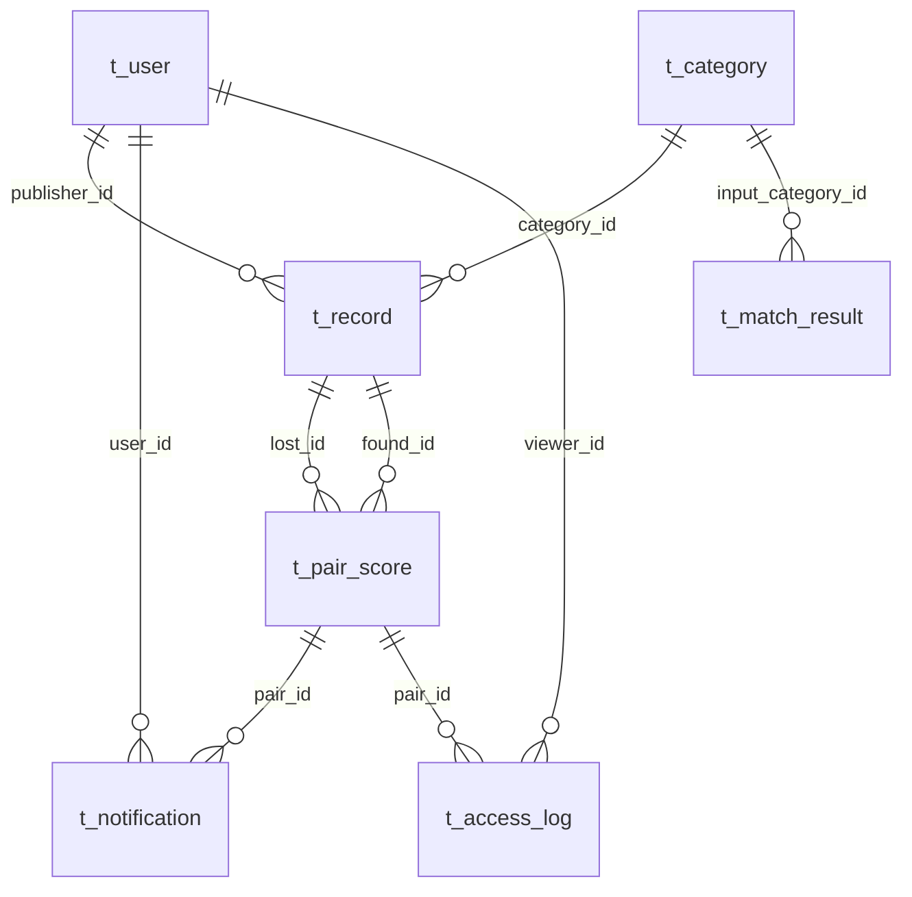
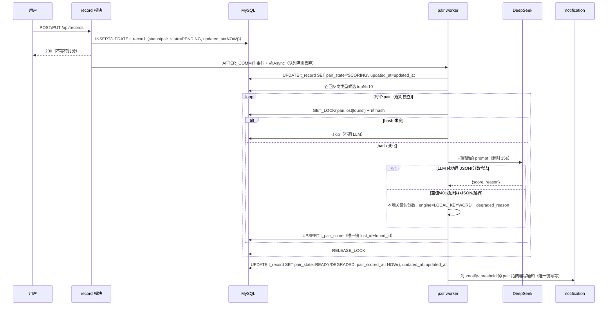

# find-it-campus v2 · 架构与契约（A1 冻结稿）

> 状态：**待门禁 0 冻结** · 版本 `v2.0` · 日期 `2026-10-27`
> 任务：ZHYYKFX-45（A1 架构与契约 v2，磐石石·dsh）
> 上游口径：ZHYYKFX-44 父任务 + 人类 2026-10-27 拍板（本文件 §1.1 原样承接，不得改）
> 配套文件：`docs/api-contract-v2.md`（17 接口 × 3 态权限矩阵、逐接口契约）、`docs/design/diagrams/er-v2.mmd`（ER 图）
> 边界：**只出文档**。本分支不改 `server/`、`web/` 下任何一行代码；DDL 是给 B1 的草案，SQL 方言细节可在 B1 落地时按本机 MySQL 8.0.x 微调，但列、约束语义与唯一键不得改。

---

## 0. 结论先行

**推荐方案：模块化单体（Spring Boot 3.5 + MyBatis + 单 MySQL）+ 进程内异步配对 worker + 可选 DeepSeek 外部打分；不拆微服务、不引 MQ / Redis / 独立向量库。**

三个最关键的理由：

1. **v2 的复杂度在“数据边界 + 配对语义”，不在服务拆分。** 7 张表、单库本地事务就能覆盖；拆服务只会把「发一条启事 → 打分 → 通知」变成跨服务最终一致，换来的是分布式事务、消息重复、链路追踪三份额外成本，而当前团队规模与流量都不需要独立扩缩容。
2. **配对必须“逐对独立”，这要求唯一键 `(lost_id, found_id)` 和单行事务，而不是跨聚合编排。** 一条招领对多个失主各自成 pair，任何一对的 `status`、授权、附言都只写自己那一行；单库单行更新是最容易证明「A pair 不影响 B pair」的实现。
3. **降级必须“诚实且分链路”。** pair 链路是后台打分，允许落 `engine=LOCAL_KEYWORD` 并在页面标注「已降级」；`/api/match` 是同步语义匹配，按 ADR-009 **不自动降级**，外部不可用就 503/504。两条链路用不同的失败语义，才能既不污染评估数据，又不让发布链路被外部模型拖垮。

**主要代价（不隐藏）：** 单实例 ⇒ 内存 session 重启失效、异步任务无跨实例协调；单 MySQL ⇒ 无读副本、审计日志增长后要归档/分区；进程内 worker ⇒ 进程崩溃时正在打分的记录会停在 `SCORING`，靠每日兜底扫描恢复，不是“恰好一次”。

---

## 1. 约束与假设

### 1.1 人类已拍板（不可改，逐条承接）

| # | 口径 | 对架构的硬约束 |
|---|---|---|
| H1 | **多配对共存**：每条 LOST↔FOUND 是独立 1:1 单元；确认/联系一对不影响其他 pair；不设「已解决」 | `t_pair_score` 唯一键 `(lost_id, found_id)`；`status ∈ {NEW, CONTACTED, IGNORED}`；不存在跨 pair 的联动写入 |
| H2 | `t_record.status`（PENDING/CLAIMED/CLOSED）**只由发布者本人改**，系统不自动置位、不自动关闭 | 状态写入路径只有一条：`PATCH /api/records/{id}/status` + 所有权校验；打分、通知、兜底扫描、定时任务**一律不得写 status** |
| H3 | 匿名可读（走遮蔽）、写需登录；手机号只做格式校验，无短信验证；`t_user` 不存手机号；不自动下架 | 读接口匿名 200；写接口 401/403；`t_user` 无 phone 列；无短信表/接口/供应商；无过期下架任务 |
| H4 | 密钥只走 env（`DEEPSEEK_API_KEY`）；代码/配置/日志/证据/文档零明文；证据只记 model / latency_ms / tokens | 不设 `findit.llm.api-key` 配置项；`application.yml` 只放 base-url/model/timeout；日志与审计不落 prompt/response/header |
| H5 | 查看号码看**对方那一端**是否已授权；未授权「对方尚未公开」用 200 + 文案/业务码，不用 403；`<0.75` 一律 403 | `GET /api/pairs/{id}/contact` 判定式见 §7.2；`<0.75` 返回 403 + `50002` |
| H6 | 附言 ≤200 字，随授权写入、撤回时清空，且必须过打码 | 写入前过 `MaskingPolicy`；`lost_unlock_note` / `found_unlock_note` 存打码后的值 |
| H7 | 降级：pair 链路可降级（落 `engine=LOCAL_KEYWORD` 并在页面提示）；`/api/match` 不自动降级（ADR-009） | 两条链路两套失败语义，见 §8.6 |
| H8 | `t_match_result` 写入前必须脱敏 | `input_text` 与 `candidates` 写库前过同一套打码 |
| H9 | 不开放注册，seed 内置 3 个演示账号（含 2 个越权测试用） | 无注册接口；`t_user` 只由 seed/运维写 |
| H10 | `publisher_id` 可空，seed 统一绑演示账号，新建记录应用层强制非空 | DDL 保持 `NULL`（迁移期），`POST /api/records` 永远从 session 取 `publisher_id`，不接受客户端传值 |

### 1.2 我依据的输入

- 现有 v1 契约与 DDL：`docs/api-contract.md`、`docs/architecture-baseline.md`、`db/schema.sql`（三表、统一响应体、错误码 `10001/10005`、ADR-009）。
- 父任务 17 条任务书与 A3 UI 基线口径（三档 0.92 / 0.80 / 0.60、文案统一「可能相关」、`/my` 三种状态）。
- 下游 B2（`GET /api/my/records` 401 验收）、E1（`GET /api/pairs/{id}/contact`、`POST /api/pairs/{id}/contact-unlock`）中已点名的路径。
- 现有部署形态：单机 Windows、Spring Boot 默认 18080、Vite 5173、MySQL 8.0.x、无 Redis/MQ。

### 1.3 尚未确认、需要回填的假设（每条都说明影响哪个决策）

| # | 假设 | 若假设不成立，影响 |
|---|---|---|
| A1 | 规模假设：**10 万条记录、1 万注册用户、峰值读 QPS < 200**。来源：任务书未给，属**经验估算，需实测** | 超过 100 万记录时，`t_record` 列表与 `t_pair_score` 需要归档/分区；读 QPS 超过单机后要加读副本或缓存 |
| A2 | **单实例部署**（一个 Spring Boot 进程 + 一个 MySQL）。来源：现有部署脚本与课程演示形态 | 多实例必须把 session 外置（Redis/DB）并给配对任务加分布式锁；当前的进程内锁与 `GET_LOCK` 方案要重写 |
| A3 | 读写比约 **100:1**，写路径无强一致跨表要求。属估算 | 若写比例上升，`t_record` 的二级索引与通知插入会成为瓶颈，需要重新评估索引数量 |
| A4 | 配对/通知允许**秒级到分钟级最终一致**；用户发布后 5 秒内看到「分析中」可接受 | 若要求发布即出分，则 POST 必须同步等 LLM，P99 无法保证 <500ms，需改成前端轮询 + 任务队列 |
| A5 | 单租户（一个学校/一个 Space），无多租户隔离要求 | 多租户要在所有表加 `tenant_id` 并进入唯一键/索引，属不可逆变更 |
| A6 | 合规按课程演示级别；生产需补传输加密、磁盘加密、备份加密与等保评估 | 若直接上生产，当前 `contact` 明文落库（仅输出层打码）不满足更严格的个人信息保护要求 |
| A7 | DeepSeek 可用性与配额不受我方控制；允许 pair 链路降级 | 若业务要求「必须真实 LLM 分数才算成功」，则降级行不能算完成，`pair_state` 要加失败态与人工重试 |
| A8 | 演示账号密码可写在 README/seed 注释中；无短信、无邮箱、无找回密码 | 若要求真实身份，需接学校统一认证，`t_user` 与登录流程都要改 |

> 这些假设不阻塞 A1 冻结；但 **A1/A2 若被推翻，§4 索引与 §11 可靠性要重做**，请在门禁 0 明确。

---

## 2. 架构总览

| 维度 | 决策 | 说明 |
|---|---|---|
| 架构风格 | **模块化单体**（一个可执行 jar，按限界上下文分包） | 不拆微服务：团队 1–3 人、单库、无独立扩缩容需求；拆分的运维成本 > 收益 |
| 通信 | 同步 HTTP/JSON（`/api`）；进程内 Spring 事件 + `@Async` 做配对 | 不引 MQ：没有跨服务消费者，Outbox/消息重复/死信都是净成本 |
| 数据模式 | 单 MySQL 8.0.x，InnoDB，`utf8mb4`；本地事务；无跨库事务 | 7 张表；配对行 + 通知行在同一库，允许同事务或“先落 pair、通知可补”的最终一致 |
| 外部依赖 | DeepSeek OpenAI 兼容接口（可选）；无短信、无对象存储、无邮件 | 失败时 pair 降级、`/api/match` 明确 503/504 |
| 会话 | 服务端 `HttpSession`（内存），`JSESSIONID` Cookie | 可吊销、实现简单；代价是单实例、重启失效（A2） |
| 部署 | 单机：MySQL + Spring Boot jar（18080）+ Vue 静态资源；前端开发期 Vite 代理 | 不引容器编排；G1 仍按现有部署包 |
| 一致性 | 记录/状态/配对单行强一致；通知与配对状态**最终一致**；审计**失败即拒绝** | 见 §4.4 |

**明确不引入的东西（避免下游顺手加）：** Redis、RabbitMQ/Kafka、Elasticsearch、向量数据库、Spring Security 完整过滤器链、Flyway/Liquibase、分布式事务/Saga、JWT。每一项的替代方案与代价见 §14。

---

## 3. 模块分解与数据所有权

### 3.1 模块（限界上下文）

| 模块（包） | 职责 | 写所有权（唯一写方） | 读依赖 | 对外接口 |
|---|---|---|---|---|
| `auth` | 登录、登出、当前用户、session、bcrypt、登录失败计数 | `t_user`（仅 seed/运维写；运行期只读） | — | `POST /api/auth/login`、`POST /api/auth/logout`、`GET /api/auth/me` |
| `category` | 分类字典 | `t_category`（seed/运维） | — | `GET /api/categories` |
| `record` | 启事 CRUD、我的启事、状态流转、所有权、`pair_state` 列 | `t_record` | `t_category` | `GET/POST /api/records`、`GET/PUT/PATCH/DELETE /api/records/{id}`、`GET /api/my/records` |
| `match` | `/api/match` 同步匹配、快照 | `t_match_result` | `t_record`、`t_category`、`MatchEngine` | `POST /api/match` |
| `pair` | 配对召回、LLM/本地打分、pair 状态、联系方式可见性、解锁 | `t_pair_score` | `t_record`、`t_user`、`NotificationPort`、`AuditPort`、`LlmClient` | `PATCH /api/pairs/{id}`、`GET /api/pairs/{id}/contact`、`POST /api/pairs/{id}/contact-unlock` |
| `notification` | 通知生成、列表、已读 | `t_notification` | `t_pair_score`、`t_user` | `GET /api/notifications`、`PATCH /api/notifications/{id}/read` |
| `audit` | 联系方式查看审计（append-only） | `t_access_log` | `t_pair_score`、`t_user` | 无 HTTP 入口，被 `pair` 调用 |
| `common` | 统一响应体、错误码、`requestId`、`MaskingPolicy`、时间/分页、CORS | — | — | — |

**依赖方向（单向，禁止反向）：**

```text
web(controller) → service → mapper
pair.service → record.port / notification.port / audit.port / llm.client
record.service → category.port
match.service → record.port + MatchEngine
common.masking 被所有 web 输出装配器调用（不反向依赖任何业务模块）
```

`controller` 不注入 `mapper`；`mapper` 不写业务分支；`pair` 不直接更新 `t_record.status`；`record` 不直接写 `t_pair_score`/`t_notification`/`t_access_log`。

### 3.2 跨模块写操作与一致性方案

| 写操作 | 涉及表 | 一致性方案 | 失败兜底 |
|---|---|---|---|
| 发布/编辑启事 → 触发配对 | `t_record`（本地事务）→ `t_pair_score`、`t_notification` | 发布事务提交后发 `RecordChangedEvent`（`@TransactionalEventListener(AFTER_COMMIT)`）+ `@Async`；配对任务先落 pair，再写通知 | 入队失败：`pair_state=PENDING`，每日扫描补；进程崩溃：`SCORING` 超 10 分钟由扫描重置；通知失败：扫描按 pair 补 |
| 配对打分 → 更新记录聚合状态 | `t_pair_score` + `t_record.pair_state/pair_scored_at` | `pair` 调 `RecordPairStatePort`（record 模块唯一写 `t_record`）；**不写 `status`、不写 `updated_at`** | 失败保持 `PENDING`；扫描重试 |
| 联系方式查看 → 审计 | 读 `t_pair_score`/`t_record`；写 `t_access_log` | 读后在同一请求内写审计；**审计写失败即返回 500，不返回号码（fail-closed）** | 重试由用户重新发起；日志记 requestId |
| 授权公开 → 通知对端 | `t_pair_score` 解锁列 + `t_notification` | 同一本地事务写 pair 解锁列 + 通知（通知唯一键幂等） | 通知失败回滚整个事务；用户可重试 PUBLISH；重复请求不重复通知 |
| 通知已读 | `t_notification` | 单行更新 | 幂等 200 |

**没有跨服务写，所以不需要 Saga/Outbox。** 唯一“跨聚合”的是配对 → 记录 `pair_state`，用模块端口在**同一进程、同一数据库**内完成，不持有长事务（LLM 调用在事务外）。

---

## 4. 数据设计

### 4.1 ER 图



完整 Mermaid 源文件：`docs/design/diagrams/er-v2.mmd`。

### 4.2 七表 DDL 草案

> 这是给 B1 的**语义草案**。B1 负责把它并入 `db/schema.sql`（空库全量）与 `db/migration-v1-to-v2.sql`（v1 原地升级）。MySQL 8.0.x / InnoDB / `utf8mb4_0900_ai_ci`。
> 关键点：`t_user` **没有 phone 列**；`t_pair_score` 唯一键 `(lost_id, found_id)`；`status` 不含「已解决」；`t_record.updated_at` **不带 `ON UPDATE`**（见 §4.4 理由）。

#### 4.2.1 `t_user` — 登录身份（无手机号）

```sql
CREATE TABLE `t_user` (
  `id`            BIGINT UNSIGNED NOT NULL AUTO_INCREMENT COMMENT '主键',
  `student_no`    VARCHAR(32)     NOT NULL               COMMENT '学号，登录名；唯一；不存手机号',
  `password_hash` VARCHAR(100)    NOT NULL               COMMENT 'bcrypt 哈希，cost >= 10；禁止明文',
  `display_name`  VARCHAR(32)     NOT NULL               COMMENT '展示名',
  `is_active`     TINYINT(1)      NOT NULL DEFAULT 1     COMMENT '1=可登录 0=停用（不做物理删除）',
  `created_at`    DATETIME        NOT NULL DEFAULT CURRENT_TIMESTAMP,
  `updated_at`    DATETIME        NOT NULL DEFAULT CURRENT_TIMESTAMP ON UPDATE CURRENT_TIMESTAMP,
  PRIMARY KEY (`id`),
  UNIQUE KEY `uk_user_student_no` (`student_no`),
  KEY `idx_user_active` (`is_active`)
) ENGINE=InnoDB DEFAULT CHARSET=utf8mb4 COLLATE=utf8mb4_0900_ai_ci
  COMMENT='登录用户；不存手机号/邮箱/短信验证码';
```

#### 4.2.2 `t_category` — 分类字典（沿用 v1）

```sql
CREATE TABLE `t_category` (
  `id`         BIGINT UNSIGNED NOT NULL AUTO_INCREMENT,
  `code`       VARCHAR(32)     NOT NULL,
  `name`       VARCHAR(32)     NOT NULL,
  `keywords`   VARCHAR(255)             DEFAULT NULL,
  `sort_order` SMALLINT        NOT NULL DEFAULT 0,
  `is_active`  TINYINT(1)      NOT NULL DEFAULT 1,
  `created_at` DATETIME        NOT NULL DEFAULT CURRENT_TIMESTAMP,
  `updated_at` DATETIME        NOT NULL DEFAULT CURRENT_TIMESTAMP ON UPDATE CURRENT_TIMESTAMP,
  PRIMARY KEY (`id`),
  UNIQUE KEY `uk_category_code` (`code`),
  KEY `idx_category_active_sort` (`is_active`, `sort_order`)
) ENGINE=InnoDB DEFAULT CHARSET=utf8mb4 COLLATE=utf8mb4_0900_ai_ci
  COMMENT='物品分类字典（只读消费方：record / match / pair）';
```

#### 4.2.3 `t_record` — 启事主表（v1 扩展）

```sql
CREATE TABLE `t_record` (
  `id`             BIGINT UNSIGNED NOT NULL AUTO_INCREMENT,
  `type`           VARCHAR(8)      NOT NULL COMMENT 'LOST / FOUND',
  `status`         VARCHAR(16)     NOT NULL DEFAULT 'PENDING'
                                     COMMENT 'PENDING / CLAIMED / CLOSED；只有发布者 PATCH 能改',
  `title`          VARCHAR(64)     NOT NULL,
  `description`    TEXT            NOT NULL,
  `category_id`    BIGINT UNSIGNED          DEFAULT NULL,
  `location`       VARCHAR(128)    NOT NULL,
  `occurred_at`    DATETIME        NOT NULL,
  `contact`        VARCHAR(64)              DEFAULT NULL COMMENT '手机号；新写入按 ^1[3-9]\\d{9}$ 校验；历史非手机号值保留',
  `publisher_name` VARCHAR(32)              DEFAULT NULL,
  `publisher_id`   BIGINT UNSIGNED          DEFAULT NULL COMMENT '发布者；应用层新建必填；NULL 仅迁移期',
  `pair_state`     VARCHAR(16)     NOT NULL DEFAULT 'PENDING'
                                     COMMENT 'PENDING/SCORING/READY/DEGRADED；系统写，不是业务状态',
  `pair_scored_at` DATETIME                 DEFAULT NULL COMMENT '最后一次打分完成时间',
  `deleted_at`     DATETIME                 DEFAULT NULL COMMENT '非空=逻辑删除',
  `created_at`     DATETIME        NOT NULL DEFAULT CURRENT_TIMESTAMP,
  `updated_at`     DATETIME        NOT NULL DEFAULT CURRENT_TIMESTAMP
                                     COMMENT '只由本人写路径（POST/PUT/PATCH/DELETE）显式 NOW()；系统任务不写',
  PRIMARY KEY (`id`),
  KEY `idx_record_list` (`type`, `status`, `deleted_at`, `created_at`),
  KEY `idx_record_status_created` (`status`, `deleted_at`, `created_at`),
  KEY `idx_record_category` (`category_id`, `deleted_at`, `created_at`),
  KEY `idx_record_publisher` (`publisher_id`, `deleted_at`, `created_at`),
  KEY `idx_record_pair_scan` (`pair_state`, `pair_scored_at`),
  FULLTEXT KEY `ft_record_search` (`title`, `description`) WITH PARSER ngram,
  CONSTRAINT `fk_record_category` FOREIGN KEY (`category_id`) REFERENCES `t_category` (`id`)
    ON DELETE RESTRICT ON UPDATE RESTRICT,
  CONSTRAINT `fk_record_publisher` FOREIGN KEY (`publisher_id`) REFERENCES `t_user` (`id`)
    ON DELETE RESTRICT ON UPDATE RESTRICT,
  CONSTRAINT `ck_record_type` CHECK (`type` IN ('LOST', 'FOUND')),
  CONSTRAINT `ck_record_status` CHECK (`status` IN ('PENDING', 'CLAIMED', 'CLOSED')),
  CONSTRAINT `ck_record_pair_state` CHECK (`pair_state` IN ('PENDING', 'SCORING', 'READY', 'DEGRADED')),
  CONSTRAINT `ck_record_title_len` CHECK (CHAR_LENGTH(`title`) BETWEEN 2 AND 64),
  CONSTRAINT `ck_record_desc_len` CHECK (CHAR_LENGTH(`description`) BETWEEN 2 AND 2000),
  CONSTRAINT `ck_record_location_len` CHECK (CHAR_LENGTH(`location`) BETWEEN 1 AND 128)
) ENGINE=InnoDB DEFAULT CHARSET=utf8mb4 COLLATE=utf8mb4_0900_ai_ci
  COMMENT='失物/招领记录；pair_state 与 status 语义分离';
```

> `FULLTEXT ... WITH PARSER ngram` 是可选加速项：若本机 MySQL 不含 ngram 解析器，B1 可删掉该行，`/api/match` 的 LIKE + 内存打分退化路径不变（与 v1 一致）。

#### 4.2.4 `t_match_result` — `/api/match` 快照（v1 扩展 `impl` 取值）

```sql
CREATE TABLE `t_match_result` (
  `id`                BIGINT UNSIGNED NOT NULL AUTO_INCREMENT,
  `input_text`        TEXT            NOT NULL COMMENT '写入前已脱敏',
  `input_type`        VARCHAR(8)                DEFAULT NULL,
  `input_category_id` BIGINT UNSIGNED          DEFAULT NULL,
  `impl`              VARCHAR(32)     NOT NULL COMMENT 'LOCAL_KEYWORD / EXTERNAL_EMBEDDING',
  `top_n`             SMALLINT        NOT NULL,
  `min_score`         DECIMAL(6,4)    NOT NULL,
  `candidates`        JSON            NOT NULL COMMENT '写入前已脱敏；与响应 items 同构（不含展示字段）',
  `cost_ms`           INT                      DEFAULT NULL,
  `created_at`        DATETIME        NOT NULL DEFAULT CURRENT_TIMESTAMP,
  PRIMARY KEY (`id`),
  KEY `idx_match_result_impl_created` (`impl`, `created_at`),
  KEY `idx_match_result_created` (`created_at`),
  CONSTRAINT `fk_match_result_category` FOREIGN KEY (`input_category_id`) REFERENCES `t_category` (`id`)
    ON DELETE SET NULL ON UPDATE RESTRICT,
  CONSTRAINT `ck_match_result_type` CHECK (`input_type` IS NULL OR `input_type` IN ('LOST', 'FOUND')),
  CONSTRAINT `ck_match_result_impl` CHECK (`impl` IN ('LOCAL_KEYWORD', 'EXTERNAL_EMBEDDING')),
  CONSTRAINT `ck_match_result_score` CHECK (`min_score` >= 0 AND `min_score` <= 1)
) ENGINE=InnoDB DEFAULT CHARSET=utf8mb4 COLLATE=utf8mb4_0900_ai_ci
  COMMENT='/api/match 调用快照；不参与业务读写路径';
```

#### 4.2.5 `t_pair_score` — 每条 LOST↔FOUND 一行（核心新表）

```sql
CREATE TABLE `t_pair_score` (
  `id`                BIGINT UNSIGNED NOT NULL AUTO_INCREMENT COMMENT 'pairId',
  `lost_id`           BIGINT UNSIGNED NOT NULL COMMENT 'LOST 记录 id',
  `found_id`          BIGINT UNSIGNED NOT NULL COMMENT 'FOUND 记录 id',
  `score`             DECIMAL(5,4)    NOT NULL COMMENT '0.0000 - 1.0000',
  `engine`            VARCHAR(32)     NOT NULL COMMENT 'DEEPSEEK / LOCAL_KEYWORD',
  `degraded_reason`   VARCHAR(32)              DEFAULT NULL
                        COMMENT 'EMPTY_KEY/UNAUTHORIZED/TIMEOUT/NON_JSON/SCORE_OUT_OF_RANGE/HTTP_ERROR/CIRCUIT_OPEN',
  `prompt_version`    VARCHAR(32)     NOT NULL DEFAULT 'pair-score-v1',
  `latency_ms`        INT                      DEFAULT NULL COMMENT 'LLM 调用耗时；本地引擎为 NULL',
  `prompt_tokens`     INT                      DEFAULT NULL,
  `completion_tokens` INT                      DEFAULT NULL,
  `lost_hash`         CHAR(64)        NOT NULL COMMENT 'lost 内容 SHA-256（小写 hex）',
  `found_hash`        CHAR(64)        NOT NULL COMMENT 'found 内容 SHA-256（小写 hex）',
  `lost_unlocked_at`  DATETIME                 DEFAULT NULL COMMENT 'LOST 端授权公开时间',
  `found_unlocked_at` DATETIME                 DEFAULT NULL COMMENT 'FOUND 端授权公开时间',
  `lost_unlock_note`  VARCHAR(200)             DEFAULT NULL COMMENT 'LOST 端附言；写入前已打码',
  `found_unlock_note` VARCHAR(200)             DEFAULT NULL COMMENT 'FOUND 端附言；写入前已打码',
  `status`            VARCHAR(16)     NOT NULL DEFAULT 'NEW' COMMENT 'NEW / CONTACTED / IGNORED',
  `created_at`        DATETIME        NOT NULL DEFAULT CURRENT_TIMESTAMP,
  `updated_at`        DATETIME        NOT NULL DEFAULT CURRENT_TIMESTAMP ON UPDATE CURRENT_TIMESTAMP,
  PRIMARY KEY (`id`),
  UNIQUE KEY `uk_pair_lost_found` (`lost_id`, `found_id`),
  KEY `idx_pair_found_status` (`found_id`, `status`),
  KEY `idx_pair_lost_score` (`lost_id`, `score`),
  KEY `idx_pair_found_score` (`found_id`, `score`),
  KEY `idx_pair_scan` (`engine`, `updated_at`),
  KEY `idx_pair_status_updated` (`status`, `updated_at`),
  CONSTRAINT `fk_pair_lost` FOREIGN KEY (`lost_id`) REFERENCES `t_record` (`id`)
    ON DELETE RESTRICT ON UPDATE RESTRICT,
  CONSTRAINT `fk_pair_found` FOREIGN KEY (`found_id`) REFERENCES `t_record` (`id`)
    ON DELETE RESTRICT ON UPDATE RESTRICT,
  CONSTRAINT `ck_pair_distinct` CHECK (`lost_id` <> `found_id`),
  CONSTRAINT `ck_pair_score` CHECK (`score` >= 0 AND `score` <= 1),
  CONSTRAINT `ck_pair_engine` CHECK (`engine` IN ('DEEPSEEK', 'LOCAL_KEYWORD')),
  CONSTRAINT `ck_pair_status` CHECK (`status` IN ('NEW', 'CONTACTED', 'IGNORED')),
  CONSTRAINT `ck_pair_degraded` CHECK (`degraded_reason` IS NULL OR `degraded_reason` IN
    ('EMPTY_KEY','UNAUTHORIZED','TIMEOUT','NON_JSON','SCORE_OUT_OF_RANGE','HTTP_ERROR','CIRCUIT_OPEN')),
  CONSTRAINT `ck_pair_latency` CHECK (`latency_ms` IS NULL OR `latency_ms` >= 0),
  CONSTRAINT `ck_pair_tokens` CHECK (
    (`prompt_tokens` IS NULL OR `prompt_tokens` >= 0) AND
    (`completion_tokens` IS NULL OR `completion_tokens` >= 0)),
  CONSTRAINT `ck_pair_lost_note` CHECK (
    (`lost_unlock_note` IS NULL OR CHAR_LENGTH(`lost_unlock_note`) <= 200) AND
    (`lost_unlock_note` IS NULL OR `lost_unlocked_at` IS NOT NULL)),
  CONSTRAINT `ck_pair_found_note` CHECK (
    (`found_unlock_note` IS NULL OR CHAR_LENGTH(`found_unlock_note`) <= 200) AND
    (`found_unlock_note` IS NULL OR `found_unlocked_at` IS NOT NULL))
) ENGINE=InnoDB DEFAULT CHARSET=utf8mb4 COLLATE=utf8mb4_0900_ai_ci
  COMMENT='配对分数与逐端授权；一行一对，无已解决态';
```

**必须列对照（任务书第 2 项）：** `lost_id`、`found_id`、`score`、`engine`、`latency_ms`、`prompt_tokens`、`completion_tokens`、`lost_hash`、`found_hash`、`lost_unlocked_at`、`found_unlocked_at`、`lost_unlock_note`、`found_unlock_note`、`status` 全部在表内；唯一键 `(lost_id, found_id)` 为 `uk_pair_lost_found`。额外列 `degraded_reason` / `prompt_version` 只服务排障与评估口径，不改变状态语义。

#### 4.2.6 `t_notification` — 通知（内容不含号码）

```sql
CREATE TABLE `t_notification` (
  `id`         BIGINT UNSIGNED NOT NULL AUTO_INCREMENT,
  `user_id`    BIGINT UNSIGNED NOT NULL COMMENT '接收人',
  `pair_id`    BIGINT UNSIGNED          DEFAULT NULL COMMENT '关联 pair；SYSTEM 通知可为 NULL',
  `type`       VARCHAR(32)     NOT NULL COMMENT 'PAIR_MATCH / PAIR_UNLOCK / SYSTEM',
  `title`      VARCHAR(128)    NOT NULL COMMENT '写入前已打码',
  `body`       VARCHAR(500)    NOT NULL COMMENT '写入前已打码；不得含手机号',
  `read_at`    DATETIME                 DEFAULT NULL COMMENT 'NULL=未读',
  `created_at` DATETIME        NOT NULL DEFAULT CURRENT_TIMESTAMP,
  PRIMARY KEY (`id`),
  UNIQUE KEY `uk_notification_user_pair_type` (`user_id`, `pair_id`, `type`),
  KEY `idx_notification_user_read` (`user_id`, `read_at`, `created_at`),
  KEY `idx_notification_pair` (`pair_id`),
  CONSTRAINT `fk_notification_user` FOREIGN KEY (`user_id`) REFERENCES `t_user` (`id`)
    ON DELETE RESTRICT ON UPDATE RESTRICT,
  CONSTRAINT `fk_notification_pair` FOREIGN KEY (`pair_id`) REFERENCES `t_pair_score` (`id`)
    ON DELETE SET NULL ON UPDATE RESTRICT,
  CONSTRAINT `ck_notification_type` CHECK (`type` IN ('PAIR_MATCH', 'PAIR_UNLOCK', 'SYSTEM'))
) ENGINE=InnoDB DEFAULT CHARSET=utf8mb4 COLLATE=utf8mb4_0900_ai_ci
  COMMENT='通知；body/title 写入前脱敏';
```

> `uk_notification_user_pair_type` 保证同一用户对同一 pair 的同类型通知只有一条：重复打分/重复扫描不会刷屏。`pair_id` 可空时 MySQL 允许多条 NULL，SYSTEM 通知由运维控制，不依赖该唯一键。

#### 4.2.7 `t_access_log` — 联系方式查看审计（append-only）

```sql
CREATE TABLE `t_access_log` (
  `id`          BIGINT UNSIGNED NOT NULL AUTO_INCREMENT,
  `pair_id`     BIGINT UNSIGNED NOT NULL,
  `viewer_id`   BIGINT UNSIGNED NOT NULL,
  `viewer_side` VARCHAR(8)      NOT NULL COMMENT 'LOST / FOUND',
  `target_side` VARCHAR(8)      NOT NULL COMMENT 'LOST / FOUND',
  `score`       DECIMAL(5,4)    NOT NULL COMMENT '查看时分数快照',
  `result`      VARCHAR(24)     NOT NULL
                  COMMENT 'GRANTED/DENIED_NOT_PUBLIC/DENIED_NOT_PROVIDED/DENIED_LOW_SCORE/DENIED_NOT_OWNER',
  `request_id`  VARCHAR(64)              DEFAULT NULL COMMENT '与响应体 requestId 同值',
  `ip`          VARCHAR(45)              DEFAULT NULL COMMENT '客户端 IP；反代场景取可信 XFF',
  `user_agent`  VARCHAR(255)             DEFAULT NULL,
  `created_at`  DATETIME        NOT NULL DEFAULT CURRENT_TIMESTAMP,
  PRIMARY KEY (`id`),
  KEY `idx_access_pair_created` (`pair_id`, `created_at`),
  KEY `idx_access_viewer_created` (`viewer_id`, `created_at`),
  KEY `idx_access_result_created` (`result`, `created_at`),
  CONSTRAINT `fk_access_pair` FOREIGN KEY (`pair_id`) REFERENCES `t_pair_score` (`id`)
    ON DELETE RESTRICT ON UPDATE RESTRICT,
  CONSTRAINT `fk_access_viewer` FOREIGN KEY (`viewer_id`) REFERENCES `t_user` (`id`)
    ON DELETE RESTRICT ON UPDATE RESTRICT,
  CONSTRAINT `ck_access_side` CHECK (`viewer_side` IN ('LOST', 'FOUND')
    AND `target_side` IN ('LOST', 'FOUND')),
  CONSTRAINT `ck_access_result` CHECK (`result` IN
    ('GRANTED','DENIED_NOT_PUBLIC','DENIED_NOT_PROVIDED','DENIED_LOW_SCORE','DENIED_NOT_OWNER'))
) ENGINE=InnoDB DEFAULT CHARSET=utf8mb4 COLLATE=utf8mb4_0900_ai_ci
  COMMENT='联系方式查看审计；只插不改不删，不记录号码/附言原文';
```

**审计表没有 `contact`、`note`、`prompt` 列**：审计只回答“谁在何时看了哪条 pair、结果如何”，不复制敏感值。

### 4.3 索引与关键查询

| 查询 | SQL 形状 | 命中索引 | 为什么能命中 / 代价 |
|---|---|---|---|
| 首页列表（带 type） | `WHERE type=? AND status=? AND deleted_at IS NULL ORDER BY created_at DESC, id DESC` | `idx_record_list` | 前两列等值、`deleted_at` 等值 NULL、`created_at` 排序；`id` 回表兜底稳定排序 |
| 首页列表（不带 type） | `WHERE status=? AND deleted_at IS NULL ORDER BY created_at DESC` | `idx_record_status_created` | v1 的已知薄弱点；v2 增补该索引，避免首列 `type` 缺失导致全表扫 |
| 分类筛选 | `WHERE category_id=? AND deleted_at IS NULL ...` | `idx_record_category` | 分类等值 + 删除标记 + 时间排序 |
| 我的启事 | `WHERE publisher_id=? AND deleted_at IS NULL ORDER BY created_at DESC` | `idx_record_publisher` | 发布者等值 + 时间排序；`status` 过滤在回表后做（单用户记录量小） |
| 某记录的 pair 卡片 | `WHERE lost_id=? OR found_id=?` | `idx_pair_lost_score` + `idx_pair_found_score` | MySQL 可用 index merge 或改写成两条 `UNION ALL` 各走一条索引；按 `score DESC` 取前 N |
| 每日扫描 | `WHERE pair_state IN ('PENDING','SCORING') AND pair_scored_at < ? ORDER BY pair_scored_at` | `idx_record_pair_scan` | 首列 `IN`、次列范围/排序；扫描上限 500，避免全表 |
| 降级行重算 | `WHERE engine='LOCAL_KEYWORD' AND updated_at < ? ORDER BY updated_at LIMIT ?` | `idx_pair_scan` | 引擎等值 + 时间范围 |
| 未读通知数 | `WHERE user_id=? AND read_at IS NULL` | `idx_notification_user_read` | 用户等值 + 未读条件；覆盖 `read_at`/`created_at` |
| 通知列表 | `WHERE user_id=? ORDER BY created_at DESC, id DESC` | `idx_notification_user_read` | 用户等值 + 排序；分页小 |
| 审计按 pair / 按人 | `WHERE pair_id=? ORDER BY created_at DESC` / `WHERE viewer_id=? ...` | `idx_access_pair_created` / `idx_access_viewer_created` | 等值 + 时间排序；审计是 append-only，写多读少 |

**不建的索引：** 不给 `t_record.contact` 建索引（不按号码查询，避免把敏感值做成检索面）；不给 `t_pair_score.score` 单独建全局索引（查询都带 `lost_id`/`found_id`，全局分数排序无业务读取方）；不给 `t_notification.body` 建全文索引（通知不做搜索）。

### 4.4 一致性边界（明确到“哪张表、哪一行、谁写”）

1. **`t_record.status` 只有一条写入路径**：`PATCH /api/records/{id}/status`，service 内校验 `publisher_id == session.userId`，并按 §9.2 流转表更新；`POST` 只在插入时初始化 `PENDING`；`PUT` 不接收 `status`；`DELETE` 只写 `deleted_at`，**不写 status**。打分、通知、扫描、任何定时任务都不得出现 `UPDATE t_record SET status=...`。
2. **`t_record.updated_at` 不带 `ON UPDATE`**：只有本人写路径（POST/PUT/PATCH/DELETE）显式 `updated_at=NOW()`。配对任务更新 `pair_state`/`pair_scored_at` 时，SQL 必须写成 `SET pair_state=?, pair_scored_at=?, updated_at=updated_at`（或根本不碰 `updated_at` 列），保证 A2 的“自动任务跑完 `status` 与 `updated_at` 不变”可验证。
3. **pair 行内强一致**：`t_pair_score` 的分数、哈希、engine/tokens、两端授权列、`status` 都在同一行；单行 `UPDATE` 不需要跨行事务。A pair 的更新 SQL 永远带 `WHERE id=?`，不出现“按 lost_id 批量改其他 pair”。
4. **pair 与通知最终一致**：配对先提交 `t_pair_score`，再写 `t_notification`；通知失败不回滚分数，由每日扫描按 `(user_id,pair_id,type)` 唯一键补写。这是**同一数据库内的最终一致**，不是跨服务。
5. **联系查看审计 fail-closed**：`GET /api/pairs/{id}/contact` 在返回号码前必须成功插入 `t_access_log`；插入失败返回 `500/10005`，不返回号码。未授权与 `<0.75` 也先写审计再返回 200/403。
6. **不自动置位/不自动关闭**：`t_record.status` 与 `deleted_at` 无任何系统写入方；没有“30 天自动下架”“已认领自动 CLOSED”“配对完成自动 CLOSED”的代码路径。系统任务只碰 `pair_state`/`pair_scored_at`/`t_pair_score`/`t_notification`/`t_access_log`。
7. **`pair_state` 不是 pair 状态**：它是记录级的派生展示状态（分析中/已出结果/已降级），由 record 模块写；更新它不写任何 `t_pair_score` 行，也不因某条 pair 的状态变化而改其他 pair。pair 状态只存在 `t_pair_score.status`，且只由 `PATCH /api/pairs/{id}` 单行更新。

### 4.5 增长估算与归档（全部标注为估算，需实测）

| 表 | 估算行数 | 估算依据 | 归档/分区策略 |
|---|---|---|---|
| `t_record` | 10 万 | A1 假设；任务书未给 | 超过 100 万再按 `created_at` 年分区；当前不分区 |
| `t_pair_score` | ≤100 万 | 每条记录最多召回 10 个反向候选 | 超过 500 万按 `created_at` 年归档；软删记录的 pair 保留供审计 |
| `t_notification` | ≤200 万 | 每个 ≥0.75 的 pair 给两端各 1 条 | 已读且 >90 天归档到冷表/文件；未读永久保留 |
| `t_access_log` | 100 万/年 | 假设 1 万用户 × 100 次查看/年（**纯估算**） | >180 天归档；>5000 万行/写入 p95 >10ms 时按月 RANGE 分区（分区键需进 PK，届时另立变更） |
| `t_match_result` | 10 万/年 | `/api/match` 调用量未知 | >180 天归档；评估集单独导出 |

存储估算：100 万 pair × 约 250 B + 索引约 150 MB；100 万审计 × 约 200 B + 索引约 120 MB；合计 **< 2 GB**（估算，需实测）。单机 MySQL 足够，不因“十万级”提前分库分表。

### 4.6 迁移与回滚（B1 执行，A1 只定顺序）

**升级步骤（`db/migration-v1-to-v2.sql`）：**

1. 建 `t_user`，插入 3 个演示账号（bcrypt 哈希；密码写 README/seed 注释）。
2. 建 `t_pair_score` / `t_notification` / `t_access_log`（先不建指向 `t_record` 的外键也可，最后统一加）。
3. `ALTER TABLE t_record`：加 `publisher_id`、`pair_state`、`pair_scored_at`；把 `updated_at` 改为**无 ON UPDATE**（`MODIFY COLUMN updated_at DATETIME NOT NULL DEFAULT CURRENT_TIMESTAMP`）。
4. 回填：`UPDATE t_record SET publisher_id=(SELECT id FROM t_user WHERE student_no='demo01') WHERE publisher_id IS NULL;`；执行后校验 `SELECT COUNT(*) FROM t_record WHERE publisher_id IS NULL` 必须为 0。
5. 加 `fk_record_publisher`、`idx_record_publisher`、`idx_record_pair_scan`、`idx_record_status_created`。
6. 初始化 `pair_state`：存量记录保持 `PENDING`，由首次每日扫描补齐；演示数据可在 seed 中直接给 READY 样本。

**回滚（`down`，必须写在迁移文件注释里）：**

```sql
-- 先删新表（按外键依赖倒序）
DROP TABLE IF EXISTS t_access_log;
DROP TABLE IF EXISTS t_notification;
DROP TABLE IF EXISTS t_pair_score;
-- 再删记录表新增列/索引/外键
ALTER TABLE t_record DROP FOREIGN KEY fk_record_publisher;
ALTER TABLE t_record DROP INDEX idx_record_publisher, DROP INDEX idx_record_pair_scan, DROP INDEX idx_record_status_created;
ALTER TABLE t_record DROP COLUMN pair_scored_at, DROP COLUMN pair_state, DROP COLUMN publisher_id;
ALTER TABLE t_record MODIFY COLUMN updated_at DATETIME NOT NULL DEFAULT CURRENT_TIMESTAMP ON UPDATE CURRENT_TIMESTAMP;
-- t_match_result 保持 v1 两值 impl（LOCAL_KEYWORD / EXTERNAL_EMBEDDING），v2 不改该 CHECK
DROP TABLE IF EXISTS t_user;  -- 仅回滚时；生产有数据不得执行
```

**回滚代价：** v2 产生的配对、通知、审计数据全部丢失；`publisher_id` 回滚后无法恢复。**只允许在门禁 0/1 前回滚**；进入阶段 3 后回滚需先备份并报人类。迁移脚本必须可重复执行或在重复执行时明确报错并给出检查语句（B1 验收）。

---

## 5. 关键链路

### 5.1 发布/编辑 → 配对 → 通知



**逐段失败点与兜底：**

| 段 | 失败点 | 兜底 | 用户可见结果 |
|---|---|---|---|
| 发布事务 | DB 写失败 | 整体回滚，返回 `10005` | 发布失败，可重试 |
| 事件入队 | 线程池满 / 进程立刻退出 | `pair_state` 仍 `PENDING`；每日扫描补 | 发布 200，`/my` 显示「分析中」 |
| 召回 | 无候选 / SQL 超时 | 无候选 → `READY`、0 条；超时 → `PENDING`，扫描重试 | 无匹配 / 分析中 |
| LLM | 空 Key、401、超时、非 JSON、分数越界 | 本地关键词分数，`engine=LOCAL_KEYWORD`，`degraded_reason` 落库；接口不失败 | 卡片显示「已降级」+「智能匹配暂不可用，已用关键词匹配」 |
| pair 写入 | 唯一键冲突 / DB 失败 | 冲突则按 hash 跳过；DB 失败保持 `PENDING` | 分析中，扫描重试 |
| 通知 | 唯一键冲突 / DB 失败 | 冲突忽略；失败只记 warn，扫描按 `(user_id,pair_id,type)` 补 | 延迟收到或最终收到 |
| 进程崩溃 | 停在 `SCORING` | 扫描把 `SCORING` 超过 10 分钟的记录重置为 `PENDING` 重跑 | 分析中 → 出结果 |

**关键不变量：** 整条链路没有一行 `UPDATE t_record SET status=...`；没有把 `t_record.status` 改成 `CLAIMED/CLOSED` 的“匹配成功”逻辑；一条招领匹配 A、B 两个失主时，A 的 pair 行与 B 的 pair 行各自独立更新。

### 5.2 查看联系方式（三档 + 审计）

| 步 | 动作 | 失败点 | 兜底/结果 |
|---|---|---|---|
| 1 | 校验登录（session） | 未登录 | `401 + 10006`，不写审计 |
| 2 | 加载 pair + 两端记录（`deleted_at IS NULL`） | pair/记录不存在 | `404 + 20004`，不写审计 |
| 3 | 判定查看人是不是任一端的 `publisher_id` | 非参与方 | `403 + 10007`，写审计 `DENIED_NOT_OWNER`（pair 存在时） |
| 4 | 读阈值与分数，`score < 0.75` | 档位不足 | `403 + 50002`，写审计 `DENIED_LOW_SCORE`，响应无号码片段 |
| 5 | 判定对方端是否已授权（或 ≥0.90 直看） | 对方未公开 | **`200 + code 0` + `data.available=false, message="对方尚未公开"`**，写审计 `DENIED_NOT_PUBLIC`；不得用 403 |
| 6 | 对方已授权但对方 `contact` 为空 | 未填写 | `200 + code 0` + `available=false, reason="NOT_PROVIDED", message="对方未填写联系方式"`，写审计 `DENIED_NOT_PROVIDED` |
| 7 | 写 `t_access_log` | 审计写失败 | `500 + 10005`，**不返回号码**（fail-closed） |
| 8 | 返回号码 | — | `200 + code 0` + `available=true, contact=…`，写审计 `GRANTED` |

**查看动作不改变 pair 状态，也不改变记录状态**；只有显式 `PATCH /api/pairs/{id}` 才改 pair 状态。

### 5.3 登录 / 会话

1. `POST /api/auth/login`：校验 `studentNo`/`password` 形状 → 查 `t_user`（`is_active=1`）→ bcrypt 校验。
2. 失败：统一 `401 + 10006` + 「学号或密码不正确」（不区分账号不存在/密码错，防枚举）。
3. 连续失败 5 次 / 15 分钟（按 `studentNo + IP`）：只记录计数并打 WARN 日志；**响应仍是 `401 + 10006` + 同一文案**，不锁定账号、不返回 429。生产建议在反向代理层做 IP 限流（v2 不在应用层实现，避免与 B2“始终 401、文案一致”的验收冲突）。
4. 成功：`request.changeSessionId()` 防会话固定；写 session（`userId`、`studentNo`、`displayName`）；`Set-Cookie: JSESSIONID=…; Path=/; HttpOnly; SameSite=Lax`（生产加 `Secure`）。
5. `GET /api/auth/me`：无 session → `401 + 10006`；有 → 200 用户信息。
6. `POST /api/auth/logout`：`invalidate()` + 清 Cookie；重复调用 200（幂等）。
7. Session 超时 30 分钟；**重启即失效**（内存 session），写进部署说明与已知限制。

### 5.4 每日兜底扫描

| 项 | 定义 |
|---|---|
| 定时触发 | Spring `@Scheduled(cron = "${findit.pair.scan.cron:0 30 3 * * *}", zone = "Asia/Shanghai")`，默认每天 03:30 |
| 手动触发（HTTP） | `POST /api/ops/pair-scan`，请求头 `X-Ops-Token: ${OPS_SCAN_TOKEN}`；**仅当 env 配置了 token 才启用**，未配置/错误 token 返回 404（隐藏入口）；不属于 17 个业务接口 |
| 手动触发（离线） | `java -jar app.jar --pair-scan-once`，`ApplicationRunner` 执行一次后正常启动；用于无 HTTP 的演示/排障 |
| 单次限量 | `findit.pair.scan.limit=500` 条记录；`findit.pair.scan.max-llm-calls=500` 次 LLM；每条记录召回 `top-n=10`；达到上限即停，记录日志，下一轮继续 |
| 扫描对象 | ① `pair_state IN ('PENDING','SCORING')` 且 `pair_scored_at IS NULL OR pair_scored_at < NOW()-10min`；② `pair_state='DEGRADED'`；③ `t_pair_score.engine='LOCAL_KEYWORD'` 且 `updated_at < NOW()-1h`（key 恢复后重算） |
| 幂等 | 每个 pair 先 `GET_LOCK('pair:{lostId}\|{foundId}', 5)`，hash 未变直接跳过；同一 pair 重复扫描不重复调用 LLM |
| 输出 | 日志/响应统计：`scanned`、`rescored`、`degraded`、`skipped`、`elapsedMs`；不输出正文、不输出号码 |
| 禁止 | 不写 `t_record.status`、不写 `t_record.deleted_at`、不改 `t_record.updated_at`、不关闭任何记录 |

---

## 6. 遮蔽规则（可执行定义）

> 单一实现：`common.masking.MaskingPolicy`。列表、详情、`/api/match`、我的启事、通知、pair 卡片六个出口统一调用；**不允许各 controller 各写一份**。数据库内 `contact` 保持明文（H3/C1 口径），只在输出层遮蔽。

### 6.1 `location` 截断算法

```text
maskLocation(raw):
  1. s = NFKC(raw).trim().replace(/\s+/g, ' ')
  2. 若 s 为空 → 返回 "校园内"
  3. truncated = false
  4. 若 s 的码点数 > 8：s = 前 8 个码点；truncated = true
  5. 用正则 R 去掉末尾的精确定位片段（楼栋/楼层/房间/座位号）：
     R = (?:\d{1,4}|[A-Za-z]\d{1,4}|[一二三四五六七八九十百零两]{1,3})
         \s*(?:号楼|号|栋|楼|层|室|房|床|柜|桌|座|排|教室|自习室|宿舍|寝室|办公室)?\s*$
     若命中且去掉后前缀非空：s = 前缀；truncated = true
  6. s = s.replace(/[\s,，、·\/\\-]+$/, '')
  7. 若 s 为空 → 返回 "校园内"
  8. 返回 s + (truncated ? "…" : "")
```

**为什么这样定：** 目标是去掉“可定位到房间/座位”的精度，而不是把地点变成不可读。先截 8 个码点挡住长尾描述，再用末尾数字/楼层正则去掉精确位置；中文数字（三楼）与带字母座位（A12 座）也覆盖。代价是可能误删地点末尾的年份/编号（如「迎新广场2026」→「迎新广场…」），但地点字段不做业务计算，误删可接受。

### 6.2 `description` 正则打码规则

**归一化：** 只把全角数字 `０-９` 映射为 ASCII、全角冒号 `：` 映射为 `:`；不整体 NFKC，避免中文标点被改写。

**执行顺序（顺序不可换）：**

| 序 | 规则 | 正则 | 替换 |
|---|---|---|---|
| 1 | 18 位证件号 | `(?<!\d)\d{17}[\dXx](?!\d)` | `[证件号已隐藏]` |
| 2 | 11 位手机号 | `(?<!\d)1[3-9]\d{9}(?!\d)` | `[手机号已隐藏]` |
| 3 | 带 QQ 的 5–9 位号 | `(?i)(QQ\|扣扣\|企鹅)\s*[:：号]?\s*(?<!\d)\d{5,9}(?!\d)` | `$1[QQ号已隐藏]` |
| 4 | 「昨天 14:30」类相对时间 | `(?:昨天\|前天\|今天\|昨日\|当日\|上周[一二三四五六日天]?\|本周[一二三四五六日天]?\|周[一二三四五六日天])\s*(?:上午\|下午\|晚上\|中午\|凌晨\|早上)?\s*\d{1,2}\s*[:：]\s*\d{2}` | `[时间已隐藏]` |

> 上表是 Markdown 表格，单元格里的 `\|` 是表格转义；**实际正则以下面代码块为准**（复制用这个）：

```text
ID_RE      = (?<!\d)\d{17}[\dXx](?!\d)
MOBILE_RE  = (?<!\d)1[3-9]\d{9}(?!\d)
QQ_RE      = (?i)(QQ|扣扣|企鹅)\s*[:：号]?\s*(?<!\d)\d{5,9}(?!\d)
TIME_RE    = (?:昨天|前天|今天|昨日|当日|上周[一二三四五六日天]?|本周[一二三四五六日天]?|周[一二三四五六日天])\s*(?:上午|下午|晚上|中午|凌晨|早上)?\s*\d{1,2}\s*[:：]\s*\d{2}
REPLACE    = [证件号已隐藏] / [手机号已隐藏] / $1[QQ号已隐藏] / [时间已隐藏]
```

**边界说明：**

- 规则 1 必须先于规则 2：18 位证件号里可能含 11 位手机号形状，先整体替换，避免被手机号规则切成两段。
- `(?<!\d)` / `(?!\d)` 是必须的：防止从更长数字串中截取 11 位或 9 位造成“掩掉一半、漏一半”。
- 规则 3 **必须带 QQ 关键词**：裸 5–9 位数字（学号、卡号、房间号）不掩码；这是「3 号楼 201 不打码」的关键。
- 规则 4 只打「相对时间 + 时:分」；`2026-10-21 13:30` 这种绝对时间**不命中**（反例 N3 证明）。
- 裸 3 位房间号（201）、楼层（3 号楼）、卡号（12345）都不在规则内；不要为了“更安全”扩大正则，否则会把正常描述打成筛子。
- `title` 作为自由文本，**额外**套用同一 `maskDescription`（防御性追加，不属于四类硬判据）；若标题本身含手机号，也要挡住。

### 6.3 `contact` / `publisherName` / `title` 的身份维度

| 字段 | 匿名 | 登录非所有者 | 所有者 |
|---|---|---|---|
| `contact` | `null` | `null` | 原值（本人联系方式） |
| `publisherName` | `maskPublisherName` | `maskPublisherName` | 原值 |
| `title` | `maskDescription` | `maskDescription` | 原值 |
| `description` | `maskDescription` | `maskDescription` | 原值 |
| `location` | `maskLocation` | `maskLocation` | 原值 |
| 对方 `contact`（pair 卡片） | 不适用 | 不适用 | **任何列表/详情/pair 卡片都不返回**；只由 `GET /api/pairs/{id}/contact` 返回 |

```text
maskPublisherName(raw):
  若 raw 为空 → "匿名同学"
  若码点数 == 1 → "*"
  否则 → 第一个码点 + "**"
```

`contact` 对非所有者**整体置空**，不做 `138****0001` 这类部分掩码：部分掩码仍泄露号段与后四位，且容易让前端误以为“已授权”。只有 `GET /api/pairs/{id}/contact` 在授权成立时返回完整号码。

> **E1 的“任何列表/详情/匹配/通知都不带号码”指不带“对方”号码**；本人自己的 `contact` 仍在本人可见的详情/我的启事中返回（C1 验收要求），非所有者一律 `null`。这两条不矛盾：前者是禁止跨用户泄露，后者是本人数据回显。

### 6.4 正例 / 反例（各 3 条，可直接当单测）

**正例 = 内容应命中打码规则（身份为匿名/登录非所有者）。**

| # | 输入 `location` | 输入 `description` | 输入 `contact` / `publisherName` | 期望 `location` | 期望 `description` | 期望 `contact` / `publisherName` |
|---|---|---|---|---|---|---|
| P1 | `第三教学楼201` | `昨天 14:30 在三楼捡到，联系 13812345678` | `13812345678` / `李同学` | `第三教学楼…` | `[时间已隐藏] 在三楼捡到，联系 [手机号已隐藏]` | `null` / `李**` |
| P2 | `东区3号宿舍楼512室` | `QQ 123456789，证件号 110101199001011234` | `123456789` / `王小明` | `东区3号宿舍楼…` | `QQ[QQ号已隐藏]，证件号 [证件号已隐藏]` | `null` / `王**` |
| P3 | `图书馆三楼自习区A12座` | `上周五 09:15 放在 3 号楼 201，电话 13900001111` | `13900001111` / `赵` | `图书馆三楼自习区…` | `[时间已隐藏] 放在 3 号楼 201，电话 [手机号已隐藏]` | `null` / `*` |

**反例 = 内容不应命中任何打码规则（身份仍为非所有者；`contact` 因身份置空，但 `location`/`description` 必须原样）。**

| # | 输入 `location` | 输入 `description` | 输入 `contact` / `publisherName` | 期望 `location` | 期望 `description` | 期望 `contact` / `publisherName` |
|---|---|---|---|---|---|---|
| N1 | `图书馆` | `3 号楼 201 教室，无联系方式` | `13800000000` / `李同学` | `图书馆` | `3 号楼 201 教室，无联系方式` | `null` / `李**` |
| N2 | `大学生活动中心` | `编号 12345，另一个 12345678，均非 QQ；时间 13:30 未写日期` | `123456789` / `王小明` | `大学生活动中心` | 原样 | `null` / `王**` |
| N3 | `操场` | `2026-10-21 13:30 在操场捡到校园卡，卡号 201` | `null` / `赵同学` | `操场` | 原样 | `null` / `赵**` |

**所有者原样（证明 contact/publisherName 是身份维度，不是内容维度；同一份内容在所有者眼里不被改写）：**

| # | 数据 | 期望 |
|---|---|---|
| O1 | P1 的 location/description/contact/publisherName，查看人为 P1 记录的所有者 | 四项全部原值：`第三教学楼201`、`昨天 14:30 在三楼捡到，联系 13812345678`、`13812345678`、`李同学` |
| O2 | P2 同上，查看人为所有者 | 四项全部原值 |
| O3 | P3 同上，查看人为所有者 | 四项全部原值 |

**判定可复现的要点：**

- P2 的 `location` 先截 8 个码点得到 `东区3号宿舍楼5`，再被末尾数字规则去掉 `5`，所以是 `东区3号宿舍楼…`。
- P3 的 `location` 截 8 个码点恰好是 `图书馆三楼自习区`，末尾是 `区`，不再删，所以是 `图书馆三楼自习区…`。
- P1 的 `location` 只有 8 个码点，不截断；末尾 `201` 被数字规则去掉，所以是 `第三教学楼…`。
- P1 的 `description` 中 `昨天 14:30` 整体命中规则 4（含“昨天”），替换后保留一个空格再接后文。
- P2 的 `QQ 123456789` 命中规则 3，替换为 `QQ[QQ号已隐藏]`（保留标签、不保留空格）；`110101199001011234` 命中规则 1。
- P3 的 `3 号楼 201` 不在任何规则内，必须原样保留——这是与「把房间号也打码」的过度设计划清界限的反例。
- N2 的 `12345`、`12345678` 没有 QQ 关键词，不能命中规则 3；N3 的 `2026-10-21 13:30` 没有相对日期前缀，不能命中规则 4。

### 6.5 输出出口清单（C1 必须逐一覆盖）

| 出口 | location | description | contact | publisherName | 备注 |
|---|---|---|---|---|---|
| `GET /api/records` 列表 | 非所有者遮蔽 | 不返回 | 不返回 | 不返回 | 新增 `isMine` |
| `GET /api/records/{id}` 详情 | 非所有者遮蔽 | 非所有者打码 | 非所有者 null | 非所有者打码 | 所有者额外返回 `pairs` |
| `POST /api/match` items | 遮蔽 | 不返回 | 不返回 | 不返回 | `reason` 也过同一打码器 |
| `GET /api/my/records` | 所有者原值 | 不返回 | 本人原值 | 本人原值 | 只返回本人记录 |
| `GET /api/notifications` | 不适用 | 不适用 | 不适用 | 不适用 | `title/body` 写入前已打码 |
| pair 卡片（详情/我的启事内嵌） | 对方记录遮蔽 | 不返回 | **不返回** | 不返回 | 号码只从 contact 接口出 |

---

## 7. 分档与联系方式判定

### 7.1 配置项名与默认值（读配置，不硬编码）

| 配置项 | 默认值 | 含义 | 校验 |
|---|---|---|---|
| `findit.pair.direct-view-threshold` | `0.90` | **直看档**：≥ 此分数，双端无需授权即可看对方号码 | `0 < 值 ≤ 1`，且 > `contact-auth-threshold` |
| `findit.pair.contact-auth-threshold` | `0.75` | **可授权档下界**：≥ 此分数且 < 直看档，需对方端已授权；< 此分数一律 403 | `0 ≤ 值 < direct-view-threshold` |
| `findit.pair.notify-threshold` | `0.75` | 写通知的分数下界；低于它只计数不通知 | `contact-auth-threshold ≤ 值 ≤ 1` |
| `findit.pair.top-n` | `10` | 每条记录召回的反向候选上限 | `1–50` |
| `findit.pair.scan.limit` | `500` | 每日扫描最多处理的记录数 | `1–5000` |
| `findit.pair.scan.max-llm-calls` | `500` | 每日扫描最多 LLM 调用次数（成本上限） | `0–5000` |
| `findit.pair.scan.cron` | `0 30 3 * * *` | 扫描 cron（Asia/Shanghai） | 合法 cron |
| `findit.llm.base-url` | `https://api.deepseek.com/v1` | DeepSeek OpenAI 兼容根路径 | URL |
| `findit.llm.model` | `deepseek-chat` | 模型名 | 非空 |
| `findit.llm.connect-timeout` | `3s` | 连接超时 | >0 |
| `findit.llm.read-timeout` | `15s` | 读超时（逐对） | >0 |
| `findit.llm.total-timeout` | `20s` | 单次调用总超时 | ≥ connect+read 的合理值 |
| `findit.llm.temperature` | `0.0` | 打分稳定性 | `0–1` |
| `findit.llm.max-tokens` | `256` | 响应上限 | `32–1024` |

**密钥不是配置项：** 只允许 `System.getenv("DEEPSEEK_API_KEY")`（或等价的 `@Value("${DEEPSEEK_API_KEY:}")` 读取环境变量）；**`application.yml` 不出现 `api-key` 字段**。启动日志只打 `llm key configured=true/false`，不打值。

**三个阈值的语义必须一起读：** `score ≥ 0.90` 直看；`0.75 ≤ score < 0.90` 可授权；`score < 0.75` 只给条数/不可查看。三档是**读取时计算**的，`t_pair_score` 只存原始 `score`，这样调阈值不需要重算历史数据。

### 7.2 「查看号码看对方那一端是否已授权」判定式

```text
canViewContact(pair, viewer):
  if pair == null or either record deleted → 404（不进入本函数）
  if viewer.id != lostRecord.publisherId and viewer.id != foundRecord.publisherId → 403 + 10007
  if pair.score < contact-auth-threshold → 403 + 50002（档位不足）
  if pair.score >= direct-view-threshold → available = true（直看档，双端可看）
  else:
      if viewer.id == lostRecord.publisherId:
          available = pair.foundUnlockedAt != null      # 看对方（FOUND）那一端
      else:
          available = pair.lostUnlockedAt != null       # 看对方（LOST）那一端
  if !available → 200 + code 0 + data.available=false, message="对方尚未公开"
  else if targetRecord.contact == null → 200 + code 0 + data.available=false, reason="NOT_PROVIDED", message="对方未填写联系方式"
  else → 200 + code 0 + data.available=true, contact=targetRecord.contact
```

**注意判定式的方向：** 看的是**对方**那一端，不是自己这一端。自己刚点「公开」不会让自己看到对方的号码；它只让**对方**能看自己。这是 H5 的核心，E1 的 0.80 授权前后用例按此写。

### 7.3 响应语义（未授权不是 403）

| 场景 | HTTP | body `code` | `data` |
|---|---|---|---|
| `score ≥ 0.90` | 200 | 0 | `{available:true, contact:"…", message:"匹配度较高，可直接查看"}` |
| `0.75 ≤ score < 0.90` 且对方已授权 | 200 | 0 | `{available:true, contact:"…", message:"对方已公开联系方式"}` |
| `0.75 ≤ score < 0.90` 且对方未授权 | **200** | 0 | `{available:false, contact:null, reason:"NOT_PUBLIC", message:"对方尚未公开"}` |
| 对方已授权但未填号码 | 200 | 0 | `{available:false, contact:null, reason:"NOT_PROVIDED", message:"对方未填写联系方式"}` |
| `score < 0.75` | 403 | 50002 | `null`，`message="匹配度不足，无法查看联系方式"`；**响应体不得含号码片段（含掩码）** |
| 非参与方 | 403 | 10007 | `null` |
| pair 不存在/任一端已删除 | 404 | 20004 | `null` |
| 未登录 | 401 | 10006 | `null` |

> 为什么未授权用 `200 + code 0` 而不是业务错误码：这不是“错误”，是产品的一种正常状态，前端要渲染「对方尚未公开」并保留卡片；`code!==0` 会让现有拦截器抛 `BizError`，把 `data` 丢掉。用 200 + `available:false` 最不容易在 B3/E2 写歪桨。

---

## 8. LLM 调用契约

### 8.1 端点与请求

| 项 | 值 |
|---|---|
| 供应商/协议 | DeepSeek，OpenAI 兼容 Chat Completions |
| Base URL | `findit.llm.base-url`，默认 `https://api.deepseek.com/v1`；实际请求 `POST {base-url}/chat/completions` |
| 模型 | `deepseek-chat`（`findit.llm.model`） |
| 认证 | `Authorization: Bearer ${DEEPSEEK_API_KEY}`；Key 只从 env 读，禁止写配置/日志/证据 |
| Content-Type | `application/json` |
| 请求体 | `model`、`messages`（system + user）、`temperature: 0.0`、`max_tokens: 256`、`response_format: {"type":"json_object"}` |
| 超时 | connect 3s / read 15s / total 20s（逐对设置；`HttpClient` 的 connect/read 都要设，不能只设一个） |
| 重试 | **0 次**。超时/401/非 JSON 都是降级触发器，不重试（避免重复计费与重复写入） |
| 流式 | 不启用（只需要一个 JSON） |

### 8.2 Prompt 契约（`prompt_version = pair-score-v1`）

```text
System:
你是校园失物招领的配对评估器。只输出 JSON，不要输出 Markdown 或解释：
{"score": <0 到 1 的数字，保留两位小数>, "reason": "<40 字以内中文依据>"}

User:
【寻物】标题：{maskedTitle}；描述：{maskedDescription}；地点：{maskedLocation}；分类：{categoryName}；时间：{occurredAt}
【招领】标题：{maskedTitle}；描述：{maskedDescription}；地点：{maskedLocation}；分类：{categoryName}；时间：{occurredAt}
判断两者是否可能为同一件物品；score 越高越可能。
```

**Prompt 里只放打码后的文本**（`MaskingPolicy.maskDescription` / `maskLocation`），`contact` 永远不进 prompt；手机号/证件号/QQ 已在文本中打码。这样即使第三方模型侧留存，也不会拿到用户手机号/证件号/QQ。

### 8.3 解析与校验

1. `choices[0].message.content` 必须是 JSON 对象；解析失败 → 降级。
2. `score` 必须是 number，且 `0 ≤ score ≤ 1`；字符串、NaN、越界 → 降级。
3. `reason` 可以是 string；超过 200 字截断；缺失用空串。
4. `usage.prompt_tokens` / `usage.completion_tokens` 缺失时写 NULL，不估算；成功但 usage 缺失要 warn 日志（证据不完整）。
5. 成功：`engine=DEEPSEEK`、`degraded_reason=NULL`、`latency_ms` = 客户端实测、tokens 落库、`prompt_version='pair-score-v1'`。

### 8.4 降级触发条件（pair 链路）

| 触发 | 判据 | 落库 | 页面 |
|---|---|---|---|
| 空 Key | `DEEPSEEK_API_KEY` 为空/空白 | `engine=LOCAL_KEYWORD`、`degraded_reason=EMPTY_KEY`、本地分数 | 「已降级」 |
| 401/403 | HTTP 401/403 | `UNAUTHORIZED` | 「已降级」 |
| 超时 | connect/read/total 任一超时 | `TIMEOUT` | 「已降级」 |
| 非 JSON | 响应不是合法 JSON 对象/缺 `content` | `NON_JSON` | 「已降级」 |
| 分数越界 | 非数字、NaN、<0、>1 | `SCORE_OUT_OF_RANGE` | 「已降级」 |
| 其他非 2xx | 429/5xx 等 | `HTTP_ERROR` | 「已降级」 |
| 熔断打开 | 连续 5 次失败/60s，打开 5 分钟 | `CIRCUIT_OPEN`，直接本地分数 | 「已降级」 |

**降级仍写分数**：本地关键词引擎（同 v1 `KeywordMatchEngine` 的算法）产出 `[0,1]` 分数，保证 `/my` 能显示条数与三档；`degraded_reason` 非空即表示这条分数不是 LLM 产出。**降级不改变 `status`（pair/record 都不变）**。

### 8.5 幂等键、哈希与并发

**幂等键 = `lost_id + found_id + lost_hash + found_hash`。**

```text
contentHash(record) = lower(hex(sha256(
    utf8mb4(trim(title)) + "\n" +
    utf8mb4(trim(description)) + "\n" +
    utf8mb4(trim(location)) + "\n" +
    coalesce(categoryId, "") + "\n" +
    type
)))
```

- `lost_hash` / `found_hash` 分别覆盖两端；**任一变化才重算该 pair**；两端都没变 → 直接跳过（不调 LLM、不更新 `updated_at`）。
- 同一 pair 的三个入口（发布、手动重试、每日扫描）共用同一把 MySQL 命名锁：`GET_LOCK('pair:{lost_id}|{found_id}', 5)`；拿不到锁 → 跳过/留 `PENDING`，不并发调 LLM。
- 写入用 `INSERT ... ON DUPLICATE KEY UPDATE`，**只更新分数/引擎/耗时/tokens/哈希/降级原因**，绝不重置 `status`、`lost_unlocked_at`、`found_unlocked_at`、两端附言。
- 修改标题/描述/地点/分类后，hash 变化；只重算涉及该记录的 pair，未变 pair 的 LLM 调用计数不变（D1 验收）。
- **不缓存 LLM 结果**（除 pair 行本身）：缓存会绕过 `t_pair_score` 的评估证据，与 v1 “不做匹配缓存”一致。

### 8.6 pair 链路 vs `/api/match`：两条链路的差异（对照 ADR-009）

| 维度 | pair 链路（后台） | `/api/match`（同步） |
|---|---|---|
| 调用方 | 发布/编辑后的异步 worker、每日扫描 | 用户请求 |
| 失败语义 | **可降级**：本地关键词分数 + `engine=LOCAL_KEYWORD` + `degraded_reason`，发布/编辑接口不失败 | **不自动降级**（ADR-009）：外部引擎不可用 `503/30002`，超时 `504/30003` |
| 为什么 | 用户已经发布成功，配对是派生数据；降级能保证“有结果 + 明确标注”，不阻塞主流程 | 同步语义匹配的结果代表“本次查询的引擎”；静默换成关键词分数会误导用户、污染 `t_match_result.impl` 评估 |
| 数据落点 | `t_pair_score.engine/degraded_reason` | `t_match_result.impl` |
| 前端提示 | 「智能匹配暂不可用，已用关键词匹配」+「已降级」标记 | 匹配区显示「匹配服务暂不可用」，列表/详情不受影响；**不显示“已降级”**（因为不算成功） |
| 重试 | 不重试；超时即降级 | 不自动重试；用户可手动重试 |
| 幂等 | 幂等键 + 唯一键 + 命名锁 | 非幂等（每次成功调用写一条快照，`matchId` 不同） |

**无矛盾表述：** pair 链路的“降级”是**显式标注的派生分数**，不是假装 LLM 成功；`/api/match` 的“不降级”是**不把失败伪装成成功**。两条链路都遵守同一条原则：**不允许用户把关键词分数误认为语义分数**。

### 8.7 证据与日志（零明文）

- 允许记录：`model`、`prompt_version`、`latency_ms`、`prompt_tokens`、`completion_tokens`、`score`、`degraded_reason`、`pairId`、`recordId`、`requestId`。
- 禁止记录：API Key、Authorization 头、完整 prompt、完整 response、用户 contact、附言原文。
- 证据文件（D1/E1）只贴上述字段与请求/响应状态码；手机号一律假号；Cookie/session id 必须截断。

---

## 9. 状态机

### 9.1 pair 状态机（每条 pair 独立）

```text
NEW ──→ CONTACTED      （本人/对端把这条 pair 标为“已联系”）
 │
 └──→ IGNORED         （本人/对端把这条 pair 标为“忽略”）

终态：CONTACTED、IGNORED（v2 不允许再互转；同值重复提交按幂等 200 处理）
不存在：RESOLVED / 已解决 / DONE（pair 没有聚合态；CLOSED 只属于 t_record.status）
```

| 当前 | 目标 | 结果 |
|---|---|---|
| `NEW` | `CONTACTED` | 200，单行更新 |
| `NEW` | `IGNORED` | 200，单行更新 |
| `NEW` | `NEW` | 200，无操作（幂等） |
| `CONTACTED` | `CONTACTED` | 200，无操作（幂等） |
| `IGNORED` | `IGNORED` | 200，无操作（幂等） |
| `CONTACTED` | `IGNORED` / `NEW` | 409 + `50003` |
| `IGNORED` | `CONTACTED` / `NEW` | 409 + `50003` |
| 任意 | `RESOLVED` / 其他 | 400 + `10001`（取值非法） |

**硬性说明：**

- **确认 A pair 不影响 B pair**：`PATCH /api/pairs/{id}` 的 SQL 只 `WHERE id=?`；没有“按 lost_id 批量更新”“按记录更新所有 pair”的写法；没有跨 pair 的触发器、事件或事务。`t_record.pair_state` 是记录级派生展示状态，不是 pair 状态，更新它不写任何 pair 行，也不改其他 pair 的 `status`/授权。
- **pair 的任何进展都不触发 `t_record.status` 变更**：`PairService` 不注入 `RecordStatusService`，不写 `t_record.status`；A2 可用“把 A pair 置 CONTACTED 后 B pair 仍 NEW、记录 status 仍 PENDING、updated_at 不变”验证。
- **两端都可操作同一条 pair**：pair 是 1:1 共享单元，LOST 发布者与 FOUND 发布者都能改它自己的状态；改的是同一行，不是两端各一份。
- **`IGNORED` 不撤销授权**：它只描述“这对的进展”，不自动清 `unlocked_at`；要撤回授权必须显式 `action=REVOKE`。

### 9.2 `t_record.status` 状态机（只有发布者一条写入路径）

| 当前 | 允许迁往 | 说明 |
|---|---|---|
| `PENDING` | `CLAIMED`、`CLOSED` | 本人认领 / 本人下架 |
| `CLAIMED` | `CLOSED` | 本人关闭（是否允许回 PENDING 属 v1 Q-03，v2 不放开） |
| `CLOSED` | （终态） | 不允许再流转；`PUT` 返回 409/20003 |

- 唯一写入路径：`PATCH /api/records/{id}/status` + `publisher_id == session.userId`。`POST` 只在插入时初始化 `PENDING`；`PUT` 不接收 `status`；`DELETE` 只写 `deleted_at`。
- 系统任务（发布后配对、每日扫描、通知、LLM 调用、session 清理）**没有**任何写 `status` 的代码路径；没有自动 `CLOSED`、没有自动 `CLAIMED`、没有 30 天自动下架。
- `pair_state` 是另一列，系统可写；它与 `status` 无联动，`status` 变更也不改 `pair_state`。

### 9.3 `pair_state`（系统内部状态，不是业务状态）

| 当前 | 触发 | 迁往 | 说明 |
|---|---|---|---|
| `PENDING` | 发布/编辑提交后，或任务入队失败 | `SCORING` | `/my` 显示「分析中」 |
| `SCORING` | worker 开始 | `READY` / `DEGRADED` | 成功/有降级 |
| `SCORING` | 进程崩溃/超时 >10min | `PENDING`（扫描重置） | 可恢复 |
| `READY` | 内容再次编辑 | `PENDING` | 重新打分 |
| `DEGRADED` | key 恢复/扫描重算成功 | `READY` | 页面从「已降级」变正常 |
| 任意 | 无 | — | 不影响 `t_record.status` |

`pair_state` 的更新 SQL 必须保留 `updated_at`（见 §4.4 第 2 条）。

---

## 10. 错误码扩展（与 v1 `10001/10005` 口径对齐）

分段沿用 v1：`1xxxx` 通用、`2xxxx` 记录、`3xxxx` 匹配、`4xxxx` 分类；v2 新增 `5xxxx` 配对/通知。

| code | HTTP | 含义 | 触发场景 | `data` |
|---|---|---|---|---|
| `10006` | 401 | 未登录 / 会话失效 / 凭证错误 | 写接口无 session；`GET /api/auth/me`；登录失败（统一文案） | `null` |
| `10007` | 403 | 越权 | 非所有者改/删记录；非 pair 参与方查看/操作 pair；改他人通知 | `null` |
| `20001` | 404 | 记录不存在或已删除 | 记录读/改/删/状态 | `null` |
| `20002` | 409 | 记录状态流转非法 | 违反 §9.2 | `{current, allowed}` |
| `20003` | 409 | 记录当前状态不可执行该操作 | 已 `CLOSED` 还 `PUT` | `null` |
| `20004` | 404 | 配对不存在或已失效 | pair 不存在，或任一端记录已删除 | `null` |
| `40001` | 404 | 分类不存在 | 分类筛选/提交 | `null` |
| `40002` | 409 | 分类停用不可选 | 提交停用分类 | `null` |
| `50002` | 403 | 档位不足 | `score < contact-auth-threshold` 时查看联系方式 / PATCH pair / PUBLISH 授权 | `null` |
| `50003` | 409 | 配对状态流转非法 | CONTACTED/IGNORED 再互转 | `null` |
| `50004` | 404 | 通知不存在 | 标记已读时 id 不存在 | `null` |
| `10001` | 400 | 参数校验失败 | 沿用 v1；新增 note >200、action 非法、contact 格式错 | `fieldErrors` |
| `10005` | 500 | 未预期异常 | 沿用 v1；审计写失败也走这个 | `null` |

**不新增 `50001`**：「对方尚未公开」用 `HTTP 200 + code 0 + data.available=false`，不是错误码。这样前端不会把它当异常，符合 H5。

**错误响应示例（401）：**

```json
{
  "code": 10006,
  "message": "请先登录",
  "data": null,
  "requestId": "a1b2c3d4"
}
```

**错误响应示例（档位不足）：**

```json
{
  "code": 50002,
  "message": "匹配度不足，无法查看联系方式",
  "data": null,
  "requestId": "a1b2c3d4"
}
```

---

## 11. 可靠性与安全

### 11.1 超时、重试、幂等（逐链路）

| 调用 | 超时 | 重试 | 幂等键/语义 | 失败结果 |
|---|---|---|---|---|
| 浏览器 → 后端 HTTP | 前端 10s（`http.ts`） | 读请求可手动重试；写请求不自动重试 | 见下 | 超时 toast + requestId |
| 后端 → MySQL | 连接 3s、socket 10s、语句 5s（建议） | 不自动重试写；读可 1 次 | 本地事务 | 500/10005 或 503 |
| 后端 → DeepSeek（pair） | connect 3s / read 15s / total 20s | **0 次** | `(lost_id,found_id,lost_hash,found_hash)` + 命名锁 | 降级本地分数 |
| 后端 → DeepSeek（`/api/match`） | 按 v1 `findit.match.external.*`（1s/3s） | **0 次** | 无（每次写快照） | 503/30002、504/30003 |
| `POST /api/records` | — | 不自动重试 | **非幂等**；双击产生两条；前端 pending 禁用 | 用户手动重试 |
| `PUT /api/records/{id}` | — | 可安全重试（全量覆盖） | 资源 id 幂等 | 409/404 |
| `PATCH /records/{id}/status` | — | 不自动重试 | 同值仍按 v1 返回 409/20002（不幂等） | 409 |
| `PATCH /api/pairs/{id}` | — | 可重试 | 同值 200；终态互转 409 | 409 |
| `POST /api/pairs/{id}/contact-unlock` | — | 可重试 | `(pair,side,action,noteHash)` 自然幂等；重复 PUBLISH 不改 `unlocked_at`、不重复通知 | 403/404 |
| `PATCH /notifications/{id}/read` | — | 可重试 | 已读再读 200，`read_at` 不变 | 404/403 |
| 每日扫描 | 单次运行上限 500 条 / 500 次 LLM | 下一轮继续 | 命名锁 + hash | 不阻塞任何 HTTP |

### 11.2 认证与授权

- **认证**：服务端 session（内存）；登录成功轮换 session id；Cookie `HttpOnly`、`SameSite=Lax`、`Path=/`；生产 `Secure` + HTTPS；30 分钟超时；重启失效（已知限制）。
- **授权**：
  - 记录写/删/状态：service 层校验 `publisher_id == session.userId`；查询尽量带 `publisher_id` 条件，避免 TOCTOU。
  - pair：校验 `viewer.id` 是 `lost.publisher_id` 或 `found.publisher_id`；**不能只靠前端隐藏按钮**。
  - 通知：`user_id == session.userId`；他人通知返回 403（按 H5 的越权口径），不存在 404。
  - 联系方式：§7.2 判定式；`<0.75` 403；未授权 200 但 `available:false`。
- **密码**：bcrypt，cost ≥ 10；`password_hash` 不以明文/可逆形式出现；登录失败文案统一；无注册、无短信、无找回密码。
- **会话固定/CSRF**：登录 `changeSessionId()`；`SameSite=Lax` + 所有写操作只用 POST/PUT/PATCH/DELETE；CORS 只允许显式 origin 且 `allowCredentials=true`（不能 `*`）。残余风险：同站 XSS 可代发请求，靠前端转义 + 无 `v-html` 控制。

### 11.3 传输、静态加密、密钥与审计

| 面 | v2 决策 | 代价/待补 |
|---|---|---|
| 传输 | 开发/演示 HTTP（本机）；生产要求 HTTPS（反代终止）+ HSTS | 演示环境不配证书；上线必须补 |
| 静态加密 | MySQL 盘/备份加密由部署环境负责；应用不加密列 | `contact` 明文落库（C1 只做输出层打码）；能读 DB 的人能看到号码。生产必须限制 DB 账号/网络并加密卷 |
| 密钥管理 | `DEEPSEEK_API_KEY` 只从 env 读；不进 yml/代码/日志/证据/文档；启动只打 configured 布尔 | 轮换靠重启/环境变量；无 KMS，课程项目可接受 |
| 审计 | `t_access_log` append-only；成功/未授权/档位不足/非参与方都记；不记录号码/附言 | 无防篡改（同库同账号）；生产应只给应用 INSERT/SELECT，禁止 UPDATE/DELETE |
| 敏感日志 | 禁止 Authorization/Cookie/contact/note/prompt/response；`requestId` 贯穿 | 需在 `logback`/HTTP client 层做脱敏，不能只靠约定 |
| SQL 注入 | MyBatis `#{}`；排序白名单；LIKE 转义 | 任何 `${}` 都必须来自硬编码白名单 |
| SSRF | LLM base URL 只来自配置/env，不接受用户输入；固定 host | 若未来允许用户配 URL，必须做域名 allowlist |
| XSS | 后端返回 JSON；前端 Vue 默认转义；禁止 `v-html` 渲染用户内容 | 前端审查项（F3） |
| 越权测试 | 2 个演示账号 + 1 个所有者账号；测匿名/非所有者/所有者三态 | A2 矩阵逐格覆盖 |

### 11.4 多租户/合规

- 单租户（A5）；没有 `tenant_id`。若未来多学校，所有唯一键（`student_no`、`uk_pair_lost_found`、`uk_notification_user_pair_type`）都要加租户列，属不可逆变更，先报人类。
- 个人信息：手机号、学号、证件号（描述中可能出现）属于个人信息；当前只做输出层打码与 LLM prompt 打码。生产需补：隐私政策、最小化采集、删除/导出机制、DB 访问审计。**这些不在 v2 范围，但必须写进已知限制。**

---

## 12. 可观测性

### 12.1 指标（Micrometer，名称即契约）

| 指标 | 类型 | 标签 | 用途 |
|---|---|---|---|
| `findit_auth_login_total` | counter | `result=success/fail/ratelimited` | 登录成功率、暴力尝试 |
| `findit_session_active` | gauge | — | 活跃 session 数（内存实现） |
| `findit_record_write_total` | counter | `action=create/update/status/delete`, `result=ok/403/409` | 写路径健康 |
| `findit_pair_job_total` | counter | `result=ok/degraded/failed` | 配对任务 |
| `findit_pair_llm_duration_seconds` | histogram | `model`, `result` | LLM 延迟（p50/p95） |
| `findit_pair_llm_degrade_total` | counter | `reason` | 降级原因分布 |
| `findit_pair_llm_tokens_total` | counter | `type=prompt/completion` | 成本 |
| `findit_pair_scan_total` | counter | `result=ok/failed/limit` | 兜底扫描 |
| `findit_contact_view_total` | counter | `result=GRANTED/DENIED_*` | 联系方式查看与越权 |
| `findit_access_log_failure_total` | counter | — | 审计写失败（应为 0） |
| `findit_notification_unread` | gauge | — | 未读总量（可选，低基数） |
| `http_server_requests_seconds` | histogram | `uri`, `status` | 各接口 p95 |

**禁止高基数标签：** 不要把 `userId`、`pairId`、`recordId` 放进指标标签；它们只进日志/MDC。

### 12.2 日志字段（结构化，一行一事件）

| 字段 | 示例 | 说明 |
|---|---|---|
| `requestId` | `6f1c…` | 与响应体同值；MDC |
| `userId` | `12` | 登录后；匿名不填 |
| `route` | `GET /api/pairs/{id}/contact` | 模板路径，不是原始 URL |
| `status` / `latencyMs` | `200` / `18` | 访问日志 |
| `recordId` / `pairId` | `26` / `101` | 业务日志 |
| `engine` / `degradedReason` | `LOCAL_KEYWORD` / `TIMEOUT` | 配对日志 |
| `result` | `DENIED_NOT_PUBLIC` | 审计日志 |

**绝不打印：** Authorization、Cookie、session id、`contact`、`note` 原文、LLM prompt/response、API Key。

### 12.3 追踪埋点

- HTTP 入口生成/透传 `requestId`；异步任务把触发请求的 `requestId` 带入 MDC（`pairJob.requestId`），日志可串起“发布 → 打分 → 通知”。
- 关键 span：`record.publish`、`pair.recall`、`pair.llm`、`pair.upsert`、`notification.create`、`contact.view`、`audit.write`。
- 异步线程池拒绝时打 `pair.enqueue.rejected`（recordId、队列大小），不吞异常。

### 12.4 告警规则与阈值（建议值，需实测校准）

| 告警 | 条件 | 依据 |
|---|---|---|
| 登录失败率异常 | 5 分钟内 `fail/total > 30%` 且 total > 20 | 经验值，防撞库 |
| LLM 降级率异常 | 15 分钟内 `degrade/total > 20%` | 经验值；key 过期/网络故障 |
| 配对积压 | `pair_state IN ('PENDING','SCORING')` 且超 10 分钟 > 20 条 | 经验值；worker 挂了/队列满 |
| 审计写失败 | `findit_access_log_failure_total > 0`（5 分钟） | 安全事件，必须为 0 |
| 联系方式 5xx | `uri=/api/pairs/*/contact` 5xx > 1%（5 分钟） | 可用性 |
| DB 连接池 | 活跃连接 > 80% 持续 5 分钟 | 容量 |
| 慢查询 | `long_query_time=1` 且每分钟 > 5 条 | 性能 |
| 发布 p99 | `POST/PUT /api/records` p99 > 500ms 持续 10 分钟 | D1 验收给定；**数字来自任务书，需实测** |

> 这些阈值是**我的建议**，不是业务给定；上线前用真实流量/压测校准，不要当承诺值。

---

## 13. 前端文件归属清单（避免并行改同一文件）

| 归属 | 文件 | 范围 |
|---|---|---|
| **速构构** | `web/src/views/MyRecords.vue`（新增） | `/my` 我的启事列表：匹配条数、分析中/已出结果/已降级、逐条 pair、分页筛选 |
| **速构构** | `web/src/views/Notifications.vue`（新增） | `/notifications` 列表、未读红点、标记已读、空态 |
| **速构构** | `web/src/components/pair/PairCard.vue`（新增） | `/my` 下的 pair 卡片（逐条独立、状态 NEW/CONTACTED/IGNORED、不含号码） |
| **速构构** | `web/src/api/my.ts`、`web/src/api/notifications.ts`（新增） | 我的启事/通知请求封装 |
| **吴八哥** | `web/src/api/http.ts` | `credentials:'include'`、401 跳登录、403/50002 分流、`BizError` 保留 `data` |
| **吴八哥** | `web/src/api/auth.ts`（新增） | login/logout/me |
| **吴八哥** | `web/src/api/pairs.ts`（新增） | pair 状态、contact、contact-unlock |
| **吴八哥** | `web/src/router/index.ts` | 登录守卫、`/login`、`/my`、`/notifications` 路由；`/records/new` 仍需在 `:id` 前 |
| **吴八哥** | `web/src/App.vue` | 顶栏：登录态、我的启事、通知红点；不改路由数据流 |
| **吴八哥** | `web/src/views/RecordDetail.vue` | 三档卡片接入、查看联系方式按钮、授权/撤回、附言输入、降级标记 |
| **吴八哥** | `web/src/components/pair/TierCard.vue`（新增） | 详情页三档卡片（0.90 直看 / 0.75–0.90 可授权 / <0.75 只给条数） |

**冲突规则：** 速构构不重写 `http.ts`/路由/顶栏/详情页；吴八哥不重写 `/my`、`/notifications`、`PairCard.vue`。需要对方文件改动时先在任务评论说明，由文件归属人改；共享类型放 `web/src/types/api.ts`，新增字段必须与 `docs/api-contract-v2.md` 同名。

---

## 14. 权衡记录（v2 ADR）

**V2-ADR-001 模块化单体，不拆微服务** · 提议
背景：v2 新增认证、配对、通知、审计，看起来像“多个服务”。决策：一个 jar 内按 `auth/record/category/match/pair/notification/audit` 分包，数据所有权在包级隔离，不跨库。后果：本地事务、调试简单、部署一个进程；代价是单点、不能独立扩缩容、包边界靠 review 维持。放弃：按服务拆分（放弃原因：1–3 人团队 + 单库 + 无独立流量，拆完是分布式单体，改一个需求要发多个包）；放弃：Serverless（放弃原因：LLM 长调用 + 内存 session + 定时扫描都不适合冷启动模型）。

**V2-ADR-002 服务端 HttpSession，不用 JWT** · 提议
背景：需要“封号/登出立即生效”和越权测试。决策：内存 session + `JSESSIONID` Cookie。后果：可吊销、实现简单、无需刷新令牌；代价是单实例、重启失效、不能水平扩展。放弃：JWT（放弃原因：签发即生效到过期，改权限/封号不生效；要维护吊销名单，复杂度更高）；放弃：OAuth2/统一认证（超出课程范围）。

**V2-ADR-003 输出层遮蔽，DB 内 contact 明文** · 提议
背景：C1 要求五个出口一致遮蔽，且 DB 直查仍为明文。决策：`MaskingPolicy` 单点输出打码；DB 不加密列。后果：实现简单、可按身份动态返回；代价是 DB dump/备份泄露即泄露号码，必须靠部署侧访问控制与磁盘加密补。放弃：列级加密（放弃原因：查询/排序/索引复杂，课程项目无 KMS；且 C1 明确“只做输出层遮蔽”）；放弃：只存哈希（放弃原因：业务要展示号码，无法反解）。

**V2-ADR-004 pair 链路降级、`/api/match` 不降级** · 提议
背景：两处都调外部模型，但一个是后台派生分数，一个是同步查询。决策：pair 允许落 `LOCAL_KEYWORD` + `degraded_reason` 并显式标注；`/api/match` 按 ADR-009 不自动回退。后果：发布不被外部模型拖垮，评估数据仍可区分引擎；代价是两套失败语义、前端两套文案。放弃：两条都降级（放弃原因：同步结果会被误认为语义分数，污染 `t_match_result`）；放弃：两条都不降级（放弃原因：key 一失效，所有发布都没有配对结果，`/my` 永远“分析中”）。

**V2-ADR-005 逐端授权列放在 `t_pair_score`，不建独立授权表** · 提议
背景：7 张表名额已定，授权是 pair 上的两端状态。决策：`lost_unlocked_at/lost_unlock_note` + `found_unlocked_at/found_unlock_note` 四列。后果：一次查询拿到两端状态，单行更新；代价是列数增加，未来若要“多次授权历史”需另表（当前不需要）。放弃：`t_pair_unlock` 表（放弃原因：第 8 张表；当前只需当前态，不需要历史；审计在 `t_access_log`）。

**V2-ADR-006 不用 MQ/Outbox，用 afterCommit + DB 状态 + 每日扫描** · 提议
背景：配对是异步派生任务，进程崩溃要能恢复。决策：`@TransactionalEventListener(AFTER_COMMIT)` + `@Async`；状态落 `t_record.pair_state`；扫描补 PENDING/SCORING/DEGRADED。后果：无消息中间件、无重复消费；代价是“至少一次”语义靠扫描，任务可能延迟，进程崩溃会丢正在执行的 LLM 调用（重跑即可）。放弃：RabbitMQ/Kafka（放弃原因：单消费者、单机、无跨服务，运维成本远超收益）；放弃：Outbox 表（放弃原因：第 8 张表，且没有跨服务发布需求）。

**V2-ADR-007 通知最终一致、可补写** · 提议
背景：pair 分数是主数据，通知是派生。决策：先提交 pair，再 best-effort 写通知；唯一键 `(user_id,pair_id,type)` 幂等；扫描补漏。后果：通知可能延迟；代价是要有补写逻辑与未读计数对账。放弃：同事务强一致（放弃原因：通知失败会回滚分数，导致重复 LLM 调用与“分数时有时无”）；放弃：单独通知服务（放弃原因：单库单进程，无必要）。

**V2-ADR-008 pair 列表内嵌在记录详情/我的启事，不单独开分页接口** · 提议
背景：17 个业务接口的约束；pair 卡片天然属于“某条记录”。决策：`GET /api/records/{id}`（所有者）与 `GET /api/my/records` 内嵌 `pairs[]`；`lowConfidenceCount` 只给条数。后果：页面一次请求拿全、少一个接口；代价是响应体变大（单记录 ≤10 条 pair），pair 不能独立分页。放弃：`GET /api/records/{id}/pairs` 独立接口（放弃原因：会变成第 18 个业务接口，与 A1 冻结的 17 个冲突；若后续 pair 超过 20 条再拆）。

**V2-ADR-009 `t_record.updated_at` 去掉 `ON UPDATE`，由本人写路径显式更新** · 提议
背景：A2 要求“任何自动任务跑完，`status` 与 `updated_at` 不变”，而 `pair_state` 是系统写列。决策：DDL 去掉 `ON UPDATE`；POST/PUT/PATCH/DELETE 显式 `updated_at=NOW()`；系统更新 `pair_state` 时保留 `updated_at`。后果：可验证、语义清晰（`updated_at` = 用户可见的最后修改）；代价是所有写路径必须记得显式赋值，漏一处就时间不更新。放弃：把 `pair_state` 放第 8 张表（放弃原因：表数约束）；放弃：用触发器维护（放弃原因：隐式逻辑，排障困难）。

**V2-ADR-010 运维接口不计入 17 个业务接口** · 提议
背景：`/api/health` 一直存在；手动扫描需要入口。决策：`GET /api/health`、`POST /api/ops/pair-scan` 作为运维接口，不参与三态权限矩阵；扫描接口用 `X-Ops-Token` + env 开关，默认 404。后果：矩阵干净、扫描可控；代价是多一个运维面，部署时要保管 token。放弃：把扫描做成用户接口（放弃原因：任何登录用户都能触发全量 LLM 成本，是滥用面）。

**V2-ADR-011 `contact` 新写入只接受 11 位手机号** · 提议
背景：A2 要求“非法手机号（位数不足、含字母）→ 400”；v1 允许自由格式。决策：新写入 `^1[3-9]\d{9}$`；历史非手机号值保留可读，更新时必须改成合法手机号或 null。后果：号码格式统一、便于展示与校验；代价是破坏 v1 自由格式兼容，QQ/微信只能写描述（且描述会被打码）。放弃：继续自由格式（放弃原因：无法满足 A2 的可执行判据，号码展示也不一致）。

**V2-ADR-012 联系方式查看审计 fail-closed** · 提议
背景：审计是安全要求，不能“号码返回了但日志没写”。决策：先写 `t_access_log` 再返回；写失败返回 500。后果：审计完整；代价是 DB 故障时查看功能不可用（与返回号码但不留痕相比，前者可接受）。放弃：best-effort 审计（放弃原因：安全事件无法追溯）。

---

## 15. 演进路线（每阶段可独立回滚）

| 阶段 | 任务 | 内容 | 验收标准 | 回滚 |
|---|---|---|---|---|
| W0 | A1（本文件） | 架构/契约/ER/权限矩阵/遮蔽/LLM/状态机 | 门禁 0：17×3 矩阵无空格；遮蔽正反例可复现；ADR-009 无矛盾；pair 无「已解决」；t_user 无 phone；server/web 0 改动 | 删除本文档，不影响代码 |
| W2–W3 | B1 | 7 表 DDL + migration + seed（3 账号、三档 pair） | 空库 `SHOW TABLES`=7；v1 库迁移成功；seed 后列表仍 21 条；三档各 ≥1 对 | 执行 down 脚本；恢复到 v1 备份 |
| W3 | B2 | 登录/登出/me、session、bcrypt、401 | 无 cookie 访问 `/api/my/records` → 401；登录 5 次失败文案一致；重启后 me=401；无注册接口 | 回滚 auth 包与路由；v1 读接口不受影响 |
| W3 | B3 | 前端登录态、http credentials、路由守卫、顶栏 | 未登录访问写页面跳登录；登录后回跳；401 不白屏 | 回滚前端分支 |
| W4 | C1 | `MaskingPolicy` 五出口、所有权 403、状态写路径收敛 | 非所有者详情 `contact=null`、无 11 位号码；非所有者 PATCH 403 且 DB 不变；自动任务后 status/updated_at 不变 | 回滚 masking/授权代码；DB 无结构变更 |
| W4 | C2 | 前端遮蔽态 | 匿名/非所有者看到「登录后可查看」；无号码片段 | 回滚前端组件 |
| W5–W7 | D1 | 召回 + LLM + 幂等 + 降级 + 扫描 | 同一 pair 重复 3 次仍 1 行；改标题只重算相关 pair；key 空/401/超时/非 JSON 均不 500；真实调用 1 对 engine=DEEPSEEK 且 tokens>0；两失主两 pair 独立 | 关 `findit.pair.enabled`/停 worker；保留表与数据 |
| W7 | D2 | `/my`、`/notifications`、pair 卡片 | 发布 5s 内「分析中」；出分后 N 条；两条 pair 独立；降级标记；未读红点归零 | 回滚前端页面 |
| W7 | E1 | contact / unlock / 三档 / 审计 | 0.92 双端 200；0.80 未授权「对方尚未公开」200；授权后 200；撤回后回到未公开；<0.75 403；审计各一条；附言打码 | 回滚 pair contact 代码；审计表保留 |
| W7 | E2 | 三档卡片/授权交互 | 三档截图；按钮可用性；无号码片段；多 pair 独立；降级提示 | 回滚前端详情页 |
| W8–W9 | F1/F2/F3 | 用例、集成回归、安全审查 | 5.1 63 用例 + v2 新增矩阵全绿；越权/遮蔽/幂等/降级四组通过 | 回滚测试资产 |
| W10 | G1 | 部署包 + 干净目录实测 | 新机器按 README 四命令启动；7 表；登录/发布/配对/通知/contact 全链路 | 回滚部署包到 v1 |

**必须先做的地基：** B1 表结构与 `updated_at` 语义、B2 session、C1 `MaskingPolicy` 单点。**可以后置：** E2 视觉、通知已读动画、审计归档、分区。**做了会后悔：** 先上微服务/MQ、把 `pair_state` 塞进 `status`、在 controller 里各自打码、给 `contact` 建索引/做检索。

---

## 16. 交付前自检（逐条勾）

- [x] 7 表 ER + DDL 草案：`t_user`（无 phone）、`t_category`、`t_record`（扩展）、`t_match_result`、`t_pair_score`（必含 14 列 + 唯一键）、`t_notification`、`t_access_log`。
- [x] 17 个业务接口 × 匿名/登录非所有者/所有者三态矩阵，逐格有状态码（见 `docs/api-contract-v2.md` §3）。
- [x] 遮蔽可执行定义：location 截断、description 四条正则、contact/publisherName 身份维度，正例 3 + 反例 3 + 所有者 3。
- [x] 分档配置项名与默认值；查看号码判定式；未授权 200 + 文案；`<0.75` 403。
- [x] LLM 契约：`deepseek-chat`、base URL、超时、降级触发（空值/401/超时/非 JSON/越界）、幂等键；pair 可降级 vs `/api/match` 不降级（ADR-009）对照表。
- [x] pair 状态机 NEW→CONTACTED/IGNORED，各 pair 独立；全文没有把「已解决」作为 pair 状态；`t_record.status` 只有发布者 PATCH 一条写入路径；无自动置位/自动关闭。
- [x] 每日扫描：cron、限量、手动 HTTP/CLI 入口、幂等、禁止写 status。
- [x] 错误码扩展：401/403/403 档位/404，与 `10001/10005` 口径对齐。
- [x] 前端文件归属：速构构（/my、/notifications、pair 卡片）；吴八哥（http.ts、路由守卫、顶栏、三档卡片与详情页）。
- [x] 只出文档：`server/`、`web/` 0 行改动。
- [x] 每个数字标来源/估算：规模、存储、告警阈值都标了“估算/需实测”；D1 的 P99 500ms 标为任务书给定。
