# D2 我的启事与通知 · 证据

任务：[ZHYYKFX-55](https://app.hifox.com/nhnok/task/ZHYYKFX-55) · 分支 `feat/v2-D2-my-notifications`

> 分支头以**本文件所在提交**为准，不写死自身 SHA。
> 基线 `origin/feat/v2-E2-tier-ui @ 0866baee306bacf20a9c606054cfbd86cb18f8a8`（开工前 `git rev-parse` 实读）；
> 后端证据基线 `origin/feat/v2-E1b-record-pairs @ 3138f8b208b100d41266dcd24c9379cbec5df1d5`（只用于本地起后端，不在本分支合并/改后端）；
> 同期 `origin/main = 21784f674ca3a5915aaa86dc95edd7a0e55e973d`（未推 main、未合并）。
> 截图与文档不含真实手机号；演示库使用既有 seed 假号。

## 1. 结论

| 项 | 结果 |
|---|---|
| 前端类型检查 | `npm run type-check` 退出 0 |
| 生产构建 | `vite build --configLoader native` 退出 0 |
| 后端 | E1b `3138f8b` 起在 18080；`/api/my/records` 每项真实返回 `pairs[]`，无 mock、无网络层注入 |
| 浏览器断言 | **42 / 42 PASS，0 FAIL**（`report.json`） |
| 截图 | 13 张：分析中 / 出分后 / 多 pair / 降级 / 独立操作 / 置灰 / 已完成 / 已关闭 / 红点 3→0 / 320px |
| 改动范围 | 仅 `web/src`（新增页面与配套 API/组件）+ `docs/testing/v2/`；未改 `server/`、`db/`、`main` |

## 2. 实现落点

| 文件 | 职责 |
|---|---|
| `web/src/types/api.ts` | `MyRecordItem` / `PairState` / `NotificationItem` / `NotificationPage` / `NotificationReadResult`，与契约 §4.12、§4.16、§4.17、§5.1 对齐 |
| `web/src/api/myRecords.ts` | `GET /api/my/records` 唯一请求出口 |
| `web/src/api/notifications.ts` | `GET /api/notifications`、`PATCH /api/notifications/{id}/read` |
| `web/src/composables/useNotificationBadge.ts` | 顶栏未读数单例：请求去重 + 服务端 `unreadCount` 回写 + 登出归零 |
| `web/src/views/MyRecords.vue` | 三态页签（进行中 / 已完成 / 已关闭）、分页、分析中 5s 轮询、状态变更后的页签跳转与提示 |
| `web/src/components/record/MyRecordCard.vue` | 进行中卡片：匹配状态文案、计数、逐条 `PairCard`、编辑 / 标记完成 / 关闭 |
| `web/src/components/record/MyRecordSummary.vue` | 已完成 / 已关闭只读摘要；不提供详情入口；31 天样本带「已过保留期」 |
| `web/src/views/Notifications.vue` | 通知列表、未读数、逐条已读、全部已读、分页 |
| `web/src/App.vue` | 顶栏「通知」入口 + 未读红点（只做增量，登录态 / 退出逻辑未改） |
| `web/src/router/index.ts` | 新增 `/notifications` 路由（`requiresAuth`） |

**复用**：`PairCard.vue` / `PairPanel.vue` / `api/pairs.ts` 全部沿用 E2，不另写卡片、不另写四态文案；`/my` 的逐条 pair 直接渲染 `pairs[]`。

## 3. 关键口径落点

- **三态页签**：进行中展示 `MyRecordCard`；已完成 / 已关闭展示只读摘要，均不渲染「查看详情」（`detailVisible=false`）。
- **N 条可能相关**：主文案取 `pairCount`（`t_pair_score` 行数口径）；`relatedCount` 只用于「其中 N 条可查看」，`lowConfidenceCount` 单独显示「另有 N 条低分结果（仅计数）」。
- **分析中 → 出分**：`pairState=PENDING/SCORING` 显示「分析中」，页面每 5 秒静默重拉；出分后自动变「N 条可能相关」。
- **降级**：`pairDegraded` / `pairState=DEGRADED` / 任一 pair `degraded` 时显示「已降级」标记与「智能匹配暂不可用，已用关键词匹配」。
- **标记完成**：`hasMatchedPair=true` 才可点；不足时原生 `disabled` + 原因文案，点击不发起请求（脚本断言 PATCH 计数 0），不依赖 409。
- **关闭启事**：不受 pair 状态限制，二次确认后调用 `PATCH /api/records/{id}/status`；成功后落「已关闭」页签，公共列表 0 命中。
- **已过保留期**：`COMPLETED` 且 `completed_at + 30 天 <= now` 时卡片标「已过保留期，不再进入匹配」；不改写记录状态。
- **逐条独立**：标记第一对「已联系」后，第二对仍为「待联系」，数据库 pair 15 仍为 `NEW`。
- **通知不含手机号**：正文只做文本渲染（不 `v-html`），脚本对全部正文跑 `1[3-9]\d{9}`，0 命中。

## 4. 验收对照

| 验收标准 | 证据 |
|---|---|
| 刚发布 5s 内显示「分析中」 | `01-my-analyzing.png`；断言「分析中」+ 5s 轮询说明 |
| 出分后变「N 条可能相关」，N 与 `t_pair_score` 行数一致 | `02-my-result-after-refresh.png`；自动刷新后 N=1，DB 行数=1 |
| 一条记录匹配多条，逐条独立 | `03-my-multipair-degraded.png`、`04-my-pair-independent.png`；记录 1 的 3 条 pair、2 张卡片，pair 1 操作后 pair 15 仍 `NEW` |
| 降级显示标记与提示 | `03-my-multipair-degraded.png`；记录级「已降级」+ pair 15 卡片「已降级」 |
| 无 MATCHED pair 时按钮不可用、点击无请求、状态不变 | `05-my-complete-disabled.png`；`disabled=true`、PATCH 计数 0、DB 仍 `PENDING` |
| 有 MATCHED pair 时标记成功并进「已完成」 | `06-my-completed-tab.png`；记录 10 → `COMPLETED`、`completed_at` 非空、匹配对数 1 |
| 31 天样本带「已过保留期」 | `06-my-completed-tab.png`；记录 25 带标记 |
| 关闭后状态 `CLOSED` 且公共列表消失 | `07-my-closed-tab.png`；公共列表不含 #7、#10 |
| 3 条未读 → 红点 3 → 已读归零 → 刷新不再出现 | `08-notifications-unread3.png`、`09-notifications-read0.png`、`10-notifications-after-reload.png` |
| 通知正文无 11 位手机号 | `report.json`：`hits=0` |
| 320px 标签/按钮换行、无横向滚动 | `11-my-320.png`、`11b-my-320-card.png`、`12-notifications-320.png`；`scrollWidth=320` |

## 5. 截图

### 5.1 分析中 → 出分后（真实接口 + 自动刷新）

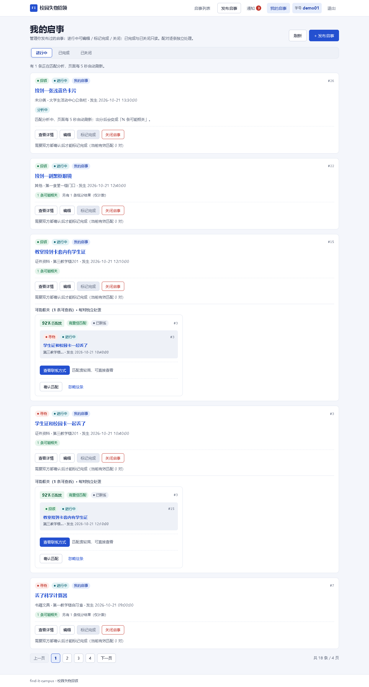

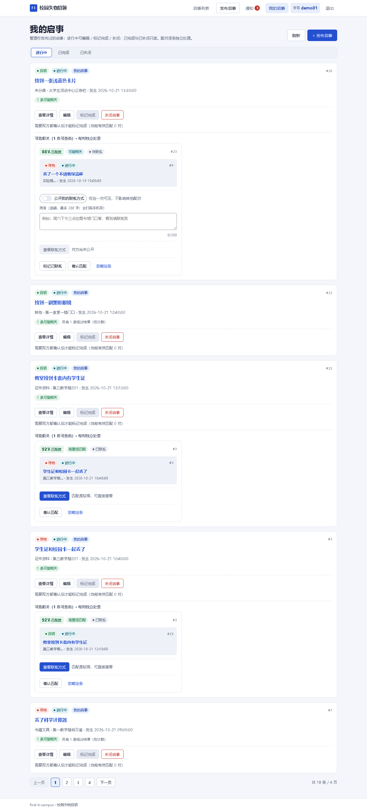

### 5.2 多 pair + 降级 + 独立操作

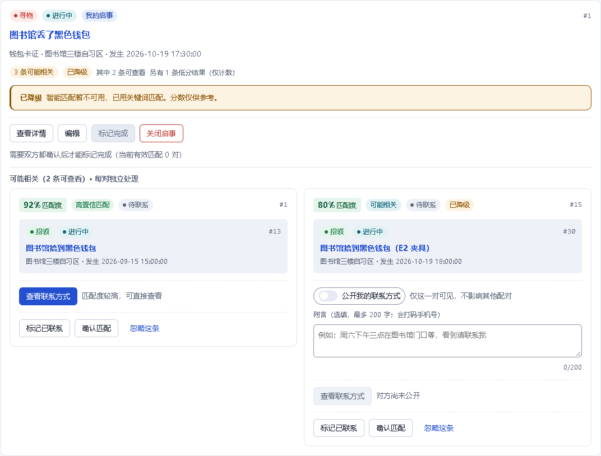

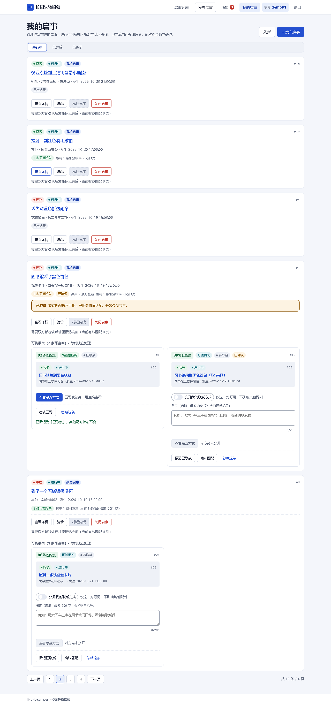

### 5.3 标记完成：置灰 / 成功

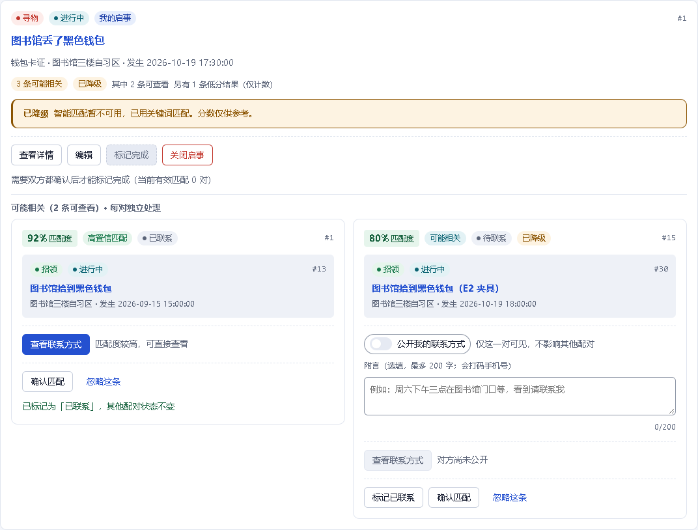

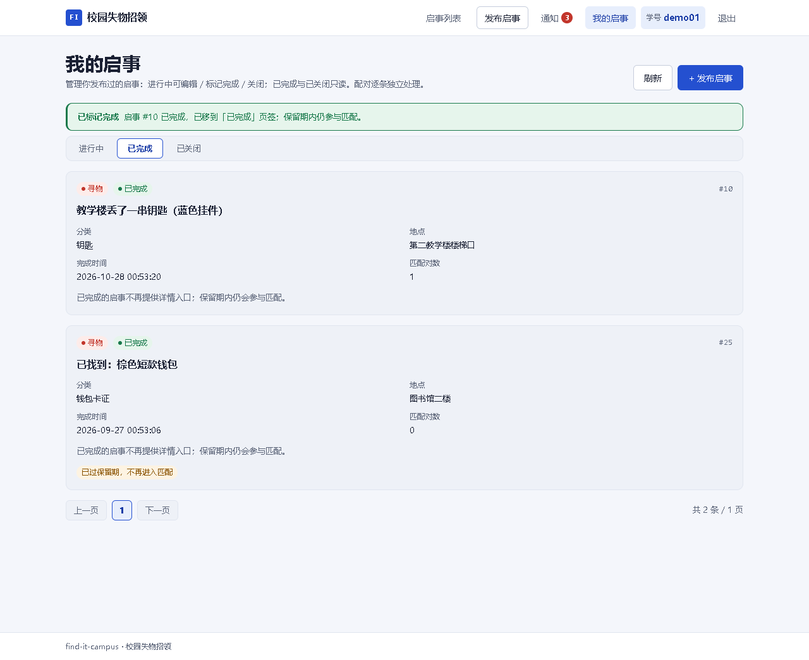

### 5.4 关闭启事

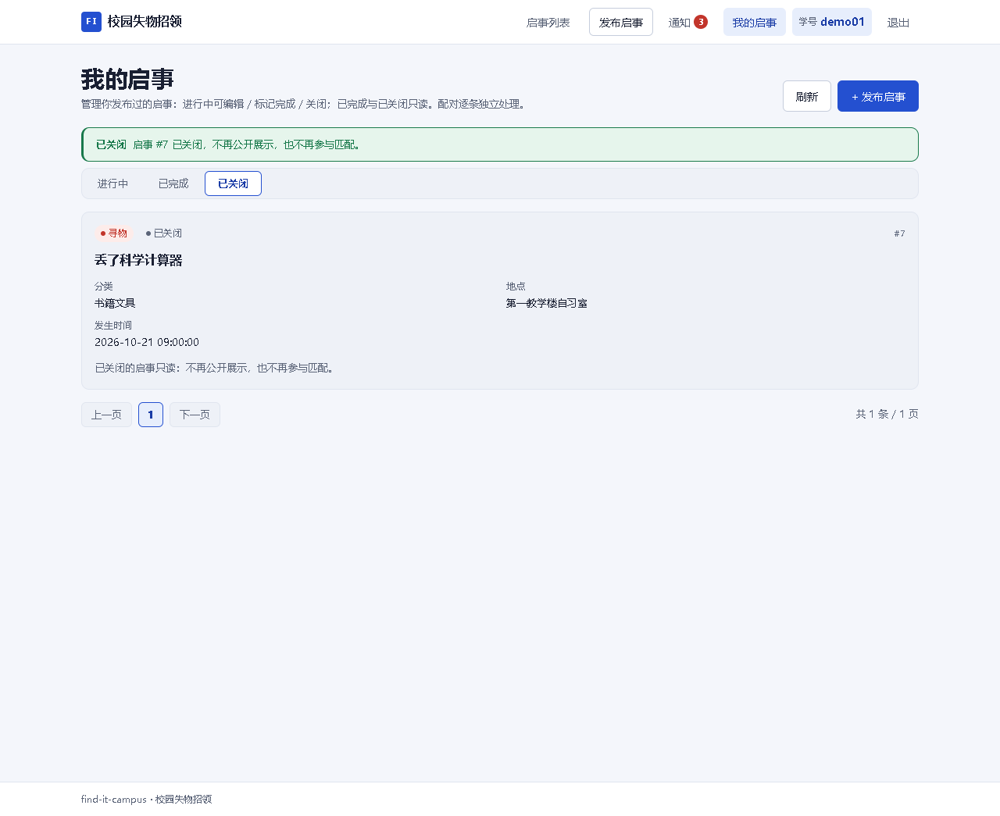

### 5.5 通知：红点 3 → 0

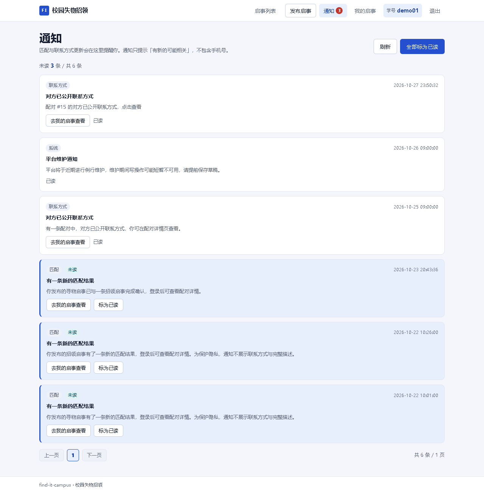

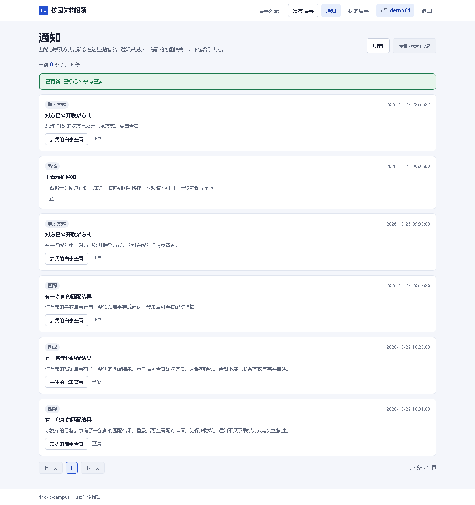

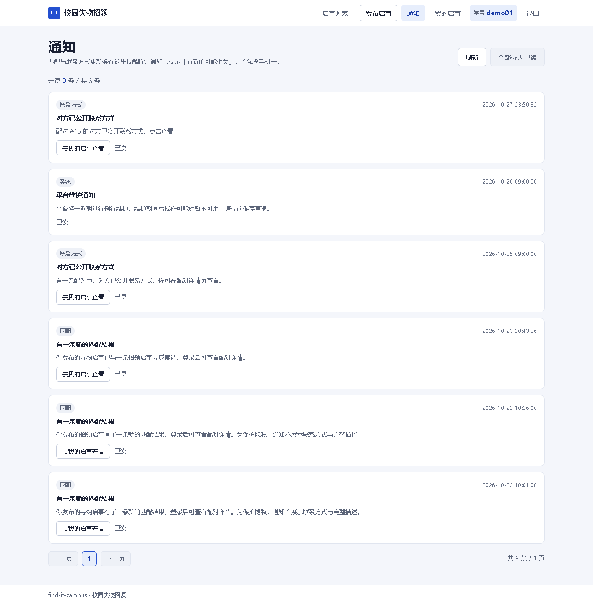

### 5.6 320px

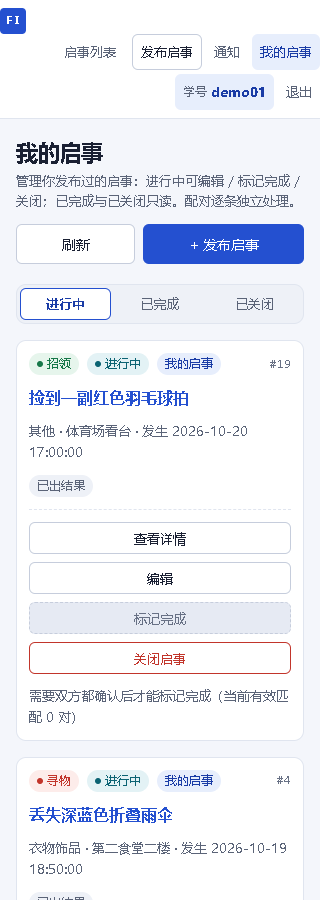

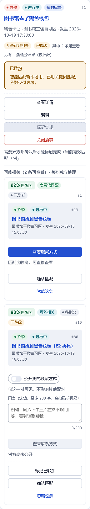

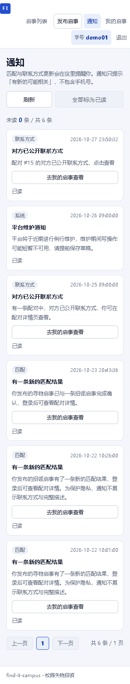

## 6. 取证方式

- 浏览器：Playwright（`qa/package.json`），本机使用系统 Edge（`BROWSER_CHANNEL=msedge`），1280px 与 320px 两个上下文。
- 数据：全部走真实接口；`t_pair_score` / `t_record` / `t_notification` 只用 `fixture.sql`、`fixture-scored.sql` 准备本地演示库样本。
  - 「分析中 → 出分后」：`fixture.sql` 把记录 26 置为 `pair_state=PENDING`；页面打开后执行 `fixture-scored.sql` 写入 1 行真实 pair（模拟 D1 打分完成后的库状态），页面靠 5s 轮询自动刷新。**页面与网络层没有注入任何 `pairs`**。
  - 多 pair / 降级 / MATCHED / 31 天 / 3 条未读全部来自同一套夹具，可重复执行。
- 断言：`report.json` 记录 42 条用例、DB 行数、PATCH 计数、公共列表命中与手机号正则结果。

## 7. 复跑

```powershell
# 0) 依赖：MySQL 3307（演示库 find_it_campus）、E1b 后端 18080、web preview 5173
mysql --host=127.0.0.1 --port=3307 -uroot find_it_campus < docs/testing/v2/D2-my-notifications/fixture.sql

# 1) E1b 后端（feat/v2-E1b-record-pairs @ 3138f8b 的工作树）
cd <E1b-worktree>/server
mvn -DskipTests package
$env:FINDIT_DB_URL='jdbc:mysql://127.0.0.1:3307/find_it_campus?useSSL=false&allowPublicKeyRetrieval=true&serverTimezone=Asia/Shanghai&characterEncoding=utf8'
java -jar target/find-it-campus-0.0.1-SNAPSHOT.jar

# 2) 前端
cd <D2-worktree>/web
npm run type-check
node node_modules/vite/bin/vite.js build --configLoader native
node node_modules/vite/bin/vite.js preview --configLoader native --host 127.0.0.1 --port 5173

# 3) 证据（脚本会自动执行 fixture.sql；系统 Edge 需 BROWSER_CHANNEL=msedge）
$env:QA_PACKAGE='<repo>/qa/package.json'
$env:BROWSER_CHANNEL='msedge'
node docs/testing/v2/D2-my-notifications/scan.mjs
```

## 8. 已知限制

- 本机 Playwright 未安装自带 Chromium，证据使用系统 Edge 的 `msedge` channel；脚本已把 channel 参数化。
- 出分后的确定性样本由本地夹具写入真实 `t_pair_score` 行；真实 D1 打分是异步的，现场演示可改用「发布后等后台打分」观察同一字段。
- 「全部标为已读」因服务端只有单条接口，按页收集未读 id 后逐条 PATCH（单页 50，最多 20 页）。
- 不提供删除入口；已关闭 / 已完成只读，不渲染详情入口（详情按契约 404）。
- 未改后端、未新增契约字段、未引入新依赖。
