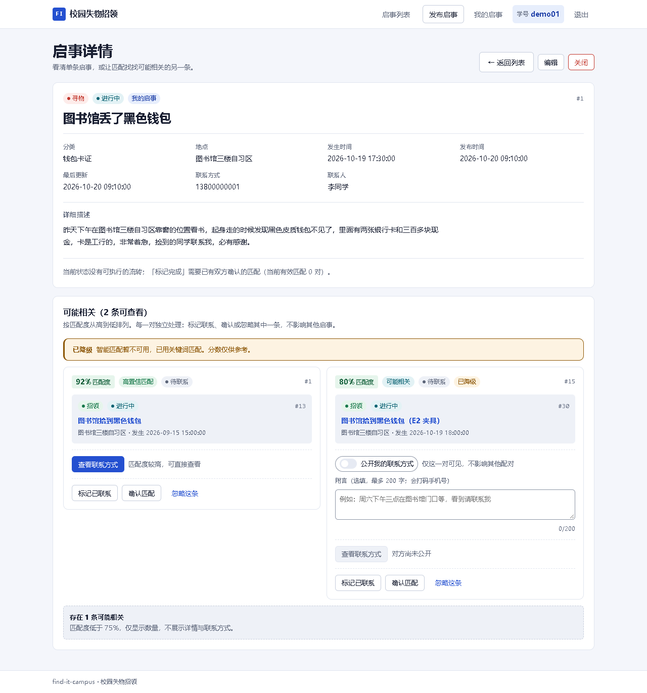
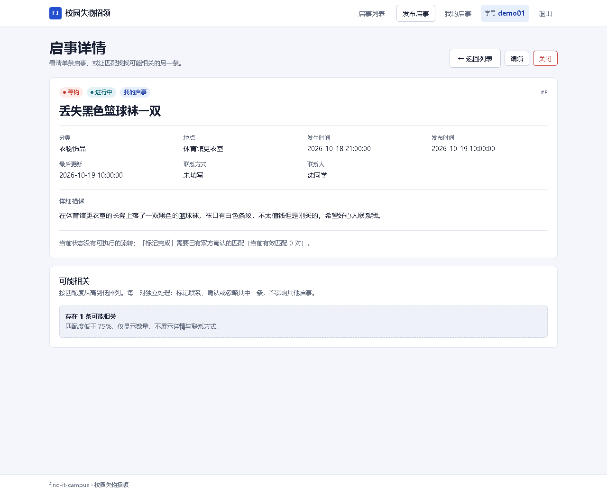
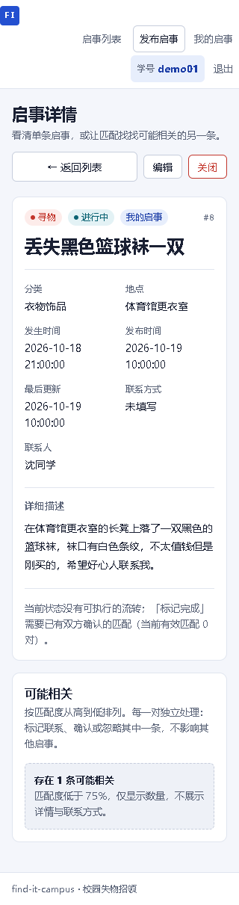
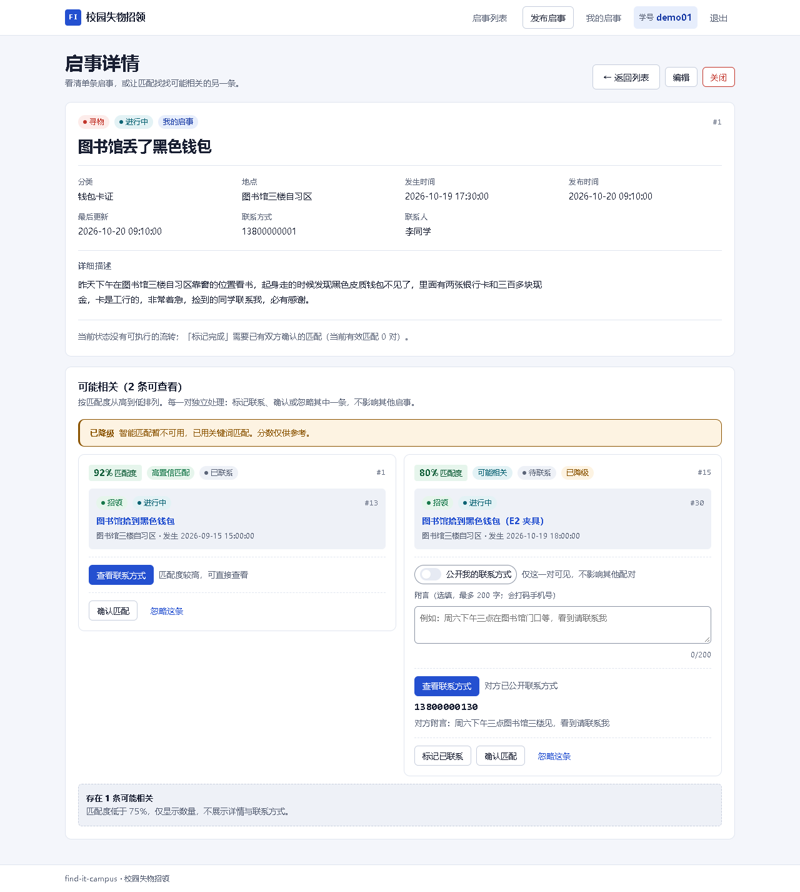
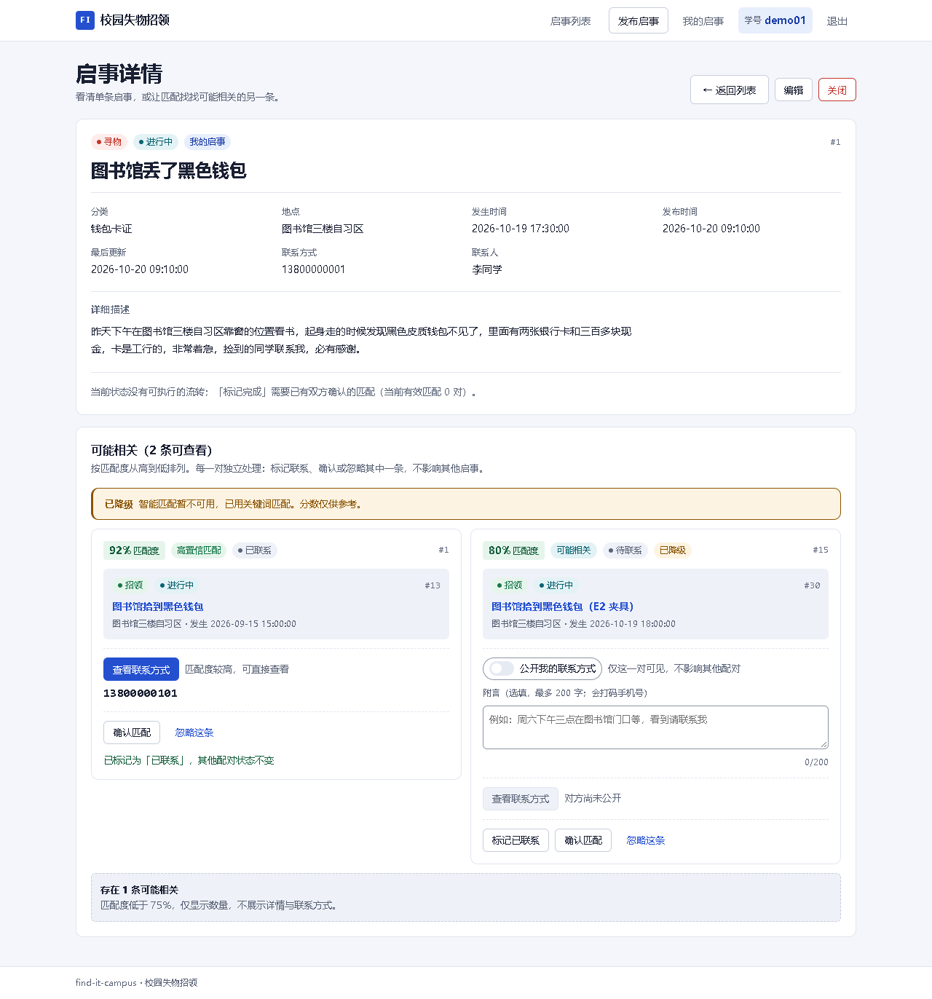
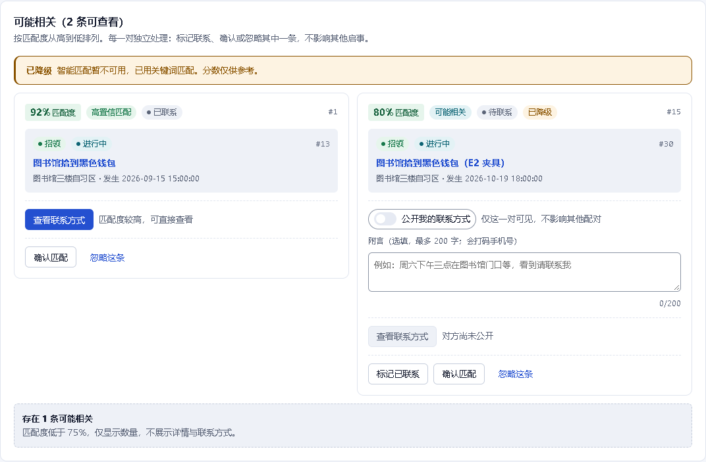
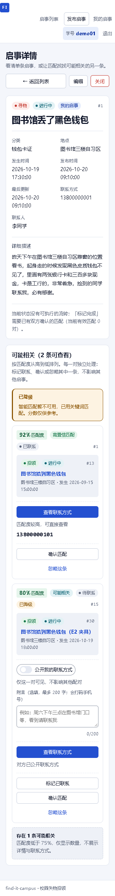
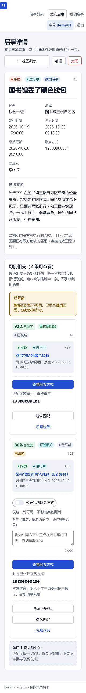

# E2 三档展示与授权交互 · 证据

任务：[ZHYYKFX-57](https://app.hifox.com/nhnok/task/ZHYYKFX-57) · 分支 `feat/v2-E2-tier-ui` · 前端基线 `origin/feat/v2-E1-contact-unlock @ 17dcc9a77` · 后端证据依赖 `feat/v2-E1b-record-pairs @ 3138f8b`

> 分支头以**本文件所在提交**为准（不写死自身 SHA）。基线用 `git ls-remote` 实读：
> `17dcc9a771f7dc6afa4c59f0b638a0affcc178ff refs/heads/feat/v2-E1-contact-unlock`；
> E1b 实读 `3138f8b208b100d41266dcd24c9379cbec5df1d5`（仅作后端证据依赖，E2 分支不合并、不改后端）；
> 同期 `main = 21784f674ca3a5915aaa86dc95edd7a0e55e973d`（未推 main、未合并）。
> 所有手机号均为 seed 假号 `138/139…`，文档与截图不含真实号码、密钥。

## 1. 结论

| 项 | 结果 |
|---|---|
| 前端类型检查 | `npm run type-check` 退出 0 |
| 生产构建 | `vite build --configLoader native` 退出 0（Vite 8） |
| 后端 | `feat/v2-E1b-record-pairs @ 3138f8b`，18080；详情/我的启事真实返回 `pairs[]` |
| 浏览器断言 | **40 / 40 PASS，0 FAIL**（`report.json`） |
| 详情注入 | **无**，`report.detailPairsInjected = false` |
| 桌面三档截图 | 0.92 / 0.80 / 0.60 各 1 张以上 |
| 320px 三档截图 | 0.92 / 0.80 / 0.60 各 1 张 |
| 改动范围 | 仅 `web/` + `docs/testing/v2/`；未改 `server/`、`db/`、`main` |

## 2. 实现落点

| 文件 | 职责 |
|---|---|
| `web/src/types/api.ts` | `PairCard` / `PairContactView` / `PairUnlockResult` / `PairActionResult`，与契约 §5.1、§4.13–§4.15 逐字段对齐；`RecordDetail.pairs?` 仅所有者返回 |
| `web/src/api/pairs.ts` | 三档取号、PUBLISH/REVOKE、CONTACT/CONFIRM/IGNORE 的唯一请求出口；状态文案集中映射 |
| `web/src/components/match/PairCard.vue` | 单对卡片：档位、四态、取号、授权开关、≤200 字附言、逐条动作；所有状态都是组件本地状态，互不联动 |
| `web/src/components/match/PairPanel.vue` | 多 pair 列表、`<0.75` 只给条数、降级提示、分析中/空态 |
| `web/src/views/RecordDetail.vue` | 本人渲染 `PairPanel`，非本人保留手动匹配；COMPLETED 标识、CLOSED 直接不可查看 |
| `web/src/App.vue` | 320px 顶部栏换行修复：导航不再把文档撑出横向滚动（320px 由 367→320） |
| `web/src/styles/components.css` | `.badge--warning`（降级）与字数超限样式 |

**关键口径落点：**

- 三档：`tier=DIRECT` 只给「查看联系方式」；`tier=AUTHORIZABLE` 额外给公开/撤回开关与附言输入；`lowConfidenceCount` 只渲染「存在 N 条可能相关」，不生成卡片、按钮或号码。
- 号码只来自 `GET /api/pairs/{id}/contact`；`PairCard` 类型里没有 `contact` 字段。未达档位/未授权时 DOM 里没有任何 `1[3-9]\d{9}` 片段。
- 一条记录多条 pair：`PairCard` 各自持有 `status/contact/unlock` 状态；`PATCH /api/pairs/{id}` 成功只更新当前卡片，其他卡片不重拉、不置灰、不改状态。
- 全站不出现「已解决」；四态文案是「待联系 / 已联系 / 双方已确认 / 已忽略」。
- 降级：`degraded=true` 时卡片给「已降级」，面板给「智能匹配暂不可用，已用关键词匹配」。
- COMPLETED：详情页给 `data-testid="detail-completed-badge"` 的「已完成」标识；CLOSED 命中时直接渲染不可查看空态，不把已关闭内容当降级页展示。

## 3. 三档截图（1280px）

### 3.1 ≥0.90 直看档（0.92）

- 卡片分值 92%，按钮可用；点击后真实调用 `GET /api/pairs/1/contact`，返回 `13800000101`。
- 截图：`tier-01-direct-092.png`（整页）、`tier-01-direct-092-card.png`（卡片）、`tier-01-direct-092-contact.png`（取号后）。




### 3.2 0.75–0.90 授权档（0.80）

- 卡片显示「可能相关」、公开/撤回开关、附言输入（≤200 字）。
- 对方未公开时「查看联系方式」禁用，并写明「对方尚未公开」。
- 截图：`tier-01-direct-092.png` 右卡、`auth-01-before-publish.png`。


### 3.3 <0.75 只给条数（0.60）

- 使用记录 #8（本人、联系为空、仅一条 0.60 低分 pair），页面只显示「存在 1 条可能相关」。
- 该页整页 DOM 正则 `1[3-9]\d{9}` **0 命中**（桌面 `lowTier.phoneHits`、320px `mobile.lowPhoneHits` 均为空）。
- 截图：`tier-03-low-060.png`（桌面）、`tier-320-060.png`（320px）。





## 4. 授权前后与撤回（真实后端）

| 步骤 | 真实请求 | 结果 | 截图 |
|---|---|---|---|
| demo02 在 pair 15 的 FOUND 端公开 | `POST /api/pairs/15/contact-unlock {"action":"PUBLISH","note":"周六下午三点图书馆三楼见，看到请联系我"}` | 200，`public=true`，附言打码返回 | `auth-02-publisher-published.png` |
| demo01 再看 0.80 卡片 | `GET /api/pairs/15/contact` | 按钮可用，返回 `13800000130` 与对方附言 | `auth-03-after-publish.png` / `-card.png` |
| demo02 撤回 | `POST /api/pairs/15/contact-unlock {"action":"REVOKE"}` | 200，`public=false`，附言清空 | `auth-04-publisher-revoked.png` |
| demo01 再看 | 详情重载 | 按钮回到禁用，提示「对方尚未公开」，卡片无号码残留 | `auth-05-after-revoke.png` / `-card.png` |




## 5. 多 pair 相互独立

同一记录 #1 同时渲染 0.92 与 0.80 两张卡：

- 把 0.92 卡片标为「已联系」后，该卡变「已联系」，0.80 卡片仍「待联系」，且「标记已联系 / 确认匹配 / 忽略这条」仍可操作。
- 页面无「已解决」字样；`PATCH /api/pairs/1` 只改 pair 1，pair 15 的分数、状态、授权均不变。
- 截图：`multi-01-independent-pairs.png`。



## 6. 降级态

pair 15 的 `engine=LOCAL_KEYWORD`（真实 D1 降级产物形态）：

- 卡片显示「已降级」，面板显示「已降级 / 智能匹配暂不可用，已用关键词匹配。分数仅供参考。」
- 截图：`degraded-01-card-and-banner.png`。



## 7. 320px 三档

| 档位 | 截图 | 断言 |
|---|---|---|
| 0.92 | `tier-320-092.png` | 文档 `scrollWidth=320`，无横向滚动；号码与按钮不重叠 |
| 0.80 | `tier-320-080.png` | 文档 `scrollWidth=320`；按钮与说明、号码与按钮均不重叠 |
| 0.60 | `tier-320-060.png` | 文档 `scrollWidth=320`；条数与说明 `white-space: normal`、无 ellipsis、`scrollWidth<=clientWidth` |

320 修复点：顶部栏在 ≤767px 时品牌/导航各占整行并允许内部换行；修复前登录态导航 max-content 宽 367px，
是文档横向滚动的唯一来源（修复前的实测值已记入 `report.json` 失败项并已修复）。





## 8. 终态口径

- COMPLETED：详情页顶部渲染「已完成」标识（`data-testid="detail-completed-badge"`）；非所有者合格对端看到的是遮蔽视图。
- CLOSED：后端 404/20001，前端落到「记录不存在或不可查看」；另有 `closedGuard` 兜底，不依赖详情接口返回内容做降级渲染。

## 9. E1b 真实 `pairs[]` 接入（本轮闭环）

E1b（`feat/v2-E1b-record-pairs @ 3138f8b`，基线 E1 `17dcc9a77`）已让 `GET /api/records/{id}` 对所有者
PENDING 详情返回契约 §5.1 全字段 `pairs: PairCard[]`；`GET /api/my/records` 每项也带 `pairs[]`。
非所有者 / 匿名 / COMPLETED 合格对端省略该键，不是空数组。

本轮把 `scan.mjs` 里给 `/api/records/(1|30)` 在网络层补 `pairs[]` 的两处注入、以及构造假卡片的函数全部删除，
`report.detailPairsInjected` 置为 **`false`**。三档、授权前后、REVOKE、多 pair 独立、降级、320 截图全部由
真实后端响应驱动，断言仍为 **40 条，40/40 PASS**。

前端消费字段逐个对：`tier / scorePercent / contactAvailable / contactHint / myNote / otherNote / counterpart`。
档位与顺序以服务端为准：`tier` 直接用后端值，卡片顺序沿用 `pairs[]` 的 `score DESC, pairId ASC`，前端不自己算档位、不重排。

降级样本：`fixture.sql` 把 pair 15 设成 `engine=LOCAL_KEYWORD`、`degraded_reason=CIRCUIT_OPEN`，
真实详情响应返回 `degraded=true`，卡片「已降级」与面板提示都由该字段驱动，不是网络层造数。

## 10. 复跑方式

```powershell
# 1) 本地演示库（3307）+ E1b 后端（18080）
mysql --host=127.0.0.1 --port=3307 -uroot find_it_campus < docs/testing/v2/E2-tier-ui/fixture.sql

# 在 E1b 工作树构建并启动（FINDIT_DB_URL 指向 3307）
cd <E1b-worktree>/server
mvn -DskipTests package
java -jar target/find-it-campus-0.0.1-SNAPSHOT.jar

# 2) 前端构建 + preview（/api 代理到 18080）
cd <E2-worktree>/web
npm run type-check
# 本机沙箱禁用命名管道时，Vite 默认 config bundle 会 EPERM；用 native loader 构建同一份 dist
node node_modules/vite/bin/vite.js build --configLoader native
node node_modules/vite/bin/vite.js preview --configLoader native --host 127.0.0.1 --port 5173

# 3) 浏览器证据（Playwright 从 qa/ 读取；本机 qa/node_modules 缺失时用 QA_PACKAGE 指向可用的 qa/package.json）
$env:QA_PACKAGE='<repo>/qa/package.json'
node docs/testing/v2/E2-tier-ui/scan.mjs
```

`fixture.sql` 只写本地演示库（记录 30/31、pair 15/16，并把 pair 1/8 的分数改成 0.92/0.60，
同时把 pair 15 设成 `LOCAL_KEYWORD` 降级样本），**不修改仓库 `db/seed.sql`**。
demo02 的公开/撤回会在库里留下真实时间戳与通知，重跑前重放一次 fixture 即可。

## 11. 已知限制

- E1b 已补详情 `pairs[]`（见 §9），本轮无网络层注入；卡片字段全部取真实响应。
- 320px 下 `<360px` 只显示 logo（沿用现有 App.vue 规则），品牌文字不显示，但不产生横向滚动。
- 无新增依赖、无 Pinia、无 UI 组件库；样式继续全部走 design token。
- 未跑后端测试（本条不改后端）；未新增接口契约字段。
